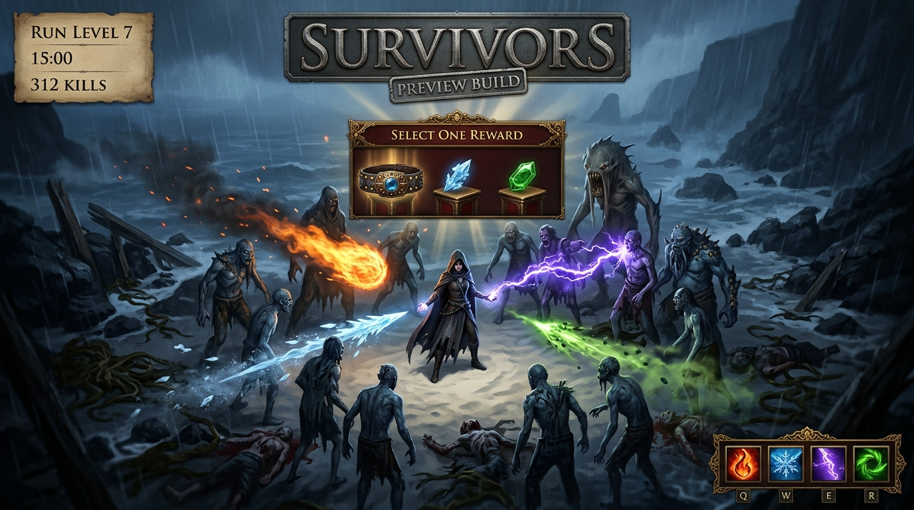

# Survivors mode (MVP)

A Vampire Survivors-style run inside the normal client ([issue #84](https://github.com/LocalExile/LocalExile/issues/84)).
The horde is the current area's own monsters, the run's skills cast themselves, and the player's only job is to move.

The mode lives in the `game` module (`Modules/Core/Game/Survivors/Survivors.cs`, `static partial class Game`); its core
model is `src/GameServer.Core/World/SurvivorsMode.cs`, and per-connection state is
`src/GameServer.Gateway/Connection/ClientState.Survivors.cs`.

The structure follows Azeroth Survivors's rules (wave clock,
auto-cast skills, a choice on every level). No code from it, or from any other project, was copied.

## Commands

| Command | Does |
|---|---|
| `/survivors start` | Starts a run in the current area. Needs an area with monster packs (The Coast, not a town or hideout). |
| `/survivors status` | Clock, kills, run level, learned skills and the horde target. |
| `/survivors pick <1-3>` | Takes a choice without the window (the window's click does the same). |
| `/survivors level` | Dev: banks a few run levels at once, so the choice window can be tested without waiting for kills. |
| `/survivors herald` | Dev: learns the first Herald gem at once, for watching its aura pulse. |
| `/survivors test <gem>` | Dev: restarts the run with exactly that gem (rank 1), for the per-gem verification pass. |
| `/survivors link <support>` | Dev: links that support to the first learned skill, for the per-support verification pass. |
| `/survivors rank <1-8>` | Dev: sets every learned skill to that rank. |
| `/survivors stop` | Ends the run and prints the result. |

A run also ends on death, on victory at 15:00, or when the area changes.

## Run skills

The run starts with the first skill the item catalogue resolves (normally **Fireball**). Each level-up opens the client's
own reward window with three items: a new skill while a slot is free (four slots), a support for a learned skill, a new
blessing while one is free (six), the next rank of a skill or blessing, and — every third run level — a unique item.
Clicking an item sends the window's normal C→S `0x88`; the server maps the item id to the choice, clears the window and
applies it.

**Skills** are every skill gem whose projectile metadata the client can draw and the projectile runtime can resolve, so
the catalogue grows with the item data. A gem with no projectile (Ice Nova, Arc) has no flight the client can draw here
and is left out.

**Supports** are real support gems linked to one skill, up to five per skill (the level-up offers them once a skill
slot is full). Each one contributes the stats of the support gem at the skill's rank (the run has no gem experience of
its own), and the cast pipeline reads them exactly as Path of Building does:

| Support | Stat it links (level 1) | Effect on the linked skill |
|---|---|---|
| Added Fire Damage | `physical_damage_%_to_add_as_fire` 25 | 25% of the hit's physical damage gained as extra fire; a pure elemental spell gains nothing |
| Added Cold Damage | `global_minimum/maximum_added_cold_damage` 4-6 | flat cold added to the hit, scaled by the skill's damage effectiveness |
| Added Lightning Damage | `global_minimum/maximum_added_lightning_damage` 1-8 | flat lightning added to the hit, scaled by the skill's damage effectiveness |
| Faster Casting | `base_cast_speed_+%` 20 | increased cast speed: interval ÷ 1.2, additive with the Haste blessing |
| Increased Area of Effect | `base_skill_area_of_effect_+%` 30 | radius × √1.3 (PoB's calcRadius), not ×1.3 |
| Increased Critical Strikes | `additional_base_critical_strike_chance` 200, `critical_strike_chance_+%` 60 | +2% base chance, then 60% increased chance |
| Faster Projectiles | `base_projectile_speed_+%` 50, `projectile_damage_+%` 20 | 50% increased projectile speed and 20% increased projectile damage |
| Life Leech | `life_leech_from_any_damage_permyriad` 200 | 2% of the damage each hit deals leeched as life |

**Blessings** are run-local passives shown as support gems, mirroring Azeroth Survivors' passives:

| Blessing | Item | Effect per level |
|---|---|---|
| Might | Added Fire Damage Support | +12% increased damage |
| Haste | Faster Casting Support | +10% increased cast speed |
| Area | Increased Area of Effect Support | +10% increased area (radius × √1.1) |
| Critical | Increased Critical Strikes Support | +20% increased critical chance |
| Leech | Life Leech Support | 0.2% of damage leeched as life |
| Wisdom | Enlighten Support | +10% run experience |
| Fortitude | Fortify Support | monster hits deal 2% less (25% base) |
| Swiftness | Faster Projectiles Support | +10% increased projectile speed |

Neither the character's stats nor its save change: every blessing and support is read by the run's own calculation.
The supports and blessings are summed into the same stat dictionary the gem uses, so one source cannot mean one thing
to the flight and another to the hit.

## Gem formulas

A run skill is the gem at **gem level = run rank** (1-8). The cast reads the gem's own rows, not a hand-written table:

- **Base hit**: `spell_minimum/maximum_base_*_damage` from `GrantedEffectStatSetsPerLevel` (`HitDamage`). An attack gem
  uses a nominal weapon of 45-90% of the area's median monster life, scaled by the gem's `DamageEffectiveness`
  (`10000 + offset`, e.g. Burning Arrow 280%); Poisonous Concoction uses its own added chaos damage instead.
- **Damage**: the Gateway's Path of Building port (`PlayerHitDamage.Resolve`, pinned PoB 16de4b82 `calcDamage`):
  conversion and gain, `increased` buckets (generic, spell/attack, projectile, area, elemental, typed) and each
  `more` multiplier. Added damage is multiplied by the skill's damage effectiveness, the gem's own base is not.
- **Critical**: `(base + additional base) × (1 + increased / 100)`, capped at 100%; the multiplier is 150% plus the
  gems' `base_critical_strike_multiplier_+`. Ice Spear's second form raises both (see below). A critical hit is ×1.5.
- **Cast time**: the gem's `GrantedEffects.CastTime` (Fireball 0.75 s, Spark 0.6 s, Tornado Shot 1.0 s), 7% shorter per
  rank, divided by the increased cast speed, floored at 200 ms.
- **Ailments**: the hit's fire portion can ignite (`base_chance_to_ignite_%`, 90% of the fire damage a second for 4 s,
  +50% multiplier on a critical hit); cold and lightning hits chill/freeze/shock through the normal monster-ailment
  thresholds. Poison is not simulated (the monster poison DOT has no server model yet).
- **Damage anchor**: the catalogue's median rank-1 spell hit lands for the area's median monster life, so each area
  stays playable while the gems keep their relative strength and their own gem-level curves.

Per-gem mechanics the shared projectile rules carry: Fireball explodes in an area, Kinetic Blast's impact blooms into
four cluster explosions, Tornado Shot's arrow fires three secondary arrows, Spark wanders on its native seeded legs and
forgets hits every 0.66 s, Ice Spear changes form (×4 speed, infinite pierce, +600% critical chance) after 35% of its
range, Ball Lightning pulses area damage every 0.2 s along its slow flight, Storm Burst pulses every 400 ms, Lightning
Arrow chains to three nearby enemies, Cobra Lash chains three times, Freezing Pulse/Frostbolt/Soulrend/Vaal Caustic
Arrow/Vaal Lightning Arrow always pierce, Vaal Burning Arrow pierces three targets and explodes, Vaal Spark and
Lightning Trap fire twelve and nine projectiles, and every other gem uses its own projectile count, pierce, chain, fork
and area from its stat set.

## Heralds

Herald gems (**Herald of Ash**, **of Ice**, **of Thunder**, **of Agony**, **of Purity**) are run skills of their own kind:
they have no projectile, so a cast is an **aura pulse** around the player - every hostile within 12 cells (grown by the
skill's rank and the run's area) takes the skill's damage. Learning one puts the gem's aura buff on the player (S->C
0x1c1, the BuffDefinitions row from the effect's ActiveSkills row), so the client draws the herald and its icon; the
buffs are removed when the run ends. Each hit also sends the impact packet (0x1af, as a melee hit) so the blood and
particles play on the monster. Kills from a pulse feed the run like any other.

A level-up window can be closed by a stray click while running; closing it takes the first reward, so the run never
stays paused with nothing to click.

## Unique items

Every third run level the window offers one **unique item** (`UniqueCatalog`'s definitions; `Mageblood`, `Crown of Eyes`
today) beside the skills. The item is created when the offer is dealt, so the pick equips exactly the item the window
showed: `PlayerInventories.Add` puts it into the first free equipment row its class fits (the main inventory when every
slot is taken), the client gets the inventory change and, for a visible slot, the equipment update, and the character's
stats are published again.

Unlike blessings, a unique is a real item on the character: it stays equipped, is saved with the character and keeps
its mods. A run waives its requirements while it lasts, because a low-level character could not otherwise wear it:
the item's **level requirement is sent as 0** (`Item.RequiredLevel`; the client keeps that byte and refuses an equip
above the player's level), the three `virtual_*_for_requirements` stats go to 1000 while a run item is worn (the client's
attribute check), and `ClientState.SurvivorsItemIds` keeps the item out of the server's inactive set so its mods count.
After the run the item follows the normal requirements again. An item already taken in the run, or already worn by the
character (matched by its name word), is not offered again.

## Skill bar

The run's learned skills are published as **Actor skills** (`0x02ba` with the actor's skill list) under ids from
`0x0300`, above the gem band and away from every ActionTypes id, so a socketed gem never takes one. Each record is the
real gem's effect at the run skill's rank, with one stored use and its cast interval as `CooldownMs`; the client's own
skill manager then draws the gem's icon. The ids go into the free slots of the saved skill bar with `0x0053` (sent,
never saved: they belong to the run), and every cast sends the cooldown trailer of `0x02ba` (`PlayerSingleUseCooldowns`)
with the real time to the next cast. On the run's end the skills are published again without them and the bar is resent,
so the slots clear.

Clicking one of those slots does not cast: the run casts for the player, and the client's own action would spawn a second
projectile next to the server's. The use packet is dropped (C→S `0x25`, logged).

## Between runs

Every `/survivors start` empties the character first: all carried, worn and flask items are removed (one `0xbf` per
inventory row), so nothing from an earlier run carries in.

## Rules

| Rule | Value |
|---|---|
| Run length | 900 s |
| Levels (areas) | the run moves to the next area every 120 s: `1_1_1`, `1_1_2`, `1_1_3`, `1_1_5`, `1_1_6`, `1_1_9`, `1_1_11_2`; the horde, run level and skills carry over |
| Monsters kept alive | 14 at the start growing to the cap (120) at the end |
| Spawn cadence | every 0.5 s, at most 4 per step, on a 30-38 cell ring around the player |
| Roster | the area's own `MonsterPacks`, deduplicated, ordered by the life the client gives the variety at the area level; the last four unlocked varieties are drawn from |
| Rarity | 15% magic after 20% of the run, 3% rare after 50% |
| Boss | the area's `WorldAreas` unique boss every 135 s |
| Ring wave | halfway between bosses, a closing ring of the weakest variety: 28 bodies at the start, 88 by the end |
| Monster scaling | life ×(1 + 0.75 × progress), damage ×(1 + 0.9 × progress) |
| Cast | each learned skill casts on the gem's own cast time, 7% shorter per rank, divided by increased cast speed (floor 200 ms); an empty cast retries in 200 ms |
| Targets | one projectile per target in 34 cells: the nearest, or the toughest for Pyroblast, Aimed Shot, Exorcism and Starfire, up to the gem's projectile count |
| Projectiles | the gem's own count, pierce, chain, fork and split; extra bodies come from the gem's stats, not from the rank |
| Damage | PoB calcDamage: the gem's base (rank = gem level) + added × effectiveness, converted, increased/more; the catalogue's median rank-1 hit equals the area's median monster life |
| Radius | the gem's area radius × √(1 + increased area); the rank still grows a Herald's aura 8% per rank |
| Critical | (base + additional base) × (1 + increased), capped at 100%, ×1.5 damage |
| Run experience | 2 normal, 4 magic, 10 rare, 50 unique |
| Level curve | `5 + 10 × (level − 1)` below 20, then `195 + 13 × (level − 20)`, then `455 + 16 × (level − 40)` |
| Incoming hits | monster hits on the player deal 25% of their damage during a run |

## Packets

The mode adds no message layouts.

- **Spawns**: `0x2b9` create monster + `0x01a9` wake zone, reusing the normal monster pipeline.
- **Skills**: the projectile runtime's own server-created objects (the payload is sent with the client-predicted flag
  off, so the server, not the client, draws the projectile), plus `0x01af` on contact, `0x01b1` life and `0x01b2`
  flinch.
- **Level-up window**: `0x00c0` registers inventory `0x600` with the three gems (a `0x00bf` for an id the client does
  not know is fatal: "Got an inventory set change for an inventory that isn't in the set"), `0x0087` opens the reward
  window, and the pick is the window's usual C→S `0x88`/`0x8a`. Clearing sends `0x00bf` with the offered ids removed.
- **Chat**: `0x0017` for the run's own lines.

## Verified live (2026-11-02)

The mode was first built on the pre-refactor Gateway and then ported to the game module on top of main (dfcdc8f3):
the run starts, the skills cast and kill, the reward window offers skills/supports/blessings/uniques, and a unique item
is equipped (Stasis Prison into the body-armour row).

An ungeared level-1 Witch in `1_1_1`, driven through `scripts/dev/client_control.py`:

- `/survivors start` reported 15 minutes, 14 monsters, 120 at most, the area and its base damage; the bar went out with
  the default attack on the left mouse button and **Fireball on Q** (`0x0053 slot 0 0x0102, slot 3 0x0300`), and the two
  mouse slots stayed empty.
- Every level-up sent `0x00c0` (inventory `0x600`, three items) and `0x0087` (the window) and paused the clock; taking
  an item cleared it with `0x00bf`, published the new skills (`0x02ba`, five skills: the attack and four run skills) and
  the bar again (`slot 3 0x0300, slot 4 0x0304, slot 5 0x0312, slot 6 0x0316`).
- Supports linked through the window: "Linked Faster Projectiles Support to Static Tether", "Linked Added Cold Damage
  Support to Lightning Trap".
- Each cast sent one `0x1ce` per target and the actor's cooldown trailer (`0x02ba … 1.20/1.20 s`). Sampling one skill
  icon's brightness over a second showed the bar's cooldown sweep (168 → 340 of 765 as the skill recovered), and four
  skills sat on Q/W/E/R.
- With the client-predicted flag on, the server sent no projectile object and the client still drew each shot (a
  Fireball trail over the horde), while the server's simulation kept scoring kills (160 kills at 00:44).
- Halfway between bosses the closing ring spawned and surrounded the player (a visible ring of 28 bodies at ~26 cells).
- `/survivors stop` and the connection's exit both ended the run and put the skills off the Actor.

The first attempt sent `0x00bf` for `0x600` before the inventory was registered and the client showed
"Got an inventory set change for an inventory that isn't in the set"; the `0x00c0` registration above is the fix.

## What is deliberately out of the MVP

- No custom arena or boundary, no run save.
- Only projectile gems are offered: a skill with no flight (Arc, a nova, a curse) has no visual here yet.
- Some projectile gems have no cast animation of their own yet: the server casts them and the client draws the shot, but
  the character may stand still through the cast. The per-gem animations are a later pass (see "Needs testing").
- Damage-over-time components of a gem (Caustic Arrow's caustic ground, Soulrend's debuff, poison) are not simulated:
  the monster poison DOT and ground effects have no server model yet, so those gems currently live on their hit damage.
- The run window is the quest-reward window: it lists gems, not custom cards with upgrade text.
- The unique pool is `UniqueCatalog`'s definitions (two today), not the game's whole unique list: the client data has no
  table linking a unique to its mods.
- No loot, gold or gem experience from run kills: `DropLoot` is skipped while a run is active.
- No HUD panel for the run's clock; the skills themselves are on the normal skill bar.

## Gem and support verification (2026-11-02, late)

`Game_SURVIVORS_TRACE=1` writes one line per cast with the mechanics actually used; `/survivors test <gem>` restarts
the run with one gem, `/survivors link <support>` links a support to the first skill, and `/survivors rank <n>` sets
the rank. With `Game_SURVIVORS_MAX_ALIVE=10` the whole catalogue was walked:

| Gem | What the trace showed |
|---|---|
| Fireball | Fire 18-28 at rank 1; one shot killed two monsters through the explosion; rank 8: Fire 211-320, interval 0.45 s |
| Riptide | Cold 100-150 (its speed-10 data row is lifted to 800 units/s) |
| Caustic Arrow | Physical 2.28-4.55 + Chaos 3.42-6.83, 60% conversion |
| Spark | 4 projectiles, `spark seq` legs wandering, 2 s duration |
| Vaal Spark | 12 projectiles of the 100-spark spiral, Lightning 2-24, 3 s duration |
| Ice Spear | 2 projectiles, Cold 44-66, second form armed at 35% of range |
| Freezing Pulse | `pierce -1`; one projectile hit two targets in a line |
| Lightning Arrow | 50/50 physical/lightning, 3 chains |
| Burning Arrow | Fire 29-58, 100% physical converted |
| Vaal Burning Arrow | Fire 40-81, pierce 3 |
| Ethereal Knives | 10 projectiles, Physical 14-22; Added Fire added exactly 25% (Fire 3.5-5.5) |
| Storm Burst | Physical 6-8 + Lightning 6-8, 0.2 s channel, `storm-burst` pulses |
| Lightning Trap | 9 projectiles of the ring |
| Ball Lightning | Lightning 4-94, radius pulses every 0.2 s along a slow flight (multiple hits per monster) |
| Tornado Shot | piercing arrow, three secondary arrows at the end |
| Kinetic Blast | four `kinetic-blast` cluster hits from one impact |
| Static Tether | Lightning 8-12, 5 s duration |
| Shadow Blades | 3 projectiles, Physical 4-6 |
| Frostbolt / Soulrend | `pierce -1`; Cold 18-26 / Chaos 42-62 |
| Cobra Lash | 3 chains; one cast hit four monsters; 60% physical to chaos |
| Flammable Shot | Physical 6-12 (its data is an unused development skill) |
| Poisonous Concoction | Chaos 22-33 as an unarmed throw |
| Vaal Caustic Arrow | Physical 11-23 + Chaos 17-39, `pierce -1` |
| Vaal Lightning Arrow | Physical/Lightning 3.7-7.4, `pierce -1`, 9 redirects |

Supports on Fireball, measured from the same trace: Added Cold added Cold 12-18 (4-6 × its 300% damage
effectiveness), Faster Casting took the interval 0.75 → 0.63 s, Increased Area took the radius 4 → 4.6 (√1.3),
Increased Critical Strikes took the chance 5% → 11.2% ((5 + 2) × 1.6), Faster Projectiles took the hit ×1.2 and
the flight speed ×1.5. Ethereal Knives + Added Fire confirmed the physical-only rule. The remaining supports (Added
Lightning, Life Leech) use the same shared pipeline, and Life Leech's coefficient is read by `LeechSources` on each hit.

## Needs testing

- **Cast animations**: some gems still cast without a character animation; each needs its own animation pass.
- **Every support on every skill**: the five links share one stat dictionary, but the full 8 × 30 matrix has not been
  walked; the checks above cover each support's formula once.
- **DOT gems**: Caustic Arrow, Vaal Caustic Arrow, Soulrend and poison builds need a monster ground/DOT model before
  their non-hit damage can be shown; the hit portion works today.
- **Tornado Shot's secondary arrows**: the client predicts and draws them in the real game; here the run hides the
  server copies and only simulates their damage, so they are not separately visible.
- **A unique item** on the third level: the window shows it, the pick equips it in the right slot, its mods reach the
  character panel, and it survives the area change (verified earlier, unchanged by this pass).

## Tuning

`Game_SURVIVORS_MAX_ALIVE` (10-400, default 120) changes how many monsters a run keeps alive.
