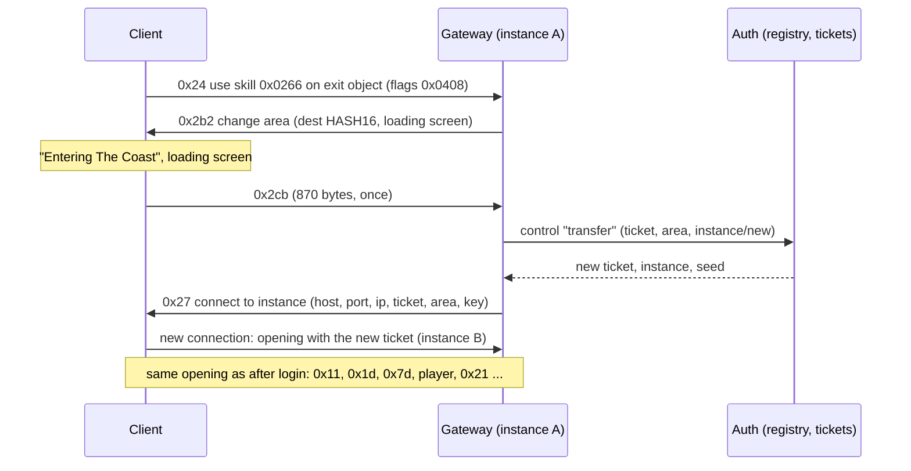

# 09 — Changing area: exits, instance details (0x27) and the instance chooser

Status (live, 2026-10-16): clicking The Coast in Lioneye's Watch shows the loading screen and loads The Coast. Ctrl+click
opens the Instance Manager. Its rows list the live instances, "New" creates one, and "Enter" joins an existing one. The
exit objects themselves are in [08-area-transitions.md](08-area-transitions.md).

## 1. Flow

With Ctrl held, 0x24's flags are 0x040c. The server then answers 0xae (instance list). The client opens the chooser and
answers 0xaf with the row it picked. After that the flow is the same as a plain click, from 0x2b2 on.

## 2. Why 0x27 and not login 0x14

The first attempt pushed login 0x14 from Auth after 0x2cb. The client dispatched it (`0x14213f190`, case 0x14), but the
listener list at login+0x298 is **empty** in game (checked with Frida). Nothing in game listens to the login connection
for instance details. Login 0x14 is only handled at character select (`0x140d0df10` → `0x140d59b70`).

In game, the "instance details" path is:

- The in-game state is constructed by `0x140d55be0`. Its primary vtable is `0x1431ec558`, and slot 38 (+0x130) is
  `0x140d59b70`, which logs "Got Instance Details from login server" and opens the new instance connection
  (`0x1415a4fe0`).
- `0x140d5bf60` wires the state's listeners onto the **instance** client. One of them, at instance+0xa00 (the
  dispatcher sees it as +0x9f0), is the forwarder `0x140d63d24` (`mov rax,[rcx]; jmp [rax+0x130]`).
- Instance dispatcher `0x14214a190`, case 0xe (= id 0x27, `dispatch_ids.py`), builds the same details object as login
  0x14 (`0x142173680` → `0x14213be50`) and notifies that list (`0x142171ee0(this+0x9f0, …)`).

So the old instance server tells the client where to go next.

## 3. Messages

### C→S 0x24 — use skill on object (12 bytes)

`u32 target object id, u16 skill (0x0266 = interact), u16 sequence, u16 flags`. Flags are 0x0408, or 0x040c with Ctrl
(bit 0x0004). The client repeats it while nothing happens, so the Gateway ignores repeats while a transfer is pending.

### S→C 0x2b2 — change area

Class `0x1435bfee0`, write `0x141f92980`, dispatcher case 0xe8. Fields: `u16 destination WorldAreas.HASH16, u16
LoadingScreenOverrides row` (0 = the area's default). The handler shows the loading screen and calls `0x142148690`. That
function sends 0x2cb once (flag +0xcd4a) and flushes. An unknown hash is fatal.

### C→S 0x2cb — leaving (870 bytes)

Sent once after 0x2b2. Our framer does not know its layout yet, so it arrives "unframed". The Gateway takes the id as
the signal to transfer. If no 0x2cb arrives, the Gateway transfers anyway after 2 s.

### S→C 0x27 — connect to instance

Class vtable `0x1435dc280` (ctor `0x14219dd90`, write `0x14219ddf0`, read `0x14219df90`), dispatcher case 0xe.

| Wire order | Type | Field | Use |
|---|---|---|---|
| 1 | str (u16 len + bytes) | +0x10 | host (`127.0.0.1`) |
| 2 | u16 | +0x86 | port (6112) |
| 3 | u32 | +0x30 | IPv4, big-endian (0x7f000001) |
| 4 | u32 | +0x34 | not passed on by the handler; 0 |
| 5 | u16 | +0x84 | area HASH16 (must exist: "Server sent area hash for area that doesn't exist") |
| 6 | u32 | +0x38 | ticket |
| 7 | u8 | +0x88 | unknown; 0 |
| 8 | u8 | +0x89 | passed on like login 0x14's last u8; 0 |
| 9 | 64 bytes | +0x3c | instance key (HMAC-SHA512(secret, ticket), as for login 0x14) |
| 10 | 8 bytes | +0x7c | unknown; zeros |

The client keeps the old connection until the new one is up, then the Gateway sees it disconnect.

The old connection is retired by the successful transfer before its socket closes.
Retired, closed or temporarily leaving connections cannot publish character-global equipment qualification.
Their recovery/stat workers stop on retirement; a failed transfer can resume a temporarily leaving connection.
Queued ES publication checks lifecycle inside the send gate before reading character sources.
See [character stat lifecycle](../dev/character-stat-lifecycle.md) for the regression and native evidence.

### S→C 0xae — instance list

Class `0x1435dca40`, write `0x1421a2300`, dispatcher case 0x2e → listeners at +0x6cf0. This opens the
InstanceChooserWindow ("Instance Manager"). Layout: `u16 area HASH16, u8 (+0x14), u8 n`, then n entries. Each entry is
`raw u64 LE, u32 BE, u8, u8 m + m × wstr`.

What the window shows (live):

| Field | Column |
|---|---|
| u64 | "Created": Unix seconds, shown in local time. Sending the instance id 2 showed "01 January 1970, 03:00:02". |
| u32 | "Time Left": seconds |
| names | "Players"; an empty list shows "None" |
| u8 | unknown (probably "Realm", which shows "-") |

The "New" row is always there. Its text ("Non-hideout instances stay open for 8-15 minutes") comes from the client.

### C→S 0xaf — chooser pick (3 bytes)

`u8 row`: 0xff = "New", otherwise the index of the row in the last 0xae. The client sends no instance id, so the Gateway
keeps the ids of the last list it sent (`ChooserList`).

## 4. Server side

- **InstanceRegistry** (`src/GameServer.Core/World/InstanceRegistry.cs`):
  - A town has one instance, with seed 1. Auth's towns are the WorldAreas rows with `IsTown` (`WorldAreaTowns`, from
    `data/tables/WorldAreas.json`): the 12 act towns, Lioneye's Watch to Karui Shores. `pvpTown` is left out (PvP is not
    implemented), and without the table only Lioneye's Watch is a town. Auth logs the list at startup (`[auth] towns:`).
  - A plain click joins the character's previous live instance of the area, or creates one.
  - The chooser can join any instance or create a new one.
  - An instance with no players is kept for 6 minutes (`Lifetime`). `TimeLeft` is the full lifetime while someone is in
    it.
- **Auth** owns the registry and issues tickets (`InstanceDirectory`, control port 127.0.0.1:20495). Control ops:
  `resolve`, `list`, `transfer` (returns the new `Ticket`), `leave`, `set_level` (`Level`: saved to the account store and
  carried by the character's next tickets). A `leave` from an older ticket of a character whose latest ticket is in the
  same instance is ignored, so re-entering the instance one is in (Instance Manager) keeps the character in it.
  `gateway_started` (no ticket) is the Gateway's first call: every player leaves every instance (`InstanceRegistry.LeaveAll`),
  so a Gateway that stopped without sending `leave` (a restart, a crash) does not keep its players' instances alive.
- **Gateway**:
  - Ctrl+click → `list` → 0xae.
  - 0xaf or a plain click → 0x2b2.
  - 0x2cb → `transfer` → 0x27 with the key for the new ticket.
  - On the new connection, `resolve` gives the area and seed. Layout: `data/walkability/<id>_seed<seed>.bin` + `.json`.
    The player arrives next to the exit leading back to the area they left (`AreaLayout.Arrival`, `SpawnNear`'s
    nearest walkable cell 6–20 cells away). `Transfer` remembers that area per destination ticket
    (`AreaLayouts.CameFrom`, in memory); Resurrect in Town (`PendingTransfer.AtSpawn`) and logins have none and use
    the spawn: the town's fixed point, or the deepest walkable cell. One-way entries have no exit back and use a named
    entrance point (`OneWayArrivals`: Lioneye's Watch from The Twilight Strand, `entrance1`) or the spawn. Resurrect
    at Checkpoint revives next to the area's waypoint once the character has activated it (waypoints are
    checkpoints), else at the arrival point (`AreaLayout.Checkpoint`).
- **Where a login starts** (Play, login 0x0e → `InstanceDirectory.AssignStart`): the spawn point of the character's
  **last town**, as in the real game, which never logs a character into a combat area or at a saved position. This
  holds after logging out, Exit to Character Selection, a crash, a server restart, or disconnecting while dead. The
  `resolve` op records the town (`Character.LastTown`, a WorldAreas Id in `data/saves.db`) when the ticket's
  instance is a town: the Gateway resolves a ticket only once the client connects to that instance, so the town counts
  once the character is in it. `WorldAreaTowns.LoginArea` picks the area: the last town, else
  `AccountService.StartingArea`, The Twilight Strand (`1_1_1`): as in the real game, a new character washes up there,
  logs in at its start point (the `washedup` room's `default`) until it first enters a town, and reaches Lioneye's
  Watch once Hillock is dead ([12](12-quests.md) §6). `resolve` sends `LastTown` 0 until then, and the death screen
  offers only Resurrect at Checkpoint (`DeathScreenFlags` 0x04). The death screen's two buttons are separate (`Resurrect`, §7).
  Issue #4.
- Auth gives a new instance of an area the Gateway generates itself (`ServerLevelAreas`, [re/011](../re/011-level-generation.md))
  a random seed; any other area keeps seed 1, because its layout must be dumped from the client (`live.ps1 -Walkmaps`).
  `Game_RANDOM_SEEDS=0` pins every area to 1. The Coast at seed 1 is 1725×1725.
  An area the client cannot generate at seed 1 (The Crossroads, Act 6's Twilight Strand, …) gets a seed it built
  instead wherever seed 1 would be used (`ServerLevelAreas.SeedsInPlaceOfOne`, re/011 §7).
  The seed the client generates is the one the Gateway sends in 0x1d: when the port cannot generate Auth's seed, the
  Gateway sends the first of 8 replacements derived from it that it can (`ServerLevels.PlayableSeed`; the same for
  everyone in the instance, not done with `Game_SEED` or `live.ps1 -Walkmaps`).

## 5. Open

- Named entrance points for the other one-way entries ([Roadmap](../../roadmap/world.md) "One-way entries").
- The Coast's own exits (back to town, to The Mud Flats) and the exits of other areas.
- 0x2cb's layout, 0x27's u32 +0x34 and u8 +0x88, 0xae's u8 fields.
- After 0x153 the client's log says "Abnormal disconnect: An unexpected disconnection occurred." (nothing on screen).
  The official server probably sends a disconnect message (S→C 0x26? [10](10-chat-and-commands.md)) with a code that
  has no text before it closes; not needed for the exit to work.

## 6. Exit to character selection (C→S 0x153)

C→S 0x153 is the id alone (2 bytes). Senders: Esc → "Exit to Character Selection" (`0x140cf1ab0`, then it closes the
menu with `0x140cf1570`), the hardcore death screen's Exit (`0x140290bf0`), `0x14063f360`, `0x1408ead30`,
`0x1408eaf00`; `0x1417a2310` picks 0x153 / 0x154 / 0x155 by an index 0..2. None of them send while the instance
connection is down (instance state `+0xc3a0` = 1).

**The answer is closing the instance connection.** The Gateway logs 0x153 and leaves its read loop, which closes the
socket; the login connection stays open. What the client does then:

1. The instance disconnect (`0x142149ca0`) stores the code (`+0xc430`) and message (`+0xc438`) and sets state 1.
2. The frame update `0x140d574e0` calls `0x140d57730` when app `+0x340` is set, else `0x140d57cd0` when the instance
   (app `+0x348`, `0x1400f34b0`) is. In game it is `0x140d57cd0`: with state 1 it shows "Abnormal disconnect: …" only if
   the code has a message, empties the state stack and pushes stack slot `+0xb8`. It does not delete the login object
   (`0x140d57730` does, at app `+0x358`).
3. The state stack (`0x1400f2600`) keeps the states in an array of shared pointers at `+0x48`, indexed by the state's id
   byte (`+0x209`, set by its constructor; `0x140104510` builds them all):

   | Id | Slot | Constructor | State |
   |---|---|---|---|
   | 2 | `+0x68` | `0x1415277d0` | |
   | 3 | `+0x78` | `0x140cf0c20` | |
   | 4 | `+0x88` | `0x140d55be0` | in game |
   | 5 | `+0x98` | `0x141529f90` | |
   | 6 | `+0xa8` | `0x140cfc2d0` | |
   | 7 | `+0xb8` | `0x140d0c8c0` | login |
   | 8 | `+0xc8` | `0x140cf3ae0` | |
   | 9 | `+0xd8` | `0x140d12140` | character select |
   | 10 | `+0xe8` | `0x140cfa310` | |

4. The login state's enter (`0x140d0d190`) creates a login object only if there is none, then pushes character select
   when the login object's state (`login+0xde8`) is 3, else the screen at `this[0xfb]` (the login form).
   `0x14213f190` sets `+0xde8`: 2 on the handshake (0x02), 3 on a 0x04 login result of 0; `0x14213e5a0` resets it to 0
   when the login connection drops.
5. Character select's enter (`0x140d13060`) sends login 0x18 and Auth answers with the character list (0x15). Play
   (login 0x0e) gets a new ticket and 0x14 as usual.

So the exit needs the login connection still logged in: if Auth has dropped it, the client lands on the login form.
Live 2026-10-18: Esc → Exit to Character Selection, then Play, twice on one login connection (0x153, close, login 0x18
→ 0x15, 0x0e → a new ticket). The closed connection runs the "Abnormal disconnect" path (§5) but the client goes
straight on to the character list.
