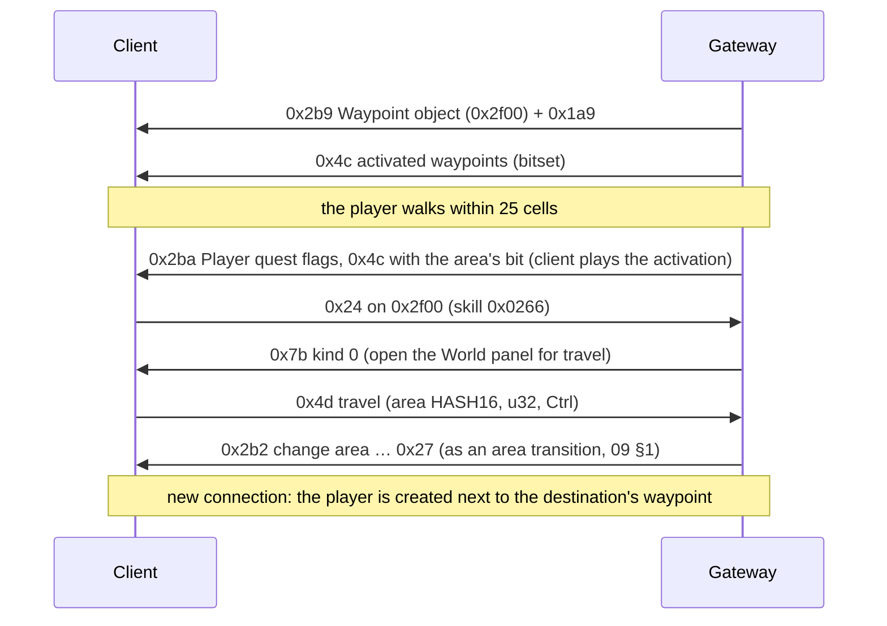

# 16 — Waypoints and the World panel

State of 2026-10-19: areas with a captured layout get their waypoint; it activates when the player comes near or clicks
it, clicking it opens the World panel in travel mode, and picking a pin changes area to that area's waypoint. Verified
live: Lioneye's Watch ↔ The Coast both ways (with and without Ctrl, the instance chooser), activation by walking up on
The Coast (the client plays the activation), pins and connection lines on the Act 1 panel. Issue #13.

Code: `InstanceWaypoints`, `WaypointObject` (`src/GameServer.Core/Protocol/Instance/InstanceWaypoints.cs`),
`WorldAreaWaypoints`, `AreaVisitFlags` (`src/GameServer.Core/World/`), `PlayerObject.WriteFlagSet` and
`InstanceEntities.PlayerQuestFlagsUpdate`, `WaypointCatalog` and the handlers in `Modules/Core/Game/World/Travel.cs`
(`UseWaypoint`, `ActivateWaypoint`, `SendWaypoints`, `TravelByWaypoint`). Tests: `tests/GameServer.Core.Tests/WaypointTests.cs`.

## 1. Flow

## 2. The Waypoint object

`Metadata/MiscellaneousObjects/Waypoint.ot`: Positioned (`object_size = 6`, not blocking), BaseEvents (`server_only`,
`is_waypoint = true`), Animated, HideoutDoodad `{}`, MinimapIcon (`icon = 9`), InteractionAction (`action_name =
"waypoint"`), StateMachine (`define_shared_state = "active;"`), client Render (`ObjectDisplayTextWaypoint`), Targetable.

| Part | Bytes |
|---|---|
| Positioned | as an area transition's (08 §2, §5): x, y, rotation, u16, flags0 `0x04` + i32 steps + f32 z (the tile record's height) |
| Animated | `01` + u32-counted UTF-16 virtual `.ao` of the tile record (e.g. `…/Town_v2/beachencampment_v01_01_v2_waypoint1.ao`) |
| HideoutDoodad | nothing: slot 17 `0x1415d9920` jumps to slot 22 `0x141e1c550`, which reads u32 + u8 + u8 only when the type's data sets `+0x14e` (hideout doodads) |
| MinimapIcon, InteractionAction | `00`, `00` |
| StateMachine | `01 00` (1 state, 0 timers), compact int "active" `00`, flags `00` |

The place comes from the tile record the walk-map recorder captures (08 §7: `.transitions.json` keeps `Waypoint`
records next to the area transitions); Lioneye's Watch has a built-in fallback (256, 169), 3π/2, z −357.52. "active"
stays 0: its client handler only plays the `inert` animation. The look comes from 0x4c (§3).

## 3. Messages

### S→C 0x4c — activated waypoints (25 bytes)

Class `0x1435dc7e0`, read `0x14219f460`, dispatcher case 0x12: u32 BE (+0x10, passed with the bitset to the listeners
at instance +0x73f0; 0 works), then **19 raw bytes** copied to instance +0xcf31.

Bit *i* is the *i*-th WorldAreas row with `HasWaypoint` (+0x15) whose column +0x1e4 (`__col51` in the extracted table)
is 1, 2, 5 or 11 (mask 0x826), at most 150 (`0x141fdcf90`). 3.29.3b has **90**: Lioneye's Watch (bit 0), The Coast (1),
… The Forest Encampment (9) … Karui Shores (88), Aspirants' Plaza (89). `WorldAreaWaypoints` builds the order.

The handler compares the current area's bit before and after: on the first 0x4c of a connection it shows the waypoint
idle (bit set) or inactive (bit clear); when a later 0x4c sets the bit it plays the activation (`0x1421449f0`, state 2).

### S→C 0x7b — open a UI (19 bytes)

Class `0x1435dc2a0`, read `0x1421a0450`, dispatcher case 0x1c → `0x142163420` (a switch over 0x73 UI kinds): u8 kind,
four u32 BE. **Kind 0** notifies the listeners at instance +0xff8; the in-game UI's `0x140dcd570` opens the World panel
and sets its travel mode (`0x140ab1440` → `0x140a97330`, panel +0x522). The u32s are not used by kind 0; the Gateway
sends the waypoint object id. The panel's Hideout button sends C→S 0x17a (character name, waypoint object id), which
takes the player to the hideout ([21](21-hideouts.md) §3).

### C→S 0x4d — travel (9 bytes)

Class `0x1435c08b8`, write `0x141f92e60`, sent by the pin click `0x140a9b580` (travel mode only): u16 BE destination
HASH16 (the pin's WorldAreas row +0x2a), u32 BE (panel +0x524; 0x2f00 live), u8 Ctrl held. The Gateway checks the
waypoint is activated, then changes area like an area transition, or with Ctrl lists the instances (0xae, 09 §3).
The destination ticket is remembered (`WaypointArrivals`); that connection creates the player on a walkable cell 6–20
cells from the area's waypoint.

### S→C 0x2ba to the Player component — quest flags

The Player component (`ClientPlayer`, vtable `0x143466450`, 04 §3) keeps the character's **quest flags**: a set at
+0x1b8 (and a second one at +0x1d0). Format (`0x141e83340`; test `0x14012aae0`): u16 count, then per block of 64 flags in
ascending order u8 block (flag >> 6) and u64 LE bits. A flag is a QuestFlags.dat row. The creation blob (0x2b9) carries
both sets after name, class, experience, u32, u16, u16; the update reader `0x141e7ee30` takes u16 flags, **bit1 (0x02)
= the quest-flag set again**, bit3 the second set, bit9 the 9 bytes at +0x1e8, bit0 experience (15 §1).

This is the S→C quest flag message [12-quests.md](12-quests.md) §4 was looking for.

## 4. What the World panel shows

Pins are MapPins.dat rows (140); each pin widget computes two states every frame (`0x140ab0330`):

- **revealed** (+0x329, `0x140ab6200`): any of the pin's `QuestFlags` is set. Those are the neighbours' visit flags: The
  Coast's pin needs 124 (Lioneye's Watch's visit), The Mud Flats' needs 125 (The Coast's).
- **waypoint** (+0x32a, `0x140ab5fc0`): the area's waypoint bit is set (0x4c) and the area is accessible
  (`0x140797750`): every QuestFlags row in its WorldAreas list at +0x54 (`EndQuestFlags` in the extracted table) is set,
  e.g. `a1q1-KilledHillock` for Lioneye's Watch and The Coast, `a1q4-PlacedGlyphs` for The Submerged Passage.

A pin with neither is hidden.

**Special pins** (the column on the right and the Hideout/Guild buttons) are SpecialMapPins.dat rows; `0x140a9bd50`
decides each one (row bytes: +0x10 i32, +0x14 QuestFlag, +0x24 WorldArea, +0x34 i32, +0x39 bool, +0x3a bool):

- the i32 at +0x10 (`__col2`) is a league quest flag id (Player +0x1d0, tested as bit id − 1); above 0x776 (1911) means
  none. The Gateway gives every character the ten in use (`Quests.League.WorldPanelPins`): 1033 HaveGuildHideout,
  409 MenagerieUnlocked, 9 NikoHaveMinedSulphite (the Mine Encampment), 414 SanctumIntroNewGivenTexts,
  608 VillageKingsmarchUnlocked, 736 HeistVisitedHub, 636 ChayulaLeagueAreaUnlocked, 677 AncestralHallsOfDeadUnlocked,
  419 NecropolisAreaUnlocked, 1834 DeepwaterBoatUnlocked;
- a WorldArea (+0x24) needs that area's waypoint bit (0x4c): the Labyrinth pin's Labyrinth_Airlock, which the Gateway
  always sends as activated (and accepts as a 0x4d destination);
- the i32 at +0x34 (`__col5`), when 1-59, must equal the current area's value at `(+0xc278)+0xd0`;
- +0x3a set hides the pin (SynthesisHub); +0x39 needs the Hideouts key (Player +0x1f8);
- the DelveHub row (index 4) also compares a level (`0x140a9c080`), which the tested character passed.

Live 2026-10-30, all pins were shown. Each league pin's click sends a message of its own, carrying the waypoint object
the panel was opened from; the Gateway moves the player to the hub (arriving at its spawn):

| C→S | Bytes (live) | Pin | Hub (WorldAreas) |
|---|---|---|---|
| 0x17a | u16 n + name, u32 BE object, u8 | Hideout | the player's hideout (21 §3) |
| 0x17b | as 0x17a: `017B 0005 DedOK 00002F00 00` | Menagerie | Menagerie_Hub |
| 0x17d | `017D 00002F00` (u32 BE object) | Mine Encampment | Delve_Hub, as Niko's Visit Mine Encampment |
| 0x17e | `017E 00002F00 00` (u32 BE object, u8) | Forbidden Sanctum | SanctumFoyer_Fellshrine |
| 0x181 | `0181 00002F00 00` | Kingsmarch | KalguuranSettlersLeague |
| 0x182 | `0182 00002F00 00` | Monastery of the Keepers | ChayulaLeague |
| 0x184 | `0184 00002F00` | Rogue Harbour | HeistHub |

The pin of each message was taken from the click that sent it (0x181 and 0x182 by the order they came in); the
Guild Hideout, Halls of the Dead, Necropolis and Deepwater pins are not mapped yet. The Deepwater pin (`__col5` 59)
sends nothing when clicked: the client refuses it outside its own area type, and `/goto DeepwaterHub` builds no layout
(its graph nests `hub_interior.dgr` as a sub-graph node, which the level generator does not place yet).

**Hub waypoints.** The hubs have no waypoint bit of their own, so the Gateway sends their tile's waypoint object anyway
(`WaypointCatalog.For`) and the player can click it to travel back; where the tiles place none (HeistHub,
ChayulaLeague) it creates one 12 cells from the spawn. The client draws them unlit: without a bit it lights a
waypoint only for its own list of area types (`0x141fdd130`, mask `0x3e602108080008`: 3, 19, 27, 32, 37, 41, 45, 46,
49-53), and both the object's creation (`0x142165ed0`) and every 0x4c (`0x14214ba58` → `0x1421449f0`) take the
state from it (0 idle, 1 `waypointeffect_prestartidle`, 2 activation). Delve_Hub is type 15: none of the StateMachine
"active" value, the 0x4c bits, the hideout's `waypointcore.ao` model or a `waypoint_idle.ao` effect object over it lit
it (live 2026-10-30).

A connection line (`0x140a9a7d0` → `0x140a9aa90`) is drawn only between two shown pins
of the act, so an unrevealed area in the middle (The Mud Flats) cut the line between The Coast and The Submerged Passage.

A visit flag is the area's MapPins `QuestFlagVisit` (the same as its WorldAreas `StartQuestFlags` where both exist).
The Gateway sends as quest flags the flags the character's quests set ([12](12-quests.md) §5) and, for the panel: the
visit flags of every area the character entered (saved as `Visited`) or activated, and the access flags of the
activated waypoints' areas (`AreaVisitFlags`, `PlayerQuestFlags`). Setting those flags has client-side effects beyond the panel (e.g. `a1q4-PlacedGlyphs` removes
the Submerged Passage blocker), which matches having been there.

## 5. Server rules

- Towns activate on entry; other waypoints when the player is within 25 cells (`WaypointActivationRange`, checked in
  the player tick) or clicks it (reach 6). Activated waypoints are saved per character (`Waypoints` in
  `data/saves.db`), added to the saved ones.
- `/waypoints` lists them; `/waypoints all` activates every waypoint and visits every pinned area (dev);
  `/waypoints reset` keeps the towns only.

## Open

- A generated area's waypoint is only known from a `-Walkmaps` capture for the seed. Without one the player arrives at
  the layout's spawn, and without a walk map at an arbitrary cell outside the map (The Submerged Passage, seed 1). The
  Roadmap's "every area at seed 1" capture fixes it for the dev seed.
- 0x4c's u32 and 0x4d's u32; the other 0x7b kinds (0x01..0x72 open other panels: stash, vendors, …).
- Real quest progress should set and save the flags instead of deriving them from visits.

### Current position versus quest highlighting

These are separate native pin layers, not two forms of the current-area field. The green `WorldPanelPlayerIcon` is pin +0x32c: 0x140a96b30 matches the actual instance WorldAreas row against each MapPins.WorldAreas list, so hideouts without campaign pins naturally show no player marker.

The orange quest-location overlay uses pin +0x32b, rendered at 0x140ab08b0 with `WorldPanelVisitedQuestLocationIcon` / `WorldPanelRevealedQuestLocationIcon`. 0x140a99f80 derives it from the selected QuestStates row's MapPins list (+0x45/+0x4d), resolved by 0x141e7fa00 and selected via 0x140a97240. It can remain on a town while the player is on The Coast or in a hideout, because the selected quest still points there. It is not a stale current-location packet. Reusing it as an unconditional location ring would require a client UI change; do not falsify quest flags or area identity to move it.
