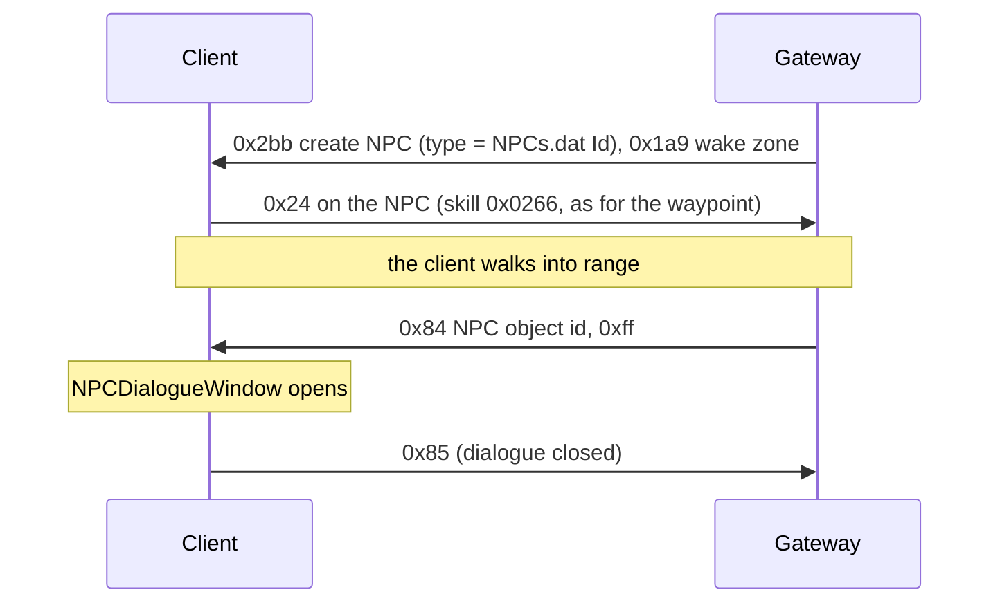

# 17. NPCs

State of 2026-10-19: Tarkleigh, Nessa and Bestel stand in Lioneye's Watch. They show their name on hover and on the minimap, and
clicking one walks the player to them and opens the NPC dialogue window. Verified live with the real client. The
window's options come from the client itself (NPCTalk); choosing one is not handled yet.

## 1. The NPC object

An NPCs.dat row's `Id` (`Metadata/NPC/Act1/Tarkleigh`) is an .ot type, created with S→C 0x2bb like any object
(type = `ObjectTypeHash(Id)`). `Metadata/NPC/NPC.ot`: Positioned (`object_size = 5`, blocking), Animated, BaseEvents
(`server_only`), InteractionAction, NPC, MinimapIcon (`icon = 3`), client Render (`ObjectDisplayTextNPC`) + Targetable.
The child .ot only sets its `animated_object`.

Of the NPC types in `data/object-types.json`, 190 have exactly that list; 54 add Transitionable, 31 StateMachine, and a
few ControlZone, Functions, Stats or Brackets (not written yet).

| Part | Bytes |
|---|---|
| Positioned | as a monster's ([10](10-chat-and-commands.md) §5): x, y, f32 rotation, u16 team 0, flags `00 02 00 01` |
| Animated | `00` (the type supplies the model) |
| BaseEvents | nothing |
| InteractionAction | `00` |
| NPC | two u8 (slot 17 `0x141e7b6e0`): `+0x20` has dialogue (`0x141e7d430` lists NPCTalk rows only when set), `+0x21` index of a component that must be alive, `0xff` none. Sent `01 ff` |
| MinimapIcon | `00` |
| Transitionable, StateMachine | as for monsters |

The NPC component's debug dump (`0x141e7b860`) prints the NPC and the NPCTalk row the client picks for the player
(`0x141e7d430`): the client chooses the dialogue itself.

Bosses that speak have an NPC component too, after their Transitionable (Captain Fairgraves' `SkeletonBossEmerge`,
Merveil, the Siren's `seawitchillusion/Merveil`; Piety, General Gravicius and the Sceptre of God's three lieutenants,
Kaom, Daresso, Utula, Malachai and the three in The Harvest): the monster blob writes it as `00 ff` (no dialogue, no
component that must be alive). Without it these monsters could not be created at all ([12](12-quests.md) §9–10).
Act 2's bandit lords (Kraityn, Alira, Oak) add InteractionAction before their NPC, written `00` as for an NPC: they
are created as hostile unique bosses; their dialogue (help or kill, the bandit choice) is not offered this way.

NPC collision uses the same inherited Positioned metadata as the client, including NPCs.dat Id aliases whose
OT is the row's Metadata. Server routing and overlap escape register every spawned NPC with its own footprint,
in both towns and hideouts; moving an NPC replaces its registered footprint rather than adding a second one.
NPCs explicitly marked nonblocking stay nonblocking. Their model hull is used when the type is static.
The common implementation is `StationaryCollision` / `Modules/Core/Game/Combat/StationaryCollision.cs` (21, installed furniture).

## 2. Where town NPCs stand

Each campaign town has one fixed town room (.arm), and the room lists its NPCs among its doodads, one line each:
`x y 0 angle qx qy qz qw a b flag [z] scale "model.ao" "Metadata/NPC/…"` (room cells; the angle in radians, the quaternion
is the same turn about z; z only when the flag is 1). That is a version 35 or 36 room; version 31 rooms (Oriath's
`entrance_04.arm`) have no 0 before the angle. Lioneye's Watch's room `beach_town_unique_normal.arm` has
`230 389 0 -0.155698 … "Metadata/NPC/Act1/Tarkleigh.ao" "Metadata/NPC/Act1/Tarkleigh"`. The client creates the plain
doodads of those lines itself (type `Metadata/MiscellaneousObjects/Doodad`) and leaves the others (NPCs, stash, notice
boards …) to the server.

The room is placed like a tile ([08](08-area-transitions.md) §6, `TilePlacement`): the town's .dgr node gives the
rotation (Lioneye's Watch R270, code 3: room (x, y) → grid (y, 413 − x), angle + 3π/2), plus the grid cell of the
room's origin. The walk-map recorder (`scripts/walkmaps`) captured every town on 2026-10-25 (seed 1): the placed room
(`<area>_seed1.rooms.json`: path, origin, size, code) and the client's doodads. In all twelve towns every plain doodad
of the room stood at exactly its line's placed cell (40 of 40 in Lioneye's Watch, 829 of 829 in the Karui Shores) and
angle, so the server's lines go through the same placement. In Lioneye's Watch that gives Tarkleigh (389, 183), Nessa
(346, 270), Bestel (362, 247), within one cell of the cells measured earlier on the real game's minimap ((388, 182),
(346, 271), (361, 246)). `TownNpcs` copies the NPC lines of every town with its room's code and origin;
`/npc_face <name> <degrees>` still turns one live, and `/npc_place <name> <x> <y> <degrees>` moves and turns one (the
NPC is removed and created again there).

The league hubs have NPCs of their own (`NpcCatalog.Towns`): Niko in the Mine Encampment, Einhar in the Menagerie
(495, 485, 290°; the hideout row `EinharHideout`, because `EinharMenagerie` has no `.ot` in the GGPK and the client
drew it without a model), Divinia (`SanctumNPCTown`) in the Forbidden Sanctum, Johan, Tujen, Gwennen, Rog, Dannig,
Faustus, Isla, Sonja and Raulf in Kingsmarch, Kurai, Faustus, Adiyah, Whakano and the nine rogues in the Rogue Harbour,
Ailith (`ChayulaFarmerHub`) in the Monastery of the Keepers. Kingsmarch, the Rogue Harbour and the Monastery have not
been placed live yet: their NPCs, stash and guild stash are offsets from the arrival (`StashCatalog.FromArrival`).
Every hideout also gets Einhar (`EinharHideout`) and Faustus (`VillageFaustusHideout`: unlike `VillageFaustus`, it has no ControlZone, so it can be serialized).

Several town rooms do not start at (0, 0): the area has a border around the room. The atlas's grid placement for
fixed layouts ([08](08-area-transitions.md) §6, step 10) assumes (0, 0), so its exits in those towns are probably off
by the same amount.

| Town | Room (.dgr rotation, origin) | NPCs placed |
|---|---|---|
| Lioneye's Watch (1_1_town) | `Act1/Town/Rooms/beach_town_unique_normal.arm` (R270, 0, 0) | Tarkleigh, Nessa, Bestel |
| The Forest Encampment (1_2_town) | `Act2/Town/Rooms/forest_town.arm` (R270, 0, 92) | Yeena, Eramir, Greust, Silk, Helena |
| The Sarn Encampment (1_3_town) | `Act3/Town/Rooms/city_town.arm` (I, 69, 69) | Hargan, Grigor, Maramoa, Clarissa |
| Highgate (1_4_town) | `Act4/Town/Rooms/town.arm` (R270, 0, 0) | Kira, Oyun, Petarus and Vanja, Lady Dialla, Tasuni |
| Overseer's Tower (1_5_town) | `Act5/Town/Rooms/town_01.arm` (I, 138, 138) | Utula, Bannon, Lani, Vilenta |
| Lioneye's Watch (2_6_town) | `Act6/BeachTown/Rooms/part2_beach_town.arm` (R270, 0, 0) | Tarkleigh, Bestel, Sin, Lilly Roth |
| The Bridge Encampment (2_7_town) | `Act7/Town/Rooms/broken_bridge_town.arm` (I, 437, 207) | Eramir, Yeena, Helena, Sin, Weylam Roth |
| The Sarn Encampment (2_8_town) | `Act8/Town/Rooms/city_town.arm` (I, 69, 69) | Hargan, Maramoa, Clarissa, Sin |
| Highgate (2_9_town) | `Act9/Town/Rooms/town.arm` (R270, 0, 0) | Petarus and Vanja, Irasha, Tasuni, Sin |
| Oriath Docks (2_10_town) | `Act10/Town/Rooms/dock_town.arm` (I, 0, 0) | Sin, Bannon, Weylam Roth, Lani, Lilly Roth |
| Oriath (2_11_town) | `Act11/Town/Rooms/Unique/fountain.arm` (node "fountain" I among generated nodes, 299, 299) | Zana, Innocence, Sin, Weylam Roth, Lilly Roth, Lani |
| | `Act11/Town/Rooms/Unique/entrance_04.arm` (node "entrance_04" I, 161, 851) | Helena |
| Karui Shores (2_11_endgame_town) | `Act11/Camp/Rooms/camp.arm` (I, 92, 92) | Lilly Roth, Weylam Roth, Lani, Helena |

- **Types without an .ot.** Half of the NPCs.dat Ids have no .ot of their own (`Metadata/NPC/Act6/Tarkleigh`,
  `Act9/Irasha`, `Epilogue/Lilly` …). The object-type register's 0xac-byte table ([04](04-player-entity.md) §1) is
  NPCs.dat: it files every row under its Id on the .ot of its `Metadata` column (row +0x10; Act 6's Tarkleigh on
  `Metadata/NPC/Act1/Tarkleigh`, Irasha on `Metadata/NPC/NPC`). So 0x2bb still uses `ObjectTypeHash(Id)`, and the
  Gateway takes the components of the Metadata .ot (`NpcCatalog`).
- **Model.** A line's .ao is sent in Animated (bit0 + path) when the type has none (Irasha, Act 6's Lilly) or another
  one (Weylam's `Act6/RotTooth.ao` instead of `Act7/Weylam.ao`, Lilly's poses `Act5/Lilly.ao` / `Act6/LillySitting.ao`,
  the Karui Shores' Helena); otherwise Animated stays 0 (the type's model).
- **Transitionable.** Helena in Oriath and the Karui Shores (`Epilogue/Helena`, an empty `Transitionable {}`) hides herself
  while untransitioned (`create_untransitioned = { DisableRendering(); … }`): with state 1 she was invisible live
  (her dialogue still opened), with state 2 she shows. Act 10's Bannon at state 1 is Bannon (his `create_transitioned`
  hides him for Innocence). So an empty `Transitionable {}` has two states, not the one `object-types.json` reports.
- **Height.** A line with flag 1 carries a world z, sent as Positioned's fixed height (flags0 bit2, before flags1
  0x02's two bytes): i32 −z / 7.8125 and f32 z, the live server's convention for a fixed height (its projectiles,
  [11](11-skills.md) "Sign"; world z points down). Live the NPCs looked the same with either sign of the i32 (Nessa,
  Kira, Oyun, Act 6's Lilly on her pier, 2026-10-25: same pose and name labels at the same height), so for a standing
  object the client seems to use the f32. The area transitions and waypoints still send +z / 7.8125
  ([08](08-area-transitions.md) §5); aligning them is left for a later change.
- **Seed.** The origins other than (0, 0) were captured with seed 1, the seed the Gateway gives towns; `TownNpcs`
  stores it with those rooms and leaves a room's NPCs out (with a log line) in an instance of another seed. Oriath's
  rooms are generated around fixed nodes, so their origins could depend on it; the single-room towns' borders
  probably do not.
- **Blocked cells.** Several NPCs stand on cells the client's walk map blocks (stalls, platforms, piers: Hargan in both
  Sarn Encampments, Grigor, Petarus and Vanja and Tasuni in both Highgates, Act 6's Sin and Lilly, Act 7's and Act 8's
  Sin) or on the edge of walkable ground. They are placed as the room has them, and the Gateway's "not walkable"
  warning skips town-room placements (`Placement.FromRoom`).
- **Not placed:** league NPCs of the same rooms (Einhar, Niko, Jun, Alva, Gwennen, Tujen, Rog, Dannig, Divinia,
  Faustus, Kurai, Cassia, Tane, Johan), the Tutorial NPC and Letters of Exile, Tolman (act 8, no NPCTalk rows), Kirac
  and the Karui Shores' `HelenaIntro` at (510, 173) (a trigger by the tunnel that plays "HelenaThroughTheTunnel" and
  then hides; both need ControlZone, which is not serialized) and later quest stages of the same NPC: Highgate's `DiallaTownWithered` at (250, 553),
  Oriath Docks' `InnocenceTown` in Bannon's cell, Act 6's Lilly sitting by Bestel at (148, 343) (she is placed by her
  ship, `QuestObjects/Act6/LillyShip`). Which stage the real server shows depends on quest progress; the Gateway places
  the first one.
- **Verified live** (2026-10-25, OfflineWitch, `/goto` into each town): every placed NPC (Oriath's Helena added
  afterwards and checked the same way) has its name and minimap label, clicking walks up and opens its dialogue (0x84), option 0 plays (Act 6's Tarkleigh shows Act 6's rows, so the
  client resolves the Act 6 Id), and Goodbye closes it (0x85). Purchase Items and Sell Items open the buy and sell
  windows for these NPCs too (§5); only the NPCs `NpcShops` stocks have goods.
- `data/room-points.json` lists these lines with `angle` 0: `RoomFile` (GameServer.Data) reads the third number, which
  is the angle in version 31 and older rooms (the Twilight Strand's force walls have theirs) but a 0 in version 35 and
  36 rooms (every town room), where the angle is the fourth. `TownNpcs` copies the angles from the lines itself.

## 3. Messages

### C→S 0x24: talk

A click on an NPC sends 0x24 (use skill on object, [09](09-area-change.md)) with skill `0x0266`, the same interaction
as the waypoint. The client walks to the NPC first. The Gateway follows the walk (`NpcReach` 8 cells, not measured)
and then answers with 0x84.

**Shortcuts.** The click's flags say which keys were held: 0x0004 Ctrl (any target) and 0x0200 Alt, which the client
sets only when the target has an NPC component (`0x1401285b0`, after 0x0400: `GetKeyState(VK_MENU)`). Live 2026-11-12
with real input: 0x0408 plain, 0x040c Ctrl, 0x0608 Alt, 0x060c both. The client does nothing else with the keys; the
server opens the option. NPCTalk `__col22` is each row's shortcut: 1 Ctrl, 2 Alt, 3 Ctrl + Alt, 4 none. Nessa: Sell
Items 1, Purchase Items 2, Identify Items 3; Kirac: Purchase 1, Sell 2, Atlas Respecialisation 3. Rows of one NPC that
share a shortcut differ in their quest flags (the hideout Niko's chart needs `ThisIsMyHideout`, else Sell Items).

The Gateway runs the NPC's first row with the click's shortcut whose quest flags hold as a picked option (0x82 below),
after a talk the NPC still has for the player and without 0x84 first. Live: the sell window (UI +0x7c8) and the buy
window (UI +0x7b8) open with the inventory, Esc cancels the sale (C→S 0xb1) or sends 0x85, and the client takes the
next click. A click without such a row, or whose option no module answers, lists the options (0x84 0xff). Not read: the
rows' other conditions (below). That a waiting talk goes first is from player reports, not measured.

### S→C 0x84: open the dialogue (13 bytes)

World group, class `0x1435e84d8`, read `0x141fe44d0`: the object header (u16 id, u32 BE object id → `+0x10`, u32, u16),
then u8 → `+0x20`. The world handler `0x14218ddf0` calls `0x142150700(instance, object id, u8)`:

- object id 0: closes the dialogue (clears instance `+0xd7c0`).
- u8 `0xff`: sets instance `+0xd7c4`/`+0xd7c8` to the NPC and fires the listeners at instance `+0x13f8` →
  `0x140dc9fb0` (in-game UI, registered by `0x140dba5d0`) → `0x140720d10` → `0x1407253a0` (NPCDialogueWindow setup).
- other values: another path that looks at the NPC component's data (`+0x66`), not mapped.

### S→C 0x1c7: a line (22 bytes)

World group, class `0x1435e82d8`, read `0x1421cbf20`: the object header (u32 BE object id → `+0x10`), u16 BE NPCs row
(`+0x20`, the speaker), u16 BE NPCTextAudio row (`+0x22`), u32 BE delay in ms (`+0x24`), u8 (`+0x28`), u8 bool
(`+0x2c`). The world handler `0x14218ddf0` says the line (subtitle and voice): object 0 globally (world vtable `+0x208`),
else from that object, kept for the delay while the client does not know it yet. Verified 2026-11-07 with Izaro's lines
(NPCs 147), the last two bytes 0. For a row of a "…1 … …8" group the client may say another of the group (sent
`IzaroFlee1`, it said `IzaroFlee7`'s text).

### C→S 0x85: dialogue closed (2 bytes)

Id only. Live 2026-10-19 it came after every opened dialogue, when the window closed (Goodbye, Esc or walking away).

### C→S 0x82: option (3 bytes)

u8 = the chosen NPCTalk row's index among the NPC's rows (column 1). The client (`0x140723fa0`) handles NPCTalkCategory 5
(Topic), 0x19 and 0x26 itself and sends 0x82 for the others. The Gateway answers by category:

| Category | Answer |
|---|---|
| Gossip, Quests, QuestReward | S→C 0x84 with the index: the window plays the row's text and audio (verified) |
| BuyItems | shop tab (S→C 0xc0, manager 1) + S→C 0x8c (verified: the buy window shows the stock) |
| SellItems | two offer inventories (0xc0, manager 1) + S→C 0xb8 (verified: drops, Ctrl + click, Accept, Cancel; §5) |
| RespecPassivePointsForGold | S→C 0x7b kind 0x5f with 1: the character's passive tree (UI +0x650, listener 0x140dc5fe0; a non-zero u32 shows it in mode 2, `0x1409df890`), the script's `SendOpenScreen( CharacterPassiveTreeScreen, 1 )`. Not kind 0x11 (Atlas tree, UI +0x668) or 0x45 (UI +0x678). "Apply refunds" (C→S 0x36 per node) and "Refund All" (0x37) are paid in gold ([15](15-progression.md) §2) |
| IdentifyItems | script `triggerer.IdentifyItems()`: every unidentified item with mods in the main inventory becomes identified, free (0xbf removes and re-adds the same ids), then a chat line "{0} Items identified" / "{0} Item identified" (ClientStrings `IdentifyItemsChatMessage(Single)`, S→C 0x17, [10](10-chat-and-commands.md) §2) and 0x84 0xff to list the options again (verified 2026-10-20). The client grays the option itself (`0x141e7bb90` case 0x3b: no unidentified item in the inventory → ClientStrings id 0x1f07 "No items in your inventory can be identified", drawn gray by `0x14071ff10`), but only when the options are listed. The real game probably charges Scrolls of Wisdom (ClientStrings `IdentifyItemsNotEnoughScrollsOfWisdom`); ours is free. The IdentifyAll sound effect is not sent |

Divination cards still use NPC dialogue in 3.29.3d: NPCTalk rows 616/1310 (Tasuni) and 2801 (hideout Lilly)
have category `TradeDivinationCards` (36).
S→C 0x7b kind 0x0c opens `DivinationWindow`; its first u32 selects a `DivinationWindowVisuals` row.
The window uses player inventory row 27 (`DivinationCardTrade`), already registered with the player inventories.
Its exchange button (`0x140bb2980`) sends C→S 0x19a with no fields only when the slot holds one complete set.
Its close handler (`0x140bb2f00`) sends C→S 0x85.
An ordinary card pickup remains C→S 0x28; it is not an exchange request.

C→S 0x85 during a talk = Continue → next eligible automatic quest talk, or 0x84 0xff (options);
otherwise the Gateway answers 0x84 with object 0,
which ends the dialogue (without an answer the client stays in its dialogue state and the player cannot move).

Official opening capture `20261105-222849` starts Nessa's introduction (NPCTalk 0), then row 5;
Bestel's introduction (58), then row 62; Tarkleigh's introduction (23), then reward offer 0 (`0xc0`, `0x87`).
No `0x82` option request precedes these chains. Local capture `20261105-224157` sends only `0x84/0xff`
on those clicks. Ordinary clicks and Continue now execute eligible unstarted introductions/quest talks through
the shared quest path, after explicit script continuation/termination. Per-interaction visited rows prevent loops;
saved start flags prevent replay after reconnect. Eligible reward rows use the existing reward handler at the
same selection point, preserving its class-filtered inventory, prerequisite checks and atomic claim handling.
Native selector `0x141e7d430` checks availability, start flag `+0x54`, automatic eligibility `+0x160`
(NPCTalk `__col33`) and greatest priority `+0x161` (`__col34`), keeping the first row on ties.
The introduction marker is `__col13`; heard introductions are skipped using their start flag.
Initial clicks and Continue share this selector: introductions have no separate priority override.
Availability `0x141e7bb90` also checks context selectors `+0x124/+0x138`, class list `+0x128`,
minimum level `+0x14c`, league lists `+0xbe/+0xd2` and item/special predicates.
Automatic quest selection conservatively accepts only rows with empty extra lists, null item/flag conditions,
zero minimum level and native neutral context/league selectors (60 / `0x777`). Other rows retain manual selection.
The raw evidence and decoded `semantics.json`/`equipment.json` stay under ignored `Tools/re/out/gameplay-captures/`.

### NPCTalk scripts

A row's `Script` / `Script2` (NPCTalk columns) can do more than set flags. The Game module runs these calls
(`NpcCatalog.Talk`, Game `World/Quest/NpcScripts.cs`; [campaign quests](../game/campaign-quests.md) E5):

| Call | When | What the Gateway does |
|---|---|---|
| `SetQuestFlag(f)`, `ClearQuestFlag(f)`, `SetSessionQuestFlag(f)` | on choosing | the flags ([12](12-quests.md) §5); a session flag (SessionQuestFlags.dat) is never saved and is gone on the next area |
| `DirtyTransition();` (top level) | on choosing | the NPC's own Transitionable steps one state on (S→C 0x2bc; Dialla at the Rapture Device withers, 534) |
| `ForEachOfType("<type>", { DirtyTransition(); })`, `ForEachInRange(r, { IfType("<type>", { Transition(); }) })` | on choosing | every object of the type steps on: NPCs, the quest objects the engine created, and area transitions of that tile type its quest flag still hides are shown on this instance (Dialla's 521 opens `AscentTransition`; the row's own flag keeps it open, `On.Exit`) |
| `DoNPCChat(n)` | when the talk ends (0x85 Continue) | the NPC's option `n` plays next (0x84 with its index), with its own flags and script: talks in pages (Sin's "Kitava" 882 → 883 → 884) |
| `FinishNPCChat()` | when the talk ends (at once for a row without text) | the dialogue closes (0x84 object 0) instead of listing the options again |
| `SendOpenScreen(PantheonScreen)` | with FinishNPCChat | S→C 0x7b kind 0x14 (the Pantheon panel) |
| `AreaTransitionTo(<area>, <index>, <delay>)` + Script2 `FadeToBlack(…)` | with FinishNPCChat | after the delay (seconds) the player moves to the area's arrival point, as `/goto`; the fade is the client's own. The index (0/1) is probably the arrival point (not decoded); every arrival is the area's default point |

Not implemented: `UnlockPantheonPowerFromItem`, `RemoveQuestItem`, `DispatchRulesetEvent`, `EnableScion`.

## 5. Shops

- **S→C 0x8c** (read `0x1421a88d0`): u32 BE NPC, u16 BE window kind (0 = buy), u8, u16 n + n × u32 BE inventory ids (one tab
  each, looked up in inventory manager 1, instance +0xca10, `0x1421713e0`), u16 m + m × (compact uint, wstr name, u8)
  tab names. Listener `0x140dca580` → VendorBuy (UI +0x7b8, vtable `0x14313f658`, +0x380 = `0x14073ef50`).
- **C→S 0x88** (write `0x141f9bdb0`): u32 BE shop item, u32 BE destination inventory (masked like 0x28's), u8 x, u8 y,
  u8, u8 flags, compact uint. The Gateway moves the item (0xbf on the tab, manager 1, and on the inventory) and takes the
  price from the main inventory's stacks and then the stash's (any tab, as 3.29 vendors do), in one transaction. Not
  enough: nothing happens, no message (the client shows the price in red itself, below). The client counts only the
  currency it knows of: the inventory's and the stash tabs it has the contents of. So on entering an area the Gateway
  sends the contents of every stash tab with stackable items (S→C 0xc0, no 0xc8; `SendPlayer`); before that, a price paid
  from the stash was red and no 0x88 came until the stash had been opened in that area (verified live 2026-10-23, Nessa
  in the hideout, the stash not opened).
- **C→S 0x8a** (dispatcher case 0x8a): Ctrl + click on a shop item. Read from live bytes (2026-10-20, Nessa): u32 BE shop
  item, u8, u8 flags, compact uint (as 0x88's), u16 token (raw); `008A 00000061 00 00 00 A777`, 11 bytes. No cell: the
  Gateway puts the item into the main inventory (a stack onto stacks of its type, then the first free cell) and takes the
  price from the inventory and then the stash, in one transaction (`ItemMoves.PurchaseVendor`); with no room or not
  enough to pay, nothing happens.
- **Prices**: Base flag bit 7 supplies u8 n + n × (u32 type hash, compact uint amount), stored at Base +0xb8.
  Explicit prices override native costs; see [vendor evidence](#vendor-evidence-and-local-policy).
- **Tabs**: ordinary shops use manager 1, inventory kind 71, row 117, 12×11, flags 0x60.
  All tabs arrive together; 0x8c has no custom names, so the client supplies labels.
  Standard disables the development catalogue (`FullGemStock` and `SellsMaps` default false).
  The `NessaDevelopmentTabs` module, listed in a league's `modules.json`, brings them back. Its `settings.json` mode
  `add` puts Awakened Gems, Exceptional Gems, Maps, Originator Maps and Unique Maps after the progression tabs;
  `replace` sets both flags, for the custom colour tabs as well, instead of them. These bypass ordinary progression.
  With `add` the window goes out as development tabs (row 83, names in 0x8c), so the added tabs show their names
  (live 2026-11-02).
  Awakened stock restores disabled rows; exceptional stock uses GemTags, excluding awakened rows.
  Maps use generic tier keys and Nightmare Map; Originator Maps carry `MapZanaInfluenced`.
  Unique maps have catalogue identities; full unique modifiers and unique-area routing remain incomplete.
- **Custom tab protocol**: development tabs fill row by row. 0x8c's u16 is the window kind (`0x140740840`, +0x5f0), not an NPCShop row: 0 buy, 1-4 haggle,
  deal, exchange and expedition, 9 Azmeri, 10 black market, 11 unset; the Gateway sends 0. The window is chosen by the
  NPC's DialogueStyle (`0x14072c7a0`: not LEGACY → UI +0x7b8), not by the u8. The u8 is the async trade mode (title
  "Merchant", 78 more height, a report popup on the tabs; `0x14073ef50`, `0x1407417b0`); the Gateway sends 0. A tab's
  compact value is its colour, not an index (+0x24: ARGB, 0 the default brown; a small number has alpha 0, which drew no
  tab background). Tabs have 11 rows: 12 pushed the tab bar over the "Purchase" title (live 2026-10-31). The window's own
  "Select Items To Buy" (`0x14073d8c0`) stays visible behind the first tabs; no server value removes it.

- **Sell**: S→C 0xb8 (write `0x141d6e350`): u32 BE other party (0 = NPC sale → VendorSell, UI +0x7c8), u32 BE your offer,
  u32 BE their offer (both manager-1 inventories, grids `0x1403179d0` / `0x140c5e410`), u8 flags, wstr name, u32 BE
  NPCs row, u16, u32 BE TradeWindowVisuals row, u16 (+0x54, shown as an error text when set), u16. The offer grids
  must use an Inventories.dat row that accepts items (row 83 refused every drop; row 0 now). C→S 0xb1 (u32, u8): Cancel
  sent u8 0; Accept assumed u8 1. S→C 0xb9 (u32, u8 accepted) closes the window. The NPC offer is calculated by VendorRecipes from the complete ingredient set; see 24-vendor-recipes.md.
- **0xb8 flags** (struct +0x50): bit 0 (0x01) = the active trade: the UI state's listener `0x140d60630` keeps the first
  u32 (struct +0x08, the other party; 0 for an NPC sale) at +0x984 and sets +0x988 = 1. Ctrl + click on an inventory item
  (`0x14030e970`, from the grid click handler `0x1402de150` through the grid's vtable +0x4d0) sends 0xb2 only when that
  is set (branch at `0x14030ea6d`); without it the click runs through the other panels' checks and sends nothing. S→C
  0xb9 with the same id clears it (`0x140d60600`). Bit 4 (0x10) drops the "Mouse over each item to enable accept" rule
  (`0x140c372c0`). The Gateway sends 0x11.
- **C→S 0xb2** (16 bytes, write `0x141f9c570`): an item into "Your Offer": u32 BE source inventory (13 = cursor),
  u32 BE item id, u16, u8 x, u8 y, u16 (changes per request). Ctrl + click sends the item's own inventory with
  x = y = 0xff (`0x14216d010`): the Gateway puts it in the offer's first free cell, scanned like a pickup into the
  inventory (column by column from the top left). **C→S 0xb3** (12 bytes, `0x14216d100`): u32 BE item id, u32 BE grid
  inventory, u16: Shift + click, the item moves to the other side (a click on an offered item sends inventory 0).
  **C→S 0xb5** (12 bytes, `0x14216d1e0`): the same for Ctrl + Shift + click.
- **Accept**: C→S 0xb6 (6 bytes, `0x140c37a50`): u32 BE the revision of the other side's offer inventory, so the
  server knows the player accepted what it showed; C→S 0xb7 (4 bytes) un-accepts. The Gateway accepts when the revision
  is the last one it sent, else treats it as Cancel. **Cancel**: C→S 0xb1 (u32, u8 0).
- **Closing**: S→C 0xb9 (u32 other party, u8 accepted) closes the window (`0x140dcac00`). The client is still in its
  NPC talk afterwards (session +0xd7c0 = 2, +0xd7c4 = the NPC object; live 2026-10-19) and the player cannot move until
  S→C 0x84 with object 0 ends it. Cancel also sends C→S 0x85 for it, Accept sends nothing, so the Gateway sends 0x84
  object 0 after every 0xb9. Verified live 2026-10-19: drops, Ctrl + click (19 items into the first free cells),
  Accept (the NPC's offer lands in the inventory) and Cancel (the items come back), walking afterwards.
- **Offered items keep their server/save cells but are hidden from the client's inventory.** On offer send manager-0
  0xbf removing the original item (or cursor item), then manager-1 0xbf adding it to the player's offer. This provides
  an unambiguous offer-only view without relying on an unreliable native grey imprint. The reserved server cell
  prevents reuse/collisions and keeps the durable item safe across disconnects and crashes. Taking back or cancelling
  sends manager-0 additions with the original ids/cells; confirming sends only reward inventory changes, since offered
  items were already hidden. Closing dialogue or reopening/switching vendor windows cancels the previous sale first.
  Acceptance persists item removal and payment together; a refused sale leaves the offer open. NPC reward previews
  are generated UI items, not paid inventory, and are never granted on cancellation. Player-to-player trade is not
  implemented by this NPC sale path. Live visibility verification pending.
- S→C 0x87 opens the quest reward window (u16 = QuestRewardOffers row, `0x140c2f9d0`); a wrong row crashes the client.

## 6. Dev commands

`/npc <NPCs row, Id or name> [rotation°]` creates an NPC next to the player, `/npcs` lists this connection's NPCs, and
`/pos` prints the player's cell (the server's estimate) for picking places.

## Open

- Selling: real sell prices; remaining quest reward offers and scripts (above); Respecialisation with refund points;
  real buy prices.
- The NPC component's two bytes, and 0x84's other mode values.
- NPCs outside towns, league NPCs in towns, and quest-stage variants of town NPCs (§2).

## Quest dialogue and first rewards (2026-10-25)

NPCTalk QuestFlag1/2 are required/excluded flags. QuestFlag4 applies when a talk is chosen; QuestFlag5 applies after
Continue. QuestFlag3 controls read/highlight state, not eligibility. QuestFlags and QuestRewardOffers are zero-based:
row 0 is valid, including `a1q1-KilledHillock`. `NEVER_SET` remains an eligibility sentinel but is never applied as an
effect. Eligibility uses the same projected visited/access flags sent to the client, plus saved character flags.

Implemented offers are limited to 0, 1, 2 and 8: their class-filtered level-one gem choices, and offer 1's normal
flasks at their row's item level (RewardLevel, QuestRewards' rarity column 0; [12](12-quests.md) §7). Offer 8's magic
armour choices need item construction not implemented here. Nessa's Brutus conversation sets `NessaChatBrutus`,
enabling her prison reward; claiming sets `a1q2-NessaRewardTaken`. Tarkleigh's Hillock reward sets
`a1q1-QuestRewardTaken`. Inventory addition and the taken flag commit in one save transaction, with a durable duplicate
check and rollback on failure/full inventory. The server removes all choices and ends dialogue after claiming.
Live verified with OfflineWitch: Combustion Support from Nessa and Freezing Pulse from Tarkleigh, including the saved
completion flags. Other quest scripts are not thereby implemented.

## Vendor evidence and local policy

### Sources and capture limits

The reviewed [community snapshot](../../../scripts/re/vendor-stock/community-stock.json) compares
[wiki vendor rewards](https://www.poewiki.net/wiki/List_of_vendor_rewards) with
[PoEDB quest rewards](https://poedb.tw/us/QuestRewards). Only the wiki identifies vendors;
agreement does not prove unlock timing or 3.29.3b parity. `snapshot.py` can refresh the source comparison;
then rebuild `ids.json` with `generate.py --ids` from English tables. The generator matches rows by those Ids, not
display names: third-party translation patches write their text over the English tables the extractor reads.

Original-client memory captures from 2026-11-02 cover one level-91 Luminary (base class Scion).
Exact league mode and Atlas history were not recorded; Siosa was locked and not captured.
Raw captures stay under ignored `Tools/re/out/vendor-research/live-2026-11-02/`.
The capture/decoder helpers live in `scripts/re/vendor-stock/`.
Stream reader `0x140df9ed0` sets `+0x252` on short reads: discard that attempt and retain the successful retry.

### Presentation and item identity

All captured vendors use the descriptor in §5 and an empty custom-name list.
Goods scan columns before rows. Equipment sorts by width descending, height descending, then BaseItemTypes row;
supplies follow in shop order. Kirac places Unmaking at (0,0), the scarab at (0,1), then maps by ascending tier.
Generated equipment rolls are observations, not fixed stock templates.

[Gem layout groups](../../../scripts/re/vendor-stock/gem-layout.json) preserve captured ordering and row breaks.
Campaign vendors mix colours/supports. Lilly separates them into seven sections; blue active gems overflow,
producing eight tabs with 79, 54, 92, 53, 103, 10, 66 and 2 items.
Locked groups consume no space. Other classes append uncaptured gems by level/base row;
Siosa and later vendors use Lilly's ordering filtered to their stock. Those fallbacks remain unmeasured.
Same-name legacy rows are not interchangeable: captured shops use SkillGemPhaseRun, SkillGemArcticArmour
and SkillGemConvocationNew; the alternatives have missing prices or different progression.

### Native prices and generation evidence

Price resolver `0x1421ef8f0` prioritizes explicit Base prices.
`0x1421ef6e0` selects the highest ItemCostPerLevel.Level not exceeding Mods item level, or level 1 without Mods.
Thus offered gem experience does not change its price row. `0x1421f0a20` selects rarity columns 1–4.
`0x1421f0940` multiplies positive costs by stack size; negative costs contribute their absolute value.
Unidentified magic adds one Wisdom; unidentified rare adds one Chance (`0x1421efa99`).
Captured currency stacks were size 1; native full-stack conversion was not verified.
Kirac's captured Kalguuran Scarab explicitly costs four Chaos Orbs; captured maps have item level 82.

All 220 campaign equipment/flask observations match `town level + 2 - rarity` (normal=0, magic=1, rare=2).
This high-level observation does not establish low-level scaling or Ruthless parity.
[Official 3.21 notes](https://www.pathofexile.com/forum/view-thread/3361403) establish partial level-up rotation
and possible rare stock, but not exact weights or retention ages.

Mod-value roller `0x142434f50` uses ranges from `0x142437330`, RNG `0x1404d0990` and context RNG pointer `+0x20`;
byte `+0x18` selects alternate ranges. Callers include Delve; this is not a recovered vendor generator.
Received mods instead use `0x142436e50`: 16-bit mod hashes followed by signed values (`0x141e4c7e0`).
Vendor messages carry rolled rarity, item level, visible modifiers, sockets and links, not a generation seed.
No complete headless native generation ABI is verified; generation remains server-authoritative.

### Unverified local choices and remaining gaps

- Captured Scion additions have assumed unlocks: Volcanic Fissure at The Caged Brute, Mana-Infused Staff at
  Sharp and Cruel, Conflagration/Holy Hammers at Sever the Right Hand.
- Campaign Lilly's observed 459 gems are all-class after Fallen from Grace; Siosa uses A Fixture of Fate.
  Hideout Lilly serves new characters without their own quest completion.
  This server already places her in every hideout, so her presence grants access; account invitation gating is not modeled.
  Later campaign membership unions the first four acts' unlocked class stock.
  Act 1–4 gem levels use a character-requirement ceiling of 52; Siosa/Lilly gems stay level 1.
- Equipment slot counts, rarity/base/quality/socket/link weights and three-level retention are local policy
  in `VendorStock`, not recovered official probabilities. Low-level item scaling extends the observation as
  `max(1, min(character level, town level) + 2 - rarity)`, including in Ruthless.
- KiracLevels supplies native offered-area levels, completion thresholds and reroll costs.
  Interpreting MapCompletion as distinct layouts, refreshing at unlock thresholds, and selecting the map
  assortment are assumptions. Highest completed tier is stored independently; no X±1 rule is inferred.
  Completion uses the owner's active-map unique-monster approximation. Earlier character Atlas records are
  not migrated because reliable tier history is absent.
- Kirac stock/progress is shared per account/league. `/vendor_refresh` charges the native progression cost;
  the native refresh-button packet remains unmapped. Special league shops are outside this implementation.
