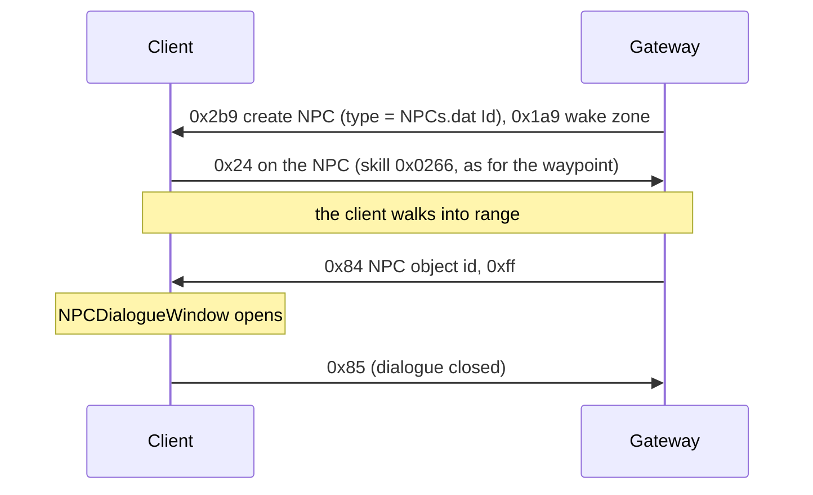

# 17. NPCs

State of 2026-10-19: Tarkleigh, Nessa and Bestel stand in Lioneye's Watch. They show their name on hover and on the minimap, and
clicking one walks the player to them and opens the NPC dialogue window. Verified live with the real client. The
window's options come from the client itself (NPCTalk); choosing one is not handled yet.

## 1. The NPC object

An NPCs.dat row's `Id` (`Metadata/NPC/Act1/Tarkleigh`) is an .ot type, created with S→C 0x2b9 like any object
(type = `ObjectTypeHash(Id)`). `Metadata/NPC/NPC.ot`: Positioned (`object_size = 5`, blocking), Animated, BaseEvents
(`server_only`), InteractionAction, NPC, MinimapIcon (`icon = 3`), client Render (`ObjectDisplayTextNPC`) + Targetable.
The child .ot only sets its `animated_object`.

Of the NPC types in `data/object-types.json`, 190 have exactly that list; 54 add Transitionable, 31 StateMachine, and a
few ControlZone, Functions, Stats or Brackets (not written yet).

| Part | Bytes |
|---|---|
| Positioned | as a monster's ([10](10-chat-and-commands.md) §5): x, y, f32 rotation, u16 team 0, flags `00 02 00 01` |
| Animated | `00` (the type supplies the model) |
| BaseEvents | nothing |
| InteractionAction | `00` |
| NPC | two u8 (slot 17 `0x141e75050`): `+0x20` has dialogue (`0x141e76d40` lists NPCTalk rows only when set), `+0x21` index of a component that must be alive, `0xff` none. Sent `01 ff` |
| MinimapIcon | `00` |
| Transitionable, StateMachine | as for monsters |

The NPC component's debug dump (`0x141e751d0`) prints the NPC and the NPCTalk row the client picks for the player
(`0x141e76d40`): the client chooses the dialogue itself.

## 2. Where town NPCs stand

The client files do not place them. Lioneye's Watch is one room, `beach_town_unique_normal.arm`, whose only named points
are `entrance1`, `entrance2` and `default`. The town tiles' `.tmd` objects are the waypoint, the area transition and
doodads, and `Tarkleigh.ot` has only its model. The real server has its own data, so `NpcCatalog.Towns` holds cells
measured on the real game's minimap: the minimap projection was fitted on our NPCs' known cells and the waypoint (under one cell of error), then inverted for the real markers. Facing is not set yet (`/npc_face <name> <degrees>` turns one live):

| NPC | Cell |
|---|---|
| Tarkleigh | (388, 182) |
| Nessa | (346, 271) |
| Bestel | (361, 246) |

## 3. Messages

### C→S 0x24: talk

A click on an NPC sends 0x24 (use skill on object, [09](09-area-change.md)) with skill `0x0266`, the same interaction
as the waypoint. The client walks to the NPC first. The Gateway follows the walk (`NpcReach` 8 cells, not measured)
and then answers with 0x84.

### S→C 0x84: open the dialogue (13 bytes)

World group, class `0x1435dd7d8`, read `0x141fddcb0`: the object header (u16 id, u32 BE object id → `+0x10`, u32, u16),
then u8 → `+0x20`. The world handler `0x142187480` calls `0x142149db0(instance, object id, u8)`:

- object id 0: closes the dialogue (clears instance `+0xd7c0`).
- u8 `0xff`: sets instance `+0xd7c4`/`+0xd7c8` to the NPC and fires the listeners at instance `+0x13f8` →
  `0x140dcc720` (in-game UI, registered by `0x140dbcd40`) → `0x14071f6d0` → `0x140723d60` (NPCDialogueWindow setup).
- other values: another path that looks at the NPC component's data (`+0x66`), not mapped.

### C→S 0x85: dialogue closed (2 bytes)

Id only. Live 2026-10-19 it came after every opened dialogue, when the window closed (Goodbye, Esc or walking away).

### C→S 0x82: option (3 bytes)

u8 = the chosen NPCTalk row's index among the NPC's rows (column 1). The client (`0x140722960`) handles NPCTalkCategory 5
(Topic), 0x19 and 0x26 itself and sends 0x82 for the others. The Gateway answers by category:

| Category | Answer |
|---|---|
| Gossip, Quests, QuestReward | S→C 0x84 with the index: the window plays the row's text and audio (verified) |
| BuyItems | shop tab (S→C 0xc0, manager 1) + S→C 0x8c (verified: the buy window shows the stock) |
| SellItems | two offer inventories (0xc0, manager 1) + S→C 0xb8 (verified: drops, Ctrl + click, Accept, Cancel; §5) |
| RespecPassivePointsForGold | S→C 0x7b kind 0x5f with 1: the character's passive tree (UI +0x650, listener 0x140dc8750; a non-zero u32 shows it in mode 2, `0x1409de680`), the script's `SendOpenScreen( CharacterPassiveTreeScreen, 1 )`. Not kind 0x11 (Atlas tree, UI +0x668) or 0x45 (UI +0x678). "Apply refunds" (C→S 0x36 per node) and "Refund All" (0x37) are paid in gold ([15](15-progression.md) §2) |
| IdentifyItems | script `triggerer.IdentifyItems()`: every unidentified item with mods in the main inventory becomes identified, free (0xbf removes and re-adds the same ids), then a chat line "{0} Items identified" / "{0} Item identified" (ClientStrings `IdentifyItemsChatMessage(Single)`, S→C 0x17, [10](10-chat-and-commands.md) §2) and 0x84 0xff to list the options again (verified 2026-10-20). The client grays the option itself (`0x141e754b0` case 0x3b: no unidentified item in the inventory → ClientStrings id 0x1f07 "No items in your inventory can be identified", drawn gray by `0x14071e8d0`), but only when the options are listed. The real game probably charges Scrolls of Wisdom (ClientStrings `IdentifyItemsNotEnoughScrollsOfWisdom`); ours is free. The IdentifyAll sound effect is not sent |

C→S 0x85 during a talk = Continue → 0x84 0xff (back to the options); otherwise the Gateway answers 0x84 with object 0,
which ends the dialogue (without an answer the client stays in its dialogue state and the player cannot move).

## 5. Shops

- **S→C 0x8c** (read `0x1421a1f60`): u32 BE NPC, u16 BE (NPCShop row), u8, u16 n + n × u32 BE inventory ids (one tab
  each, looked up in inventory manager 1, instance +0xca10, `0x14216aa30`), u16 m + m × (compact uint, wstr name, u8)
  tab names. Listener `0x140dcccf0` → VendorBuy (UI +0x7b8, vtable `0x1431356b8`, +0x380 = `0x14073d570`).
- **C→S 0x88** (write `0x141f95380`): u32 BE shop item, u32 BE destination inventory (masked like 0x28's), u8 x, u8 y,
  u8, u8 flags, compact uint. The Gateway moves the item (0xbf on the tab, manager 1, and on the inventory) and takes the
  price from the main inventory's stacks and then the stash's (any tab, as 3.29 vendors do), in one transaction. Not
  enough: nothing happens, no message (the client shows the price in red itself, below). The client counts only the
  currency it knows of: the inventory's and the stash tabs it has the contents of. So on entering an area the Gateway
  sends the contents of every stash tab with stackable items (S→C 0xc0, no 0xc8; `SendPlayer`); before that, a price paid
  from the stash was red and no 0x88 came until the stash had been opened in that area (verified live 2026-10-23, Nessa
  in the hideout, the stash not opened).
- **C→S 0x8a** (dispatcher case 0x8a): Ctrl + click on a shop item. Read from live bytes (2026-10-20, Nessa): u32 BE shop
  item, u8, u8 flags, compact uint (as 0x88's), u16 token (raw); `008A 00000061 00 00 00 A777`, 11 bytes. No cell: the
  Gateway puts the item into the main inventory (a stack onto stacks of its type, then the first free cell) and takes the
  price from the inventory and then the stash, in one transaction (`ItemMoves.BuyToInventory`); with no room or not
  enough to pay, nothing happens.
- **Prices**: item Base flag bit 7: u8 n + n × (u32 item type hash, compact uint amount), stored in the Base's +0xb8 list.
  Ours: 1 Scroll of Wisdom for everything (`NpcShops`). The tooltip shows it under Cost, in red when the player can't pay
  it: the client decides that itself, no server message needed (live 2026-10-20).
- **Stock** is the server's (NPCShop only names shops): `NpcShops.Stock`.
- **Several tabs**: one manager-1 inventory per tab (S→C 0xc0, ids from 0x400), all listed in 0x8c with their names
  (the m × (compact uint index, wstr name, u8) list). `NpcShops.Tabs`: the NPC's stock in "Goods", and Nessa also sells
  every shop gem (`ItemCatalog.ShopGems`: creatable, dropping, not Vaal or awakened, one per name) in seven tabs by
  SkillGems GemColour and IsSupport: Red Skills, Red Support, Green Skills, Green Support, Blue Skills, Blue Support,
  White Skills (2026-10-21). 1 Scroll of Wisdom each, as everything. Nessa's goods also list one of every map of tiers
  1-16 (Maps.dat Tier, a name once at its lowest tier, by tier then name; 225 in 3.29.3b); what does not fit in Goods
  goes into Goods2, Goods3 …. Tabs fill row by row. With more than one tab 0x8c's u8 is sent as 1 (the window at UI
  +0x7b8; 0 opens +0x7b0, which drew 8 tabs over its title, live 2026-10-21; being tested).
- **Sell**: S→C 0xb8 (write `0x141d6acc0`): u32 BE other party (0 = NPC sale → VendorSell, UI +0x7c8), u32 BE your offer,
  u32 BE their offer (both manager-1 inventories, grids `0x140317440` / `0x140c605f0`), u8 flags, wstr name, u32 BE
  NPCs row, u16, u32 BE TradeWindowVisuals row, u16 (+0x54, shown as an error text when set), u16. The offer grids
  must use an Inventories.dat row that accepts items (row 83 refused every drop; row 0 now). C→S 0xb1 (u32, u8): Cancel
  sent u8 0; Accept assumed u8 1. S→C 0xb9 (u32, u8 accepted) closes the window. The NPC offers 1 Scroll Fragment per item.
- **0xb8 flags** (struct +0x50): bit 0 (0x01) = the active trade: the UI state's listener `0x140d62ec0` keeps the first
  u32 (struct +0x08, the other party; 0 for an NPC sale) at +0x984 and sets +0x988 = 1. Ctrl + click on an inventory item
  (`0x14030e3e0`, from the grid click handler `0x1402ddbc0` through the grid's vtable +0x4d0) sends 0xb2 only when that
  is set (branch at `0x14030e4dd`); without it the click runs through the other panels' checks and sends nothing. S→C
  0xb9 with the same id clears it (`0x140d62e90`). Bit 4 (0x10) drops the "Mouse over each item to enable accept" rule
  (`0x140c37140`). The Gateway sends 0x11.
- **C→S 0xb2** (16 bytes, write `0x141f95b40`): an item into "Your Offer": u32 BE source inventory (13 = cursor),
  u32 BE item id, u16, u8 x, u8 y, u16 (changes per request). Ctrl + click sends the item's own inventory with
  x = y = 0xff (`0x142166660`): the Gateway puts it in the offer's first free cell, scanned like a pickup into the
  inventory (column by column from the top left). **C→S 0xb3** (12 bytes, `0x142166750`): u32 BE item id, u32 BE grid
  inventory, u16: Shift + click, the item moves to the other side (a click on an offered item sends inventory 0).
  **C→S 0xb5** (12 bytes, `0x142166830`): the same for Ctrl + Shift + click.
- **Accept**: C→S 0xb6 (6 bytes, `0x140c378d0`): u32 BE the revision of the other side's offer inventory, so the
  server knows the player accepted what it showed; C→S 0xb7 (4 bytes) un-accepts. The Gateway accepts when the revision
  is the last one it sent, else treats it as Cancel. **Cancel**: C→S 0xb1 (u32, u8 0).
- **Closing**: S→C 0xb9 (u32 other party, u8 accepted) closes the window (`0x140dcd370`). The client is still in its
  NPC talk afterwards (session +0xd7c0 = 2, +0xd7c4 = the NPC object; live 2026-10-19) and the player cannot move until
  S→C 0x84 with object 0 ends it. Cancel also sends C→S 0x85 for it, Accept sends nothing, so the Gateway sends 0x84
  object 0 after every 0xb9. Verified live 2026-10-19: drops, Ctrl + click (19 items into the first free cells),
  Accept (the NPC's offer lands in the inventory) and Cancel (the items come back), walking afterwards.
- **Offered items keep their server/save cells but are hidden from the client's inventory.** On offer send manager-0
  0xbf removing the original item (or cursor item), then manager-1 0xbf adding it to the player's offer. This provides
  an unambiguous offer-only view without relying on an unreliable native grey imprint. The reserved server cell
  prevents reuse/collisions and keeps the durable item safe across disconnects and crashes. Taking back or cancelling
  sends manager-0 additions with the original ids/cells; confirming sends only reward inventory changes, since offered
  items were already hidden. Closing dialogue or reopening/switching vendor windows cancels the previous sale first.
  Acceptance persists item removal and payment together; a refused sale leaves the offer open. NPC reward previews
  are generated UI items, not paid inventory, and are never granted on cancellation. Player-to-player trade is not
  implemented by this NPC sale path. Coverage: SaleImprintTests (duplicates, currency exclusion, cancel, restart,
  held-item recovery and atomic accepted sale). Live visibility verification pending.
- S→C 0x87 opens the quest reward window (u16 = QuestRewardOffers row, `0x140c2b690`); a wrong row crashes the client.

## 6. Dev commands

`/npc <NPCs row, Id or name> [rotation°]` creates an NPC next to the player, `/npcs` lists this connection's NPCs, and
`/pos` prints the player's cell (the server's estimate) for picking places.

## Open

- Selling: real sell prices; remaining quest reward offers/scripts; Respecialisation with refund points;
  real buy prices.
- The NPC component's two bytes, and 0x84's other mode values.
- The NPCs' facing (rotation 0 for now), and NPCs in the other towns and outside towns.

## Quest dialogue and first rewards (2026-10-25)

NPCTalk QuestFlag1/2 are required/excluded flags. QuestFlag4 applies when a talk is chosen; QuestFlag5 applies after
Continue. QuestFlag3 controls read/highlight state, not eligibility. QuestFlags and QuestRewardOffers are zero-based:
row 0 is valid, including `a1q1-KilledHillock`. `NEVER_SET` remains an eligibility sentinel but is never applied as an
effect. Eligibility uses the same projected visited/access flags sent to the client, plus saved character flags.

Implemented offers are limited to 0 and 8 and their class-filtered normal level-one gem choices. Offer 8's magic
armour choices need item construction not implemented here. Nessa's Brutus conversation sets `NessaChatBrutus`,
enabling her prison reward; claiming sets `a1q2-NessaRewardTaken`. Tarkleigh's Hillock reward sets
`a1q1-QuestRewardTaken`. Inventory addition and the taken flag commit in one save transaction, with a durable duplicate
check and rollback on failure/full inventory. The server removes all choices and ends dialogue after claiming.
Live verified with OfflineWitch: Combustion Support from Nessa and Freezing Pulse from Tarkleigh, including the saved
completion flags. Other quest scripts are not thereby implemented.
