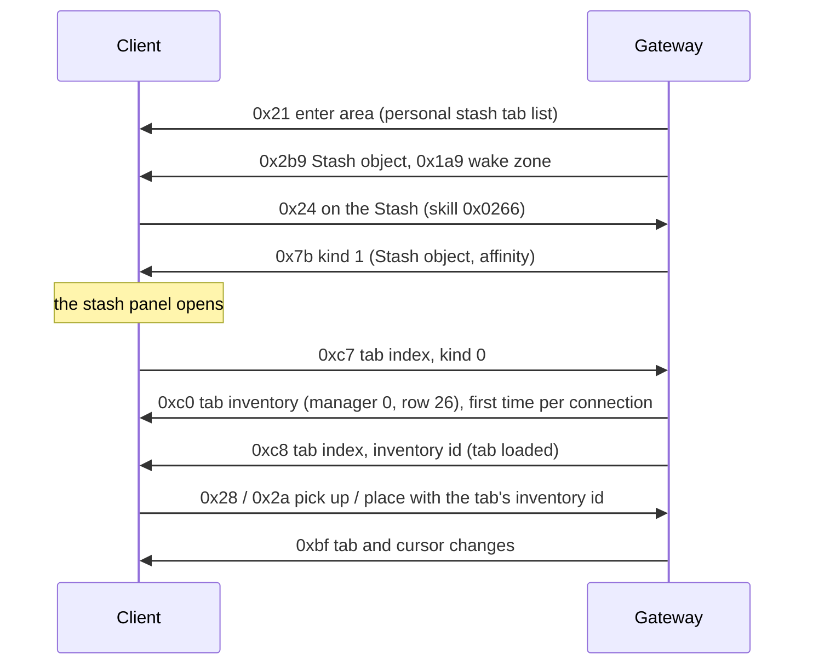

# 18. Stash

State of 2026-10-19: a Stash stands in Lioneye's Watch. Clicking it opens the stash panel with the account's tabs (11
starter tabs of several StashType kinds). The client asks for each tab's contents when it shows the tab, and items can
be put into and taken out of tabs. Tabs and items belong to the account: every character of the account sees the
same stash. Verified live (2026-10-19): the panel opens, all 11 tabs load, items go in and out of a normal tab by
click and by Ctrl + click, and the stash reopens on the last tab after a relog.

## 1. The Stash object

`Metadata/MiscellaneousObjects/Stash.ot`: Positioned (`object_size = 3`, blocking), BaseEvents (`server_only`),
Animated (`chest_v01_01.ao`), MinimapIcon (`icon = "StashPlayer"`), InteractionAction; client Render
(`ObjectDisplayTextStash`), Targetable, StateMachine (`open`). The blob is an NPC's without the NPC component:
Positioned as an NPC's (`… 00 02 00 01`), Animated `00`, MinimapIcon `00`, InteractionAction `00`, tasks `00`
(`StashObject`). It is not in the town tiles' `.tmd` records, so the server places it: `StashCatalog` (Lioneye's
Watch at (319, 272), next to Nessa). A click sends C→S 0x24 with skill `0x0266`, as for NPCs and the waypoint.

## 2. The tab list

The instance keeps three lists of 0x68-byte tab records (`0x14216cf60`): personal stash `+0xc498`, guild stash
`+0xc4b0`, trade tabs `+0xc4c8`. The panel (`0x140a87830`) builds one tab button per record.

- **S→C 0x21** (enter area, dispatcher case 10): its first two vectors are the personal stash list (→ `+0xc498`) and the
  trade tab list (→ `+0xc4c8`). The Gateway sends the account's tabs in the first.
- **S→C 0x136** (class `0x1435dc7a0`, read `0x1421a3350`, case 0x57): u8 kind (0 personal, 1 guild, 2 trade), u8 (which
  listener: `+0x8478` when set, else `+0x83f8`), then one list. Written (`InstanceStash.TabList`), not sent yet.

A list (`0x1421ba150`) is a u16 BE count and the records. A record (`0x141d4d1f0`):

| Wire | Field | Meaning |
|---|---|---|
| u32 BE | +0x28 | the tab's inventory id in the player's inventory manager (`+0xc890`) |
| u32 BE | +0x2c | copied to the panel tab's +0x30; 0 |
| wstr | +0x08 | name |
| str (u16 BE + bytes, `0x1408402a0`) | +0x48 | id string |
| u16 BE | +0x38 | button position; the panel sends C→S 0xcc when it differs from the order it builds |
| 2 bytes | +0x3d, +0x3e | flags, below; +0x3e bit 1 = contents loaded (set by S→C 0xc8) |
| u16 BE | +0x3a | parent folder's index, 0xffff none |
| u8 × 3 | +0x30..+0x32 | colour R, G, B |
| u8 | +0x34 | StashType row: 0 NormalStash, 1 PremiumStash, 3 CurrencyStash, 4 UniqueStash, 5 MapStash, 7 QuadStash, 8 EssenceStash, 9 FragmentStash, 16 Folder, 17 FlaskStash, 18 GemStash … |
| u64 | +0x00 | only with flag 0x20 |
| u8 | +0x3c | only with flag 0x10 |
| 4 bytes (raw) | +0x3f | only with flag 0x40: bitset of StashTabAffinityId rows |

+0x3d flags: 0x01 → panel tab bit 3; 0x02 premium (the tab settings `0x14025b420` can rename and recolour it); 0x08 →
panel tab bit 6; 0x20 the tab is left out of the panel; 0x40 the affinity bitset follows (the client keeps 0x40 set
while any bit is). Types 0x10 (Folder) and 0x19 get no contents request.

## 3. Opening the panel

**S→C 0x7b kind 1** (`0x142163420` case 1 → listeners at instance `+0x1178` → `0x140dcd5e0`): u32 a = the Stash
object (passed to `0x141661860`), u32 b = an affinity, clamped to 0x16. The handler opens the panel; when b ≠ 0x16 it
selects the first tab whose affinity bitset has bit b (with b = 3, a CurrencyStash tab scores higher), through
`0x140a83950`. Kind 2 (`+0x12f8` → `0x140dcd780`) is the same for the guild stash (`+0xc4b0`).

The client does not tell the server when the player switches tabs, and a second 0x7b while the panel is open closes
it (`0x140dc4db0` toggles), so the tab is chosen at the moment the panel opens. To open on the account's last tab the
Gateway sets affinity bit 0 (`UNUSED0`, no item has it) on that tab only and sends b = 0, on the first open of each
connection. Later opens send b = 0x16: the panel keeps its own tab while the connection lasts (verified live).

## 4. Tab contents

- **C→S 0xc7** (5 bytes, vtable `0x1435bff20`, write `0x141f95fa0`): u16 BE tab index, u8 kind. `0x142167010` queues
  it when a tab without a built page is selected (`0x140a85c30`) and when the panel opens on its current tab
  (`0x140a8d1b0`); the tick `0x142148880` sends one per 200 ms, **newest first** (it takes the back of the deque).
  So on a forced open the selected tab's request comes before the panel's request for its old tab (live: tab 3, then
  tab 0 twice).
- The answer: **S→C 0xc0** with manager 0, the tab's inventory id, Inventories.dat row 26 (`StashInventoryId`, kind
  0x11) and the tab's size (the register `0x141d625f0` files every row but 26 under its row, so any number of tabs share
  it), then **S→C 0xc8** (class `0x1435dc680`, read `0x1421a45b0`, case 0x3b): u16 BE tab index, u32 BE inventory id
  (→ +0x28), u8 kind. The handler sets the loaded bit and tells the panel (`+0x8378` → `0x140a87740`), which builds the
  page. The Gateway sends 0xc0 when the client doesn't have the tab, and 0xc8 every time.
- **Only the shown tab stays loaded.** The client keeps every tab it was sent, and each stash open walks all of them as
  the panel becomes visible (`0x1418ab220`, the element show/hide). Opening therefore got slower with every loaded item.
  Live 2026-10-29: about 1.5 s once the currency, essence, fragment, gem and divination tabs were all loaded.
  - When the player picks a tab (a 0xc7 outside the first open's two requests), the Gateway unloads every other loaded
    tab with **S→C 0xc1** (u8 manager, u32 inventory id).
  - It then sends the tab list (0x136) again with those tabs' loaded bit clear, so the panel asks for them (0xc7) when
    they are shown again.
  - The tabs with shop currency stay (below).
  - During the first open, the panel's old tab is asked for after the forced one; unloading the shown tab then crashed
    the client on the next open, so nothing is unloaded in that window.
  - Live 2026-10-29: the stash opened much faster after the heavy tabs were visited, with no crash.
- **Area entry preloads only shop currency.** Vendors price items against the currency the client knows of, so the
  tabs that can hold it (a currency tab or a grid tab) go out on area entry when they hold class `StackableCurrency`
  (`Program.PreloadsForPrices`). Before, every tab with a stackable item went out: a full divination tab alone is
  470 items.
- Sizes (`AccountStash.Types`): StashType StorageSlots × column 4: Normal and Premium 12 × 12, Quad 24 × 24; the special
  tabs (Currency 142 × 4, Essence 110 × 4, Fragment 255 × 9, Map 12 × 6, Flask 250 × 4, Gem 250 × 2, Delve 41 × 4,
  Blight 83 × 4, Delirium 88 × 1, Divination 255 × 2, Ultimatum 62 × 5, Breach 1 × 1) are cells x = the layout's slot
  index (CurrencyStashTabLayout `FirstSlotIndex` …). A type missing here falls back to 12 × 12, and slots past that width
  draw over the tab: blight oils at slots 12 and 79–82 did (live 2026-10-28) until Blight got its 83 × 4.
- Items move with the inventory messages of [13](13-items.md): C→S 0x28 / 0x2a with the tab's inventory id; the
  Gateway answers with S→C 0xbf on the tab (manager 0) and on the cursor.

## 5. Other C→S messages

- **0xcc** (vtable `0x1435c0438`, write `0x141f96130`, `0x1421670f0`): the tab buttons' order. u8 kind, u8 n, n × (u16
  BE tab, u16 BE position). Kept (2026-10-22): `AccountStash.SetPositions` saves each tab's position with the stash
  (kind 1 the guild stash), and the tab lists send it back as the record's +0x38, so the order survives a relog.
- **0xd1** (7 bytes, vtable `0x1435c0198`, write `0x141f96c50`, `0x142167370`): u16 BE tab, u16 BE folder (0xffff out),
  u8 kind: a tab into a folder. Logged.
- **0xcd** (vtable `0x1435c00d8`, write `0x141f962a0`; built by the tab settings `0x14025b420`): a premium tab renamed.
  u8 kind, u16 BE tab, u64 (0), wstr name. **0xce** (17 bytes, vtable `0x1435bf9a8`, write `0x141f96670`): its colour,
  u8 kind, u16 BE tab, u64 (0), u32 BE colour; the client keeps the colour in the tab record's +0x2c, which the tab lists
  send back (the record's second u32). Both are kept with the stash, account-wide (`AccountStash.Rename`, `SetColour`;
  every tab but normal ones and folders is premium, as bought tabs are: the tab settings show the name and colour only
  with the record's premium flag; kind 1 the guild stash). Verified live 2026-10-22: the settings window closes on the tab list (S→C 0x136) sent after each change, and the name and colour survive a relog.
- **0xd2** (u16 tab, u8 kind; `0x14025c030`): from the tab settings. Not seen yet.
- **0xd3** (class `0x1435c0338`, write `0x141f96da0`, built by `0x1421674c0`): the tab settings' affinities, sent by the
  window's check mark. u16 BE tab, u8 kind, u8 n, n × (u8 affinity, u8 on). Live 2026-10-20: `00D3 0005 00 01 03 01`
  (Currency on, tab 5). The window stays open until the server answers; the Gateway saves the bits with the tab
  (`SavedTab.Affinities`) and sends the tab list again (S→C 0x136), with flag 0x40 and the bitset in each record. Whether
  0x136 is what closes the window is not checked live yet.
- **0xe0** (20 bytes, vtable `0x1435c0878`, write `0x141f97560`, built by `0x142168ab0`): Ctrl + click on an inventory
  item while a tab is shown. u16 BE tab (the stash page's +0x4a4), u32 BE item id, u8 flags (bits 0, 1), u8 kind (page
  +0x491), u16 token (raw, changes per request), u64 raw (0). The item's inventory is not sent. The Gateway moves the
  item to the tab's first free cell (column by column) from whichever inventory holds it.
- **0xe3** (12 bytes, vtable `0x1435c0500`, write `0x141f97e40`, built by `0x142168e20`): Ctrl + click on a tab item.
  u16 BE tab, u32 BE item id, u8 stash kind, u16 raw token (low byte first), u8 bulk.
  Live ordinary click suffix: `00 a7 cd 00`; the middle two bytes change per request.
  Static 3.29.3b evidence: the builder copies argument 4 to kind, argument 5 to the token and argument 6 to bulk;
  the writer emits these four bytes in order from message +0x18..+0x1b.
  The ordinary inventory click (`0x14030e3e0`, call at `0x140310c63`) passes bulk 0 to `0x140312810`;
  its bulk counterpart (`0x140311440`, call at `0x14031172a`) passes 1.
  The shared handler forwards that boolean to `0x142168e20` at `0x140313444`.
  This is a separate boolean from the `0xe1` deposit flags; do not use deposit flag 0x02 for withdrawals.
  The Gateway limits ordinary withdrawals to one normal inventory stack; bulk 1 withdraws as much of the clicked
  stack as fits, topping up existing stacks before using free cells.
  Real-client/Gateway logs confirm both modes: bulk 0 takes 40 from a slot holding 218, leaving 178;
  bulk 1 takes 178 as four stacks of 40 and one of 18.
  Wire-layout, capacity, transaction rollback and transfer/reload tests cover the remaining edge cases.
- **0xe1** (vtable `0x1435c00f8`, write `0x141f97810`): Ctrl + click on an inventory item that has an affinity tab
  (currency, maps, gems …) while the stash is open, whatever tab is shown: the client names the tab. Read from live bytes
  (2026-10-20, Scroll of Wisdom, Armourer's Scrap, Orbs of Alteration and Transmutation, the Currency tab at index 5):
  u32 BE item id, u8 flags, u8, u16 token (raw), u8 n, n × (u16 BE tab, u8 affinity); `00E1 00000008 00 00 225E 01 0005
  03`, 14 bytes with one entry (the static notes said n × 4, the bytes say 3). The Gateway moves the item into that tab
  like 0xe0. **Flags 0x02 = Ctrl + right click** (Ctrl + left click sends 0; live 2026-10-23, one Ctrl + right click on an
  orb: `00E1 000037D5 02 00 6A7D 01 0005 03`; `InstanceStash.MoveAllOfType`): the Gateway moves every stack of that item
  type in the same inventory into the tab, the clicked one first, each as one Ctrl + click (its own transaction and 0xbf
  pair), so a full slot stops only what doesn't fit.
- **0xe2** (u16, u8; `0x142168d00`, the unique / special pages) is not seen yet.

## 6. The server's stash

`AccountStash` (Gateway): per account (Auth's resolve now returns `Account`), saved as its row in `data/saves.db` the way
character saves are ([saves](../saves.md)): a stash that can't be read stops what needed it instead of becoming the
starter tabs, and every move between the stash and a character's items is one transaction.
Tab i's inventory id is 0x800 + i. A new account gets two normal tabs, two premium tabs, a quad tab and Currency,
Essence, Fragment, Map, Flask and Gem tabs. An item put into the stash gets a stash id (from 0x40000000, never reused;
the next id is saved) and keeps it when a character takes it out: characters count their item ids from 1 each, and
`PlayerInventories` skips stash ids when it picks its next id.

The account's last tab is every tab the client shows the server: each 0xc7 (but not, during the first open's first
second, `StashForcedWindow`, a request for another tab than the forced one: that is the panel's old tab), and every
item moved into or out of a tab (0x28, 0x2a, 0xe0, 0xe3). Stacks merge into a tab's stacks and split out of them like in the inventory
([13](13-items.md) §4a). The same save holds the account's gold (`Gold`, [04](04-player-entity.md) §6).

## 7. What each tab holds

`StashRules` (Gateway), from the game data:

- **Which tab holds what.** An item's affinities (StashTabAffinityId rows) come from StashTabAffinityByBaseItemType,
  StashtabAffinityByItemClassCategory (gems, flasks, map keys …; maps of class Map too, which the table leaves out) and
  the special tabs' layouts below. StashTabAffinities lists, for each affinity, the StashType rows that may hold it
  (`__col2`): Currency → Normal, Premium, Quad, PC-bang Premium, Currency. Normal, premium and quad tabs hold anything; a
  special tab only items with one of its affinities. A move into a tab that doesn't hold the item is refused (0x2a, 0xe0,
  0xe1).
- **Slots.** The currency, essence and fragment tabs give each item type one slot: CurrencyStashTabLayout /
  EssenceStashTabLayout / FragmentStashTabLayout `FirstSlotIndex` (a currency slot also takes its `StoredItem`: the Eldritch Embers and Ichors rows keep old Ids, CurrencyCleansingFireOrb1-4 and CurrencyGreatTangleOrb1-4, SlotGroup 1 = the Atlas page; a fragment slot also takes its `StoredItems`). The
  client shows slot n as cell (n, 0) and sends it so (live 2026-10-20: a Scroll of Wisdom dropped at (54, 0), (12, 0) and
  (1, 0); its slot is 1). An item dropped anywhere on such a tab goes into its own slot, onto what is there.
- **Crafting slot.** The currency tab's big cell in the middle is CurrencyStashTabLayout row `CraftingSlot` (no
  `StoredItem`, `FirstSlotIndex` 28, 2 × 4). The client drops onto it as (28, 0) (live 2026-10-23, a weapon). It takes
  any item, where dropped (`StashRules.TakesAnything`), at the item's own stack size; an item dropped on it swaps with the
  one there; the load-time repair leaves it. Ctrl + click never puts anything there. Currency (from its slot or the inventory) works on the item there: 0x71 / 0x72 name the tab as the target inventory ([13](13-items.md) §4b). 
- **Spare slots.** The 14 cells under the crafting slot are rows `Generic1`–`Generic14` (no `StoredItem`, slots 30–34
  and 40–48; two rows on screen, YOffset 680 and 770). They take any item the currency tab holds, where dropped, up to
  the item's currency-tab limit below.
  Ctrl + click (and Ctrl + right click, 0xe1 flags 0x02) puts into them what the item's own slot has
  no room for: first onto a spare slot of that type with room, then into the first free one, left to right and top to
  bottom (`StashRules.OverflowSlots`, `AccountStash.AddStacked`); what still doesn't fit stays in the inventory.
- **Stack sizes.** Currency slots use `CurrencyItems.CurrencyTab_StackSize`, keyed by `BaseItemTypesKey`:
  red, yellow and blue crystallised lifeforce hold 50000, and ordinary currency generally holds 10000.
  The previous uniform 5000 limit split a 50000 lifeforce deposit across its own slot and nine spare slots.
  Live client verification: C→S 0xe1 merged 40000 into an existing 10000 in slot 99; S→C 0xbf reported 50000.
  Automated tests cover manual merging, quick deposits, all five Harvest currency types, overflow and save reloads.
  Other slotted tabs retain 5000 (`StashRules.SlotStack`), also the fallback for absent or invalid currency limits.
  The Delve (StashType 12, DelveStashTabLayout) and
  Blight (13, BlightStashTabLayout) and Delirium (15, DeliriumStashTabLayout) tabs are slotted the same way; the
  Divination tab (6) too, a card's slot being its DivinationCardStashTabLayout row. The client builds a
  map from each row's card (its BaseItemTypes Id) to the row index (`0x140b31180`), and 470 rows run past the tab's
  255 cells. So slot n is cell (n mod width, n / width): rows 255–469 go into the second row of its 255 × 2. Every other
  layout fits its first row. The tab shows a card only once its set is complete (stack = the card's stack size).
  Live 2026-10-28: with one card each, only the 1-card sets showed; with two each, exactly the 1- and 2-card sets.
  Luck of the Vaal (row 154, not in game) never showed. Unique (4), Breach (22) and Ultimatum (14) tabs exist but take nothing yet (`StashRules.NotShown`: uniques
  are keyed by unique names and the server has none; 3.29.3b has no breach or ultimatum layout table). The starter tabs
  are four normal tabs "1"-"4", as the real game's, then the premium and special ones; a stash saved before gets the
  missing ones
  appended.
- **Ctrl + click** into a tab (0xe0, 0xe1) puts a stack onto the tab's stacks of its type first (in a slotted tab, its
  slot), then into free cells; what doesn't fit stays in the inventory. Out of a tab (0xe3), a stack tops up the
  inventory's stacks of its type first, withdrawing at most the item's normal inventory stack size for Ctrl + left click.
  Ctrl + right click (`0xe3` bulk byte 1) instead tries the entire clicked stack.
  Stash reduction uses the amount actually moved, so an intentionally limited withdrawal leaves its remainder even
  when every requested item fits (issue #249).
  Each is one transaction
  (`ItemMoves`, [saves](../saves.md)).
- **The map tab takes nothing yet.** The 3.29 client lists a map tab's maps by tier ([maps](../game/maps.md)), not at
  grid cells: two Beach Maps saved at (0, 0) and (0, 1) were not shown (live 2026-10-20). Until its layout is known,
  `StashRules.NotShown` refuses every item, and maps already there move out at load.
- **A plain click on a special tab's item** sends C→S 0x7c (split) with the whole stack (live 2026-10-20, the currency
  tab: `Amount` = the stack, `B` = 0; Shift + click sends `B` = 3 with the amount chosen). The Gateway puts the whole
  stack on the cursor, keeping its id; a slot holding more than the item's inventory stack gives a full stack
  (the item's max) and keeps the rest. A Shift + click split takes at most a full stack too.
- **Repair.** Items a special tab can't show (an earlier build let any item into any tab) move at load into their slot,
  else into the first normal tab with room, and are saved there. One that finds no room stays where it is, saved.
- **Filling a tab (dev, `/item_tab <tab name> <count>`).** The tab is found by its name, ignoring case, or else by
  the only tab whose StashType name starts with the text. Each item type with a slot of its own on that tab
  (`StashRules.Slots`) gets up to `count` more, at most 1000 per command. Each type goes into its own slot only, never
  the spare slots, and is capped by that slot's limit above; an item that doesn't stack gets one. A divination card is
  capped at its complete set, which is what the tab shows.
  `AccountStash.FillSlots` does all of it in one save, and an open tab gets one S→C 0xbf.
  - Gem tab (StashType 18, 250 × 2): one of every creatable gem variant (`ItemCatalog.FullShopGems`, transfigured and
    Vaal included), red, green, blue then white, actives before supports. They go into free cells in order
    (`AccountStash.FillCells`), and a variant already there is not added again. The client sorts the gems into its colour
    sub-tabs by itself (live 2026-10-28). The server can create 1044 variants and the tab has 500 cells, so the rest are
    reported as finding no room.
  - Unique collection (StashType 4): one creatable unique per native collection cell, including unique maps.
    `UniqueStashLayout` supplies coordinates, Words HASH32 and ItemVisualIdentity HASH16; `UniqueStashTypes`
    supplies categories. Hidden child tab records use flag `0x20`, an eight-byte little-endian category key
    (table row + 1), and the visible collection tab as Parent. Position carries the collected item count.
    **An unloaded child must advertise inventory ID zero.** The native category constructor dereferences a nonzero
    ID even before its loaded flag is set; advertising an inventory before AddInventory causes a client crash.
    Send AddInventory before TabLoaded publishes the actual ID. Ctrl-click routes items to their category;
    the saved last tab remains the visible parent. Filling is transactional and preserves occupied cells.
    Apostrophe normalization and explicit legacy spelling aliases match catalogue names to native cells.
    Inactive stored tinctures serialize their Tincture component as one zero byte; active tincture gameplay
    is outside this change. Current data fills 1309 cells; seven old names lack a matching layout and unique
    Heist contracts have no generator. Legacy collection entries can exceed the native league denominator.
  - Flask tab (StashType 17, 250 × 4): `AccountStash.FillFlasks` adds one ordinary, fully charged flask or
    inactive tincture per supported standard base, sorted by class, drop level and name, plus creatable uniques.
    Ordinary flasks have 48 bases (life 12, mana 12, hybrid 6, utility 18); Royale duplicate bases are excluded.
    Normal/magic items deduplicate by base hash. Uniques use base hash, Words name and visual identity,
    so different uniques sharing a base coexist and do not suppress ordinary bases. Existing items are preserved.
    `/item_tab <flask tab name> 1` uses free cells and sends the loaded tab an inventory change (`0xbf`).
    Repeat/reload, tinctures, different uniques on one base and existing unique/magic coverage are tested.
    Serialization of stored tinctures does not implement their active combat mechanics.
  - Refused: normal, premium and quad tabs (no slot per type), and the remaining `NotShown` tabs.
  - Skipped:
    - types the server can't write;
    - a slot already holding another type;
    - slots past the tab's cells (none in the 3.29.3b layouts).
  - Real data: currency 126 types, essence 104, fragment 308 (62 of them non-stacking), delve 33, blight 17,
    delirium 24, divination 470.

## Guild stash (verified live 2026-10-21)

Every hideout also gets `Metadata/MiscellaneousObjects/GuildStash` (the Stash's components, the same blob) on the first
walkable cell 6 to 20 cells from its Stash. A click (C→S 0x24) sends S→C 0x136 kind 1 with the guild tab list, then 0x7b
kind 2 (`InstanceStash.OpenGuildStashUi`). No guilds yet: each account has its own guild stash
(`AccountStash.ForGuild`, saved as `guild:<account>`, starting with two premium tabs and a quad tab). Its tabs take
inventory ids from 0x900 and its items ids from 0x50000000, so they never meet the personal stash's (0x800…,
0x40000000…); an item keeps its id only inside the stash that gave it. While the guild panel is open the stash messages
(0xc7 kind 1 → 0xc0 + 0xc8 kind 1, 0x28, 0x2a, Ctrl + click) act on it (`StashOf`); opening the personal stash switches back.
Its tab inventories and their 0xbf changes go to **inventory manager 2** (`InstanceStash.GuildManager`, instance
`+0xcb90`): sent under manager 0 the panel shows no grid and the client hangs.
Gold stays with the personal stash.

## Open

- **Last tab:** switching to an already loaded tab sends nothing, so a switch followed by a logout without reopening
  the stash or moving an item is not seen; the next login opens on the tab before it.
- Not checked live yet: the affinity window closing on S→C 0x136, and the special tabs other than currency and map.
- Tab folders (0xd1 is logged), 0xe2, the unique, divination and other special tabs, the
  real guilds (shared guild stash, members, rights), stashes per league, and stashes in the other towns.

### Delve inventory bounds and resonators

The Delve tab must publish StashType row 12 dimensions **41 × 4**, not the default 12 × 12.
DelveStashTabLayout addresses fossils at slots 0–24, resonators at 25–36, spare slots at 37/39.
Sending slot indexes beyond the advertised width produces invalid item rectangles and corrupt-looking overlays.
The existing slotted-tab limit is 5000, including fossils and empty stackable resonators.

Legacy `DelveSocketableCurrency{Upgrade,Reroll}1..4` types lack Stack; empty instances are upgraded on load
and developer item lookup to their `DelveStackableSocketableCurrency` counterparts. Embedded items are never
removed or migrated. Empty old socket layouts are repaired to exactly 1/2/3/4 independent Delve sockets.
Socket colour **6** is Delve (yellow/orange); 5 is Abyss. Verified against the client's socket name table at
0x142fc1230, indexed by Sockets reader 0x1421e2e20 / debug writer 0x1421e3980. Create and DefaultSockets
both use this resonator-specific layout, including the stackable item creation path.
Regression coverage uses every stored item in DelveStashTabLayout, 5000-item stacks, merge and save/reload,
and all eight resonator families/tiers. The user confirmed the correction in the real client.

## Lifeforce limits and Delve crafting cells

Currency-tab HarvestSeed slots use `CurrencyItems.CurrencyTab_StackSize`, as described in section 7:
red, yellow and blue lifeforce hold 50,000; Sacred Crystallised Lifeforce and Crystallised Rancour hold 10,000.
The former HarvestSeed override of 65,535 was the wire maximum, not the data-defined storage limit.
Saved stacks above the corrected limit are retained without truncation; further deposits use overflow or stay outside.
Other special tabs retain their 5,000 fallback; inventory stacks retain their item-defined limit.
Excess lifeforce goes to available overflow cells or remains with the source, without truncation.
DelveStashTabLayout GenericSlot1 and GenericSlot2 are manual crafting cells at (37,0) and (39,0).
They accept equipment at its normal stack size; dropping another item swaps the old item onto the cursor.
Load-time validation retains these items in their crafting cells.
Ctrl-click affinity routing continues to select material slots rather than moving equipment automatically.
Lioneye's Watch creates a guild stash beside the personal stash and uses the existing guild inventory dialogue.
