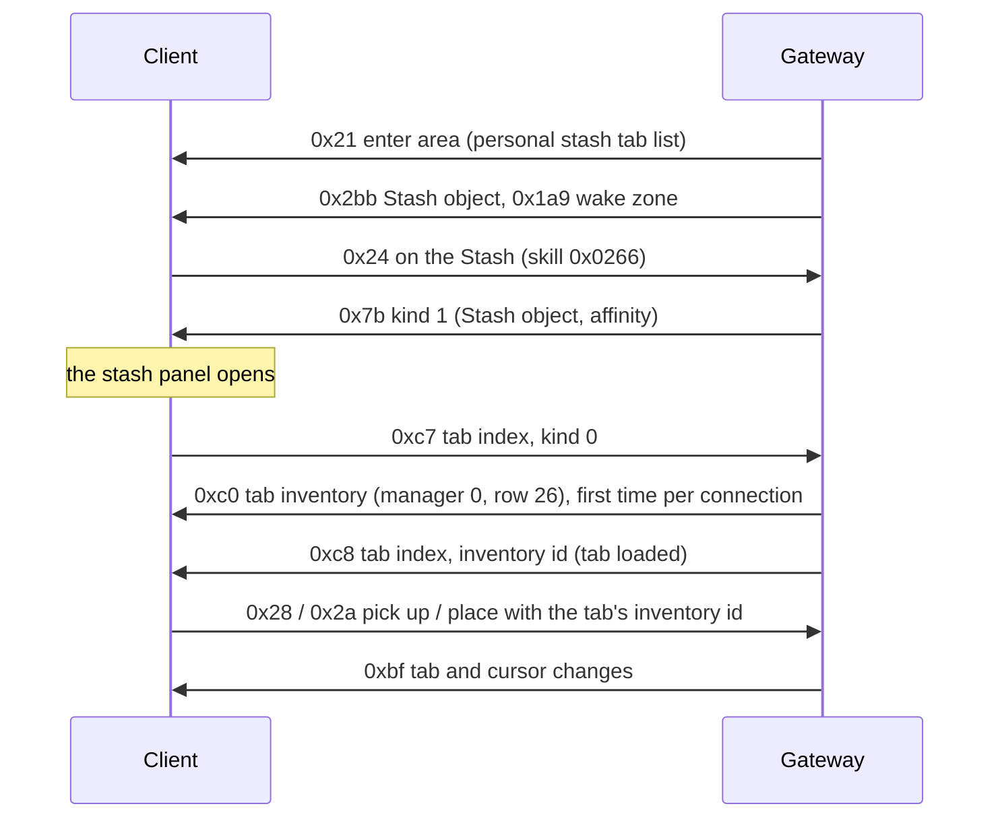

# 18. Stash

State of 2026-10-19: a Stash stands in Lioneye's Watch. Clicking it opens the stash panel with the account's tabs (11
starter tabs of several StashType kinds). The client asks for each tab's contents when it shows the tab, and items can
be put into and taken out of tabs. Tabs and items belong to the account: every character of the account sees the
same stash. Verified live (2026-10-19): the panel opens, all 11 tabs load, items go in and out of a normal tab by
click and by Ctrl + click, and the stash reopens on the last tab after a relog.

## 1. The Stash object

`Metadata/MiscellaneousObjects/Stash.ot`: Positioned (`object_size = 3`, blocking), BaseEvents (`server_only`),
Animated (`chest_v01_01.ao`), MinimapIcon (`icon = "StashPlayer"`), InteractionAction; client Render
(`ObjectDisplayTextStash`), Targetable, StateMachine (`open`). The blob is an NPC's without the NPC component:
Positioned as an NPC's (`… 00 02 00 01`), Animated `00`, MinimapIcon `00`, InteractionAction `00`, tasks `00`
(`StashObject`). It is not in the town tiles' `.tmd` records, so the server places it: `StashCatalog` (Lioneye's
Watch at (319, 272), next to Nessa). A click sends C→S 0x24 with skill `0x0266`, as for NPCs and the waypoint.

The lid is the client's own: its StateMachine `open` is a client-block state the blob does not carry, and
`UpdateStashDoodadAnimation` (`0x1417ef1d0`) plays `open_idle` / `closed_idle` when called with `true` (the model
added) but the `open` / `close` clip when called without (the state's `on_or_create_state_open_*`). That is probably
why a re-entered hideout's stash shows its lid closing as it appears (the event order is not traced); no field of the
blob selects either.

## 2. The tab list

The instance keeps three lists of 0x68-byte tab records (`0x142173910`): personal stash `+0xc498`, guild stash
`+0xc4b0`, trade tabs `+0xc4c8`. The panel (`0x140a87e90`) builds one tab button per record.

- **S→C 0x21** (enter area, dispatcher case 10): its first two vectors are the personal stash list (→ `+0xc498`) and the
  trade tab list (→ `+0xc4c8`). The Gateway sends the account's tabs in the first.
- **S→C 0x136** (class `0x1435e76a0`, read `0x1421a9cc0`, case 0x57): u8 kind (0 personal, 1 guild, 2 trade), u8 (which
  listener: `+0x8478` when set, else `+0x83f8`), then one list. Written (`InstanceStash.TabList`), not sent yet.

A list (`0x1421c0ac0`) is a u16 BE count and the records. A record (`0x141d50880`):

| Wire | Field | Meaning |
|---|---|---|
| u32 BE | +0x28 | the tab's inventory id in the player's inventory manager (`+0xc890`) |
| u32 BE | +0x2c | copied to the panel tab's +0x30; 0 |
| wstr | +0x08 | name |
| str (u16 BE + bytes, `0x14083f460`) | +0x48 | id string |
| u16 BE | +0x38 | button position; the panel sends C→S 0xcc when it differs from the order it builds |
| 2 bytes | +0x3d, +0x3e | flags, below; +0x3e bit 1 = contents loaded (set by S→C 0xc8) |
| u16 BE | +0x3a | parent folder's index, 0xffff none |
| u8 × 3 | +0x30..+0x32 | colour R, G, B |
| u8 | +0x34 | StashType row: 0 NormalStash, 1 PremiumStash, 3 CurrencyStash, 4 UniqueStash, 5 MapStash, 7 QuadStash, 8 EssenceStash, 9 FragmentStash, 16 Folder, 17 FlaskStash, 18 GemStash … |
| u64 | +0x00 | only with flag 0x20 |
| u8 | +0x3c | only with flag 0x10 |
| 4 bytes (raw) | +0x3f | only with flag 0x40: bitset of StashTabAffinityId rows |

+0x3d flags: 0x01 → panel tab bit 3; 0x02 premium (the tab settings `0x14025b9b0` can rename and recolour it); 0x08 →
panel tab bit 6; 0x20 the tab is left out of the panel; 0x40 the affinity bitset follows (the client keeps 0x40 set
while any bit is). Types 0x10 (Folder) and 0x19 get no contents request.

## 3. Opening the panel

**S→C 0x7b kind 1** (`0x142169dd0` case 1 → listeners at instance `+0x1178` → `0x140dcae70`): u32 a = the Stash
object (passed to `0x141663f40`), u32 b = an affinity, clamped to 0x16. The handler opens the panel; when b ≠ 0x16 it
selects the first tab whose affinity bitset has bit b (with b = 3, a CurrencyStash tab scores higher), through
`0x140a83fb0`. Kind 2 (`+0x12f8` → `0x140dcb010`) is the same for the guild stash (`+0xc4b0`).

The client does not tell the server when the player switches tabs, and a second 0x7b while the panel is open closes
it (`0x140dc2640` toggles), so the tab is chosen at the moment the panel opens. To open on the account's last tab the
Gateway sets affinity bit 0 (`UNUSED0`, no item has it) on that tab only and sends b = 0, on the first open of each
connection. Later opens send b = 0x16: the panel keeps its own tab while the connection lasts (verified live).

## 4. Tab contents

- **C→S 0xc7** (5 bytes, vtable `0x1435ca958`, write `0x141f9c9d0`): u16 BE tab index, u8 kind. `0x14216d9c0` queues
  it when a tab without a built page is selected (`0x140a86290`) and when the panel opens on its current tab
  (`0x140a8d810`); the tick `0x14214f1d0` sends one per 200 ms, **newest first** (it takes the back of the deque).
  So on a forced open the selected tab's request comes before the panel's request for its old tab (live: tab 3, then
  tab 0 twice).
- The answer: **S→C 0xc0** with manager 0, the tab's inventory id, Inventories.dat row 26 (`StashInventoryId`, kind
  0x11) and the tab's size (the register `0x141d65c80` files every row but 26 under its row, so any number of tabs share
  it), then **S→C 0xc8** (class `0x1435e7540`, read `0x1421aaf20`, case 0x3b): u16 BE tab index, u32 BE inventory id
  (→ +0x28), u8 kind. The handler sets the loaded bit and tells the panel (`+0x8378` → `0x140a87da0`), which builds the
  page. The Gateway sends 0xc0 when the client doesn't have the tab, and 0xc8 every time.
- **Visited inventories stay registered for the connection.** The panel asks (`0xc7`) only for a tab it has no built page for: a
  page it built stays at panel tab `+0x58` across `0x136` tab lists (`0x140a87e90` clears pages via `0x140b08980` only
  for kind 2 trade tabs), and the tab-selected handler (`0x140a86290`) shows that page without another request.
  - Earlier builds unloaded non-shown tabs on tab switch with **S→C 0xc1** (`0x141d65a40`, u8 manager, u32 inventory id)
    to reduce open cost (`0x1418b0a30`), then reloaded on `0xbf` via `Game.SendTabChange` so the client would not abort
    with `"Got an inventory set change for an inventory that isn't in the set"`
    ([#605](https://github.com/LocalExile/LocalExile/issues/605), [#710](https://github.com/LocalExile/LocalExile/issues/710)).
  - Before an ordinary chest reopens, the Gateway sends a tab list with the ordinary visited pages detached
    (inventory id 0 and loaded bit clear). Their inventory manager entries keep accepting item changes. Currency
    sources used by vendors and the Map and Unique collection bindings retain their inventory ids. The guild chest
    applies the same rule to its own catalog. No tab positions or saved items change.
  - Regular uncapped 3.29.3d, 1,503 entries across Currency, Essence, Fragment, Gem and Divination. On three
    physical chest reopens showing a small grid tab, the largest main-loop gap per open was 180–181 ms with the
    original Lockstep handler, 14–19 ms with the fix in Lockstep and 14–19 ms in Predictive. A reopen showing
    the full 470-card page measured 194 ms with the original Lockstep handler and 86 ms with the fix in either mode.
    Moving an Essence out of its cached tab and back by hand kept its item id in both modes.
  - Static 3.29.3c/d verification of `0x141d65f80` (inventory placement check): the very first lookup
    (`0x141d65830` at `0x141d65fd1`) returns null when `0xc1` removed the tab's inventory while `+0x58` kept its page
    shown, so hovering a held item over a revisited tab turns red and blocks manual left-click placement (`0x2a`),
    whereas Ctrl + click (`0xe0`/`0xe1`) still sends the tab index (`+0x4a4`) and triggers `SendTabChange`.
  - `SendStashTab` therefore keeps every visited tab registered in the client's inventory manager for the connection
    (resetting on area change), while `Game.SendTabChange` still calls `EnsureTabLoaded` (`0xc0` + `0xc8`) before any
    `0xbf` to an unopened tab (e.g. an affinity deposit or hidden Map/Unique child).
- **Area entry preloads only shop currency.** Vendors price items against the currency the client knows of, so the
  tabs that can hold it (a currency tab or a grid tab) go out on area entry when they hold class `StackableCurrency`
  (`Game.PreloadsForPrices`). Before, every tab with a stackable item went out: a full divination tab alone is
  470 items.
- Sizes (`AccountStash.Types`): StashType StorageSlots × column 4: Normal and Premium 12 × 12, Quad 24 × 24; the special
  tabs (Currency 142 × 4, Essence 110 × 4, Fragment 255 × 9, Map 12 × 6, Flask 250 × 4, Gem 250 × 2, Delve 41 × 4,
  Blight 83 × 4, Delirium 88 × 1, Divination 255 × 2, Ultimatum 62 × 5, Breach 1 × 1) are cells x = the layout's slot
  index (CurrencyStashTabLayout `FirstSlotIndex` …). A type missing here falls back to 12 × 12, and slots past that width
  draw over the tab: blight oils at slots 12 and 79–82 did (live 2026-10-28) until Blight got its 83 × 4.
- Items move with the inventory messages of [13](13-items.md): C→S 0x28 / 0x2a with the tab's inventory id; the
  Gateway answers with S→C 0xbf on the tab (manager 0) and on the cursor.

## 5. Other C→S messages

- **0xcc** (vtable `0x1435cae70`, write `0x141f9cb60`, `0x14216daa0`): the tab buttons' order. u8 kind, u8 n, n × (u16
  BE tab, u16 BE position). Kept (2026-10-22): `AccountStash.SetPositions` saves each tab's position with the stash
  (kind 1 the guild stash), and the tab lists send it back as the record's +0x38, so the order survives a relog.
- **0xd1** (7 bytes, vtable `0x1435cabd0`, write `0x141f9d680`, `0x14216dd20`): u16 BE tab, u16 BE folder (0xffff out),
  u8 kind: a tab into a folder. The tab settings' Folder box (shown only with `user_input_mode` gamepad) sends 0xffff then its choice, and its "Create New Folder" sends
  the tab's own index as the folder: only then does the sender leave the tab's +0x3a alone, so the server makes the
  folder (a StashType 16 tab, never asked for contents) and the tab list (S→C 0x136) puts the tab in it. A drag in the
  tab list (`0x140a8cf75`) sends the same pair. Kept (`AccountStash.MoveToFolder`, the parent column).
  Live 2026-11-24: the new folder's settings then open with its name; the check mark sends 0xcd only for a changed
  name and closes the window on its 0x136, while an unchanged "New Folder" sends nothing and the window stays open, as
  in retail (the 0x136 header's listener byte 1 instead of 0 after 0xd1 changed nothing).
- **0xcd** (vtable `0x1435cab10`, write `0x141f9ccd0`; built by the tab settings `0x14025b9b0`): a premium tab renamed.
  u8 kind, u16 BE tab, u64 (0), wstr name. **0xce** (17 bytes, vtable `0x1435ca3c0`, write `0x141f9d0a0`): its colour,
  u8 kind, u16 BE tab, u64 (0), u32 BE colour; the client keeps the colour in the tab record's +0x2c, which the tab lists
  send back (the record's second u32). Both are kept with the stash, account-wide (`AccountStash.Rename`, `SetColour`;
  every tab but normal ones is premium, as bought tabs are: the tab settings show the name and colour only
  with the record's premium flag; kind 1 the guild stash). Folders have the flag too but no colour: retail (3.30 capture) sends a new folder as "New Folder", inventory 0, colour 0, and its settings show only the name and Delete Folder. Verified live 2026-10-22: the settings window closes on the tab list (S→C 0x136) sent after each change, and the name and colour survive a relog.
- **0xcf** (14 bytes, writer `0x141f9d290`, sender `0x14216e070`): toggles a premium tab's Public flag.
  u8 kind, u16 BE tab, u64 (0), u8 isPublic; persists `TabFlags.Public` (0x08) and resends S→C 0x136.
- **0x1a1** (variable length, writer `0x141fa2270`, senders `0x14021de00`/`0x1402fbbf0`/`0x140b10ca0`): sets or clears
  an item's price note (u32 BE inventory id, u32 BE item id with bit 31 flag, WStr note) on items in an open, visible,
  public, premium stash tab.
  Retail clears the note when the item lands in a tab that isn't public (2026-11-24), and so does the server
  (`AccountStash.Place`); whether the inventory on the way clears it in retail is not known (ours keeps it there).
  The note travels in the item's `Base` component bit 4 (0x10) as `WStr32` before `SkinTransferSource` (0x40) and
  `Price` (0x80).
- **0xf5** (12 bytes, writer `0x141f9a550`, sender `0x1403136e1`): Blight tab oil take-out (u32 BE item id, u8 kind,
  u32 BE tab, u8 uiPanelState — UI panel state at `0x1403136d5`/`0x140313879`, not a bulk flag). Ctrl + click on an
  oil in the Blight tab sends it with panelState 1 whatever the anoint cell holds. Retail (2026-11-24): with the anoint
  cell empty the oil goes to the inventory; with an item there one oil goes to the first free input cell (15–17), and
  nothing happens when they are full. The server sends a Tainted Oil to cell 78 (from BlightCraftingItems.UseType 1).
- **0xd2** (5 bytes: u16 BE folder, u8 kind; `0x14025c5c0`, registered at `0x140258e87`): the folder settings' "Delete
  Folder", sent only for type 16 after the client cleared +0x3a of the tabs in it. The server moves them out and keeps
  the folder as a record with the hidden flag (0x20, so the panel leaves it out), which the next new folder reuses:
  removing it would move the later tabs' indices and inventory ids (`AccountStash.DeleteFolder`).
- **0xd3** (class `0x1435cad70`, read `0x141f9d9a0`, write `0x141f9d7d0`, built by `0x14216de70`): the tab settings' affinities, sent by the
  window's check mark. u16 BE tab, u8 kind, u8 n, n × (u8 affinity, u8 on). Live 2026-10-20: `00D3 0005 00 01 03 01`
  (Currency on, tab 5). The window stays open until the server answers; the Gateway saves the bits with the tab
  (`SavedTab.Affinities`), echoes the change as S→C 0xd3 and sends the tab list again (S→C 0x136), with flag 0x40 and
  the bitset in each record. Live 2026-11-24: the window closes on the echo (kind 0 too); on 0x136 alone it stays open.
  Ticking an affinity another tab has makes the client send two: that tab's off, then this tab's on.
  The message's kind names the stash (guild kind 1 saves to the guild stash), whichever panel is open. Live
  2026-11-24: the guild tabs' settings show no affinities, though retail has them; the guess is that the client wants
  guild rights this server never sends.
  S→C **0xd3** uses the same class and wire layout (dispatcher case `0x3f` at `0x142155f46` → `0x142174850`), encoded
  by `InstanceStash.EncodeSetAffinities`; the earlier reading that it accepts `kind == 1` only does not hold.
- **0xe0** (20 bytes, vtable `0x1435cb2b0`, write `0x141f9df90`, built by `0x14216f460`): Ctrl + click on an inventory
  item while a tab is shown. u16 BE tab (the stash page's +0x4a4), u32 BE item id, u8 flags (bit 1: Ctrl + right click, the
  bulk boolean of `0x1403119d0`, as 0xe1 below), u8 kind (page +0x491), u16 token (raw, changes per request), u64 raw (0). The
  item's inventory is not sent. The Gateway moves the item to the tab's first free cell (column by column) from whichever
  inventory holds it.
- **0xe3** (12 bytes, vtable `0x1435caf38`, write `0x141f9e870`, built by `0x14216f7d0`): Ctrl + click on a tab item.
  u16 BE tab, u32 BE item id, u8 stash kind, u16 raw token (low byte first), u8 bulk.
  Live ordinary click suffix: `00 a7 cd 00`; the middle two bytes change per request.
  Static 3.29.3b evidence: the builder copies argument 4 to kind, argument 5 to the token and argument 6 to bulk;
  the writer emits these four bytes in order from message +0x18..+0x1b.
  The ordinary inventory click (`0x14030e970`, call at `0x1403111f3`) passes bulk 0 to `0x140312da0`;
  its bulk counterpart (`0x1403119d0`, call at `0x140311cba`) passes 1.
  The shared handler forwards that boolean to `0x14216f7d0` at `0x1403139d4`.
  This is a separate boolean from the `0xe1` deposit flags; do not use deposit flag 0x02 for withdrawals.
  The Gateway limits ordinary withdrawals to one normal inventory stack; bulk 1 withdraws as much of the clicked
  stack as fits, topping up existing stacks before using free cells.
  Real-client/Gateway logs confirm both modes: bulk 0 takes 40 from a slot holding 218, leaving 178;
  bulk 1 takes 178 as four stacks of 40 and one of 18.
  Wire-layout, capacity, transaction rollback and transfer/reload tests cover the remaining edge cases.
- **0xe1** (vtable `0x1435cab30`, write `0x141f9e240`): Ctrl + click on an inventory item that has an affinity tab
  (currency, maps, gems …) while the stash is open, whatever tab is shown: the client names the tab. Read from live bytes
  (2026-10-20, Scroll of Wisdom, Armourer's Scrap, Orbs of Alteration and Transmutation, the Currency tab at index 5):
  u32 BE item id, u8 flags, u8, u16 token (raw), u8 n, n × (u16 BE tab, u8 affinity); `00E1 00000008 00 00 225E 01 0005
  03`, 14 bytes with one entry (the static notes said n × 4, the bytes say 3). The Gateway moves the item into that tab
  like 0xe0. **Flags 0x02 = Ctrl + right click** (Ctrl + left click sends 0; live 2026-10-23, one Ctrl + right click on an
  orb: `00E1 000037D5 02 00 6A7D 01 0005 03`; `InstanceStash.MoveAllOfType`): the Gateway moves every stack of that item
  type in the same inventory into the tab, the clicked one first, each as one Ctrl + click (its own transaction and 0xbf
  pair), so a full slot stops only what doesn't fit.
- **S→C 0xd5** (8 bytes, class `0x1435e6fe0`, read `0x1421aab70`, dispatcher case `0x40` → HUD `0x140dd8890`): result of
  a `C→S 0xe1` affinity deposit. `u8 success`, `u16 BE tab` (child tab index for Map/Unique tabs so the HUD resolves
  `Parent` and `HiddenKey`, or `0xffff` for a league locker), `u8 cellX`, `u8 affinity` (`StashTabAffinityId` row),
  `u8 stashKind` (`0` personal, `1` guild). Emitted on both success and full-tab refusal.
- **S→C 0xd6** (class `0x1435e6da0`, read `0x1421aae00`, dispatcher case `0x41`): updates a personal stash tab's narrow
  id string (`+0x48`): `u16 BE tab`, narrow UTF-8 string (`u16 BE len` + bytes).
- **C→S 0xe2** (9 bytes, writer `0x141f9e6d0`, sender `0x140b1df20`): cursor quick-place into a specialty/Unique/Map tab.
  `u16 BE tab`, `u32 BE itemId`, `u8 kind` (`0` personal, `1` guild).
- **C→S 0x2b** (21 bytes, writer `0x141f96570`, senders `0x140b3b770` / `0x140b7fae0`): click cell `(x, y)` on a
  specialty sub-tab (Map page or Unique category). `u8 kind`, `u16 BE tab`, `u64 LE subTabKey`, `u32 BE x`, `u32 BE y`.
- **C→S 0x114** (16 bytes, writer `0x141fa08c0`, sender `0x1403133bb`): Ctrl + click an item from row `0x72` (114,
  `DeepwaterCollectionInventory1`) directly into the open personal stash tab (`u32 BE itemId`, `u16 BE tab`,
  `u64 LE subTabKey`).

## 6. The server's stash

`AccountStash` (Gateway): per account (Auth's resolve now returns `Account`), saved as its row in `data/characters.db` the way
character saves are ([saves](../saves.md)): a stash that can't be read stops what needed it instead of becoming the
starter tabs, and every move between the stash and a character's items is one transaction.
Tab i's inventory id is 0x800 + i. A new account gets two normal tabs, two premium tabs, a quad tab and Currency,
Essence, Fragment, Map, Flask and Gem tabs. An item put into the stash gets a stash id (from 0x40000000, never reused;
the next id is saved) and keeps it when a character takes it out: characters count their item ids from 1 each, and
`PlayerInventories` skips stash ids when it picks its next id.

The account's last tab is every tab the client shows the server: each 0xc7 (but not, during the first open's first
second, `StashForcedWindow`, a request for another tab than the forced one: that is the panel's old tab), and every
item moved into or out of a tab (0x28, 0x2a, 0xe0, 0xe3). Stacks merge into a tab's stacks and split out of them like in the inventory
([13](13-items.md) §4a). The same save holds the account's gold (`Gold`, [04](04-player-entity.md) §6).

## 7. What each tab holds

`StashRules` (Gateway), from the game data:

- **Which tab holds what.** An item's affinities (StashTabAffinityId rows) come from StashTabAffinityByBaseItemType,
  StashtabAffinityByItemClassCategory (gems, flasks, map keys …; maps of class Map too, which the table leaves out) and
  the special tabs' layouts below. StashTabAffinities lists, for each affinity, the StashType rows that may hold it
  (`__col2`): Currency → Normal, Premium, Quad, PC-bang Premium, Currency. Normal, premium and quad tabs hold anything; a
  special tab only items with one of its affinities. A move into a tab that doesn't hold the item is refused (0x2a, 0xe0,
  0xe1).
- **Slots.** The currency, essence and fragment tabs give each item type one slot: CurrencyStashTabLayout /
  EssenceStashTabLayout / FragmentStashTabLayout `FirstSlotIndex` (a currency slot also takes its `StoredItem`: the Eldritch Embers and Ichors rows keep old Ids, CurrencyCleansingFireOrb1-4 and CurrencyGreatTangleOrb1-4, SlotGroup 1 = the Atlas page; a fragment slot also takes its `StoredItems`). The
  client shows slot n as cell (n, 0) and sends it so (live 2026-10-20: a Scroll of Wisdom dropped at (54, 0), (12, 0) and
  (1, 0); its slot is 1). An item dropped anywhere on such a tab goes into its own slot, onto what is there.
  Inventory row 26 is shared, but the kind must identify the special tab: fragment `0x16`, Delirium `0x1e`,
  divination `0x14` (`StashType.__col5`). Generic kind `0x11` hides their stack counters for inventory-single items even when the
  transmitted count is greater than one. Verified live with two Simulacrums and fragments; reopening the panel
  refreshes an inventory created before this kind changed through hot reload.
- **Crafting slot.** The currency tab's big cell in the middle is CurrencyStashTabLayout row `CraftingSlot` (no
  `StoredItem`, `FirstSlotIndex` 28, 2 × 4). The client drops onto it as (28, 0) (live 2026-10-23, a weapon). It takes
  any item, where dropped (`StashRules.TakesAnything`), at the item's own stack size; an item dropped on it swaps with the
  one there; the load-time repair leaves it. Ctrl + click never puts anything there. Currency (from its slot or the inventory) works on the item there: 0x71 / 0x72 name the tab as the target inventory ([13](13-items.md) §4b). 
- **Spare slots.** The 14 cells under the crafting slot are rows `Generic1`–`Generic14` (no `StoredItem`, slots 30–34
  and 40–48; two rows on screen, YOffset 680 and 770). They take any item the currency tab holds, where dropped, up to
  the item's currency-tab limit below.
  Ctrl + click (and Ctrl + right click, 0xe1 flags 0x02) puts into them what the item's own slot has
  no room for: first onto a spare slot of that type with room, then into the first free one, left to right and top to
  bottom (`StashRules.OverflowSlots`, `AccountStash.AddStacked`); what still doesn't fit stays in the inventory.
- **Stack sizes.** Currency slots use `CurrencyItems.CurrencyTab_StackSize`, keyed by `BaseItemTypesKey`:
  red, yellow and blue crystallised lifeforce hold 50000, and ordinary currency generally holds 10000.
  The previous uniform 5000 limit split a 50000 lifeforce deposit across its own slot and nine spare slots.
  Live client verification: C→S 0xe1 merged 40000 into an existing 10000 in slot 99; S→C 0xbf reported 50000.
  Automated tests cover manual merging, quick deposits, all five Harvest currency types, overflow and save reloads.
  Other slotted tabs retain 5000 (`StashRules.SlotStack`), also the fallback for absent or invalid currency limits.
  The Delve (StashType 12, DelveStashTabLayout) and
  Blight (13, BlightStashTabLayout) and Delirium (15, DeliriumStashTabLayout) tabs are slotted the same way; the
  Blight tab's crafting rows are cells too (live 2026-11-24): CraftingItem (13) takes any item, CraftingInputs1–3 and
  CraftingInputCorrupt (15–17, 78) the tab's own items, and BlightedMapSlots (18, Width 60) in cells 18–77 maps with
  the `InfectedMap` or `UberInfectedMap__` modifier (retail refuses an ordinary map there). Ctrl + click on a blighted
  map sends 0xe1 with affinity 13 and the Blight tab, though maps have no Blight affinity in the tables; it goes to the
  first free map cell (`AccountStash.TakesInMapRow`).
  Its Anoint button is the client's: without the quest flag `CassiaOnAnointingOils` it shows
  BlightAnointErrorNoCassia ("Strange Growths") and sends nothing. The
  Divination tab (6) too, a card's slot being its DivinationCardStashTabLayout row. The client builds a
  map from each row's card (its BaseItemTypes Id) to the row index (`0x140b306d0`), and 470 rows run past the tab's
  255 cells. So slot n is cell (n mod width, n / width): rows 255–469 go into the second row of its 255 × 2. Every other
  layout except fragments fits its first row. FragmentStashTabLayout `Subtab` is the inventory row, not the visible
  category (`Tab`): cell `(FirstSlotIndex, Subtab)`, flattened as `Subtab * 255 + FirstSlotIndex`.
  Allflame uses columns 3–10 of row 1; reusing row 0 collides with Vaal fragments and leaves Allflame empty.
  With kind `0x14` the client draws its own card collection (Size slider, Show filter) and every held card with
  its count over the set, including more than a set (live 2026-11-14: "1/4", then "5/4" with the full-set border, for
  A Chilling Wind). Under the generic kind it showed a card only once its set was complete (live 2026-10-28). Unique (4), Breach (22) and Ultimatum (14) tabs exist but take nothing yet (`StashRules.NotShown`: uniques
  are keyed by unique names and the server has none; 3.29.3b has no breach or ultimatum layout table). The starter tabs
  are four normal tabs "1"-"4", as the real game's, then the premium and special ones; a stash saved before gets the
  missing ones
  appended.
- **Ctrl + click** into a tab (0xe0, 0xe1) puts a stack onto the tab's stacks of its type first (in a slotted tab, its
  slot), then into free cells; what doesn't fit stays in the inventory. Out of a tab (0xe3), a stack tops up the
  inventory's stacks of its type first, withdrawing at most the item's normal inventory stack size for Ctrl + left click.
  Ctrl + right click (`0xe3` bulk byte 1) instead tries the entire clicked stack.
  Stash reduction uses the amount actually moved, so an intentionally limited withdrawal leaves its remainder even
  when every requested item fits (issue #249).
  Each is one transaction
  (`ItemMoves`, [saves](../saves.md)).
- **The map tab's maps live on hidden child pages.** The 3.29 client draws the map tab's 16 tier buttons, the crown
  (special maps) and the leaf (legendary maps) itself ([maps](../game/maps.md)), and it shows as its pages only the
  hidden children whose key matches its `StashViewMapsNS::GenerateExpectedSubStashKeys`. That generator returns 191 keys
  of the form `key = (page << 37) | (HASH32 of the map's base type << 5) | group` (read from the running client with a
  hardware breakpoint on the returned vector, 2026-11-06; the binary is not stripped and the generator is at
  `0x140b55010`):

  | group | id | pages | keys |
  |---|---|---|---|
  | 0 | the 20 map bases: `Map (Tier 1..16)`, Nightmare, Vaal Temple, Valdo and Shaper Guardian maps | 6 | 120 |
  | 1 | the 23 legendary maps (`MapStashUniqueMapInfo` HASH16) | 1 | 23 |
  | 2 | 1..4, the four conquerors | 6 | 24 |
  | 3 | 1..4, the four elder guardians | 6 | 24 |

  A page is a hidden child of the map tab with that key, and the client asks it for the page's inventory. The client
  drops a map on the tab itself (by click or from the cursor), never on a page, so the Gateway gives every base its six
  pages, every legendary map its one page and the two special groups their six each (`AccountStash.MapPageKey`,
  `EnsureMapChildren`) and routes a drop to the first page of the item's own kind that has room (`MapDestination`): its
  base type, its visual identity for a legendary map, or the guardian named by its map modifiers
  (`MapConquerorContainsBossN` → group 2, `MapElderContainsBossN` → group 3, Baran 1 to Drox 4), with the influence flags
  as the fallback when the map carries no such modifier. A page takes only maps that belong to it (`MapPageTakes`), so a
  request addressed straight at a child cannot put a tier-1 map on the tier-4 page or a conqueror's map on an elder's.
  Live 2026-11-06: the tier buttons then show their page strip, the tier and legendary badges count the maps and the maps
  draw on their page; a full page hands the next map to the next page. `StashRules.NotShown` still refuses items on
  the tab itself.
- **A plain click on a special tab's item** sends C→S 0x7c (split) with the whole stack (live 2026-10-20, the currency
  tab: `Amount` = the stack, `B` = 0; Shift + click sends `B` = 3 with the amount chosen). The Gateway puts the whole
  stack on the cursor, keeping its id; a slot holding more than the item's inventory stack gives a full stack
  (the item's max) and keeps the rest. A Shift + click split takes at most a full stack too.
- **Repair.** Items a special tab can't show (an earlier build let any item into any tab) move at load into their slot,
  else into the first normal tab with room, and are saved there. One that finds no room stays where it is, saved.
- **Filling a tab (dev, `/item_tab <tab name> <count>`).** The tab is found by its name, ignoring case, or else by
  the only tab whose StashType name starts with the text. Each item type with a slot of its own on that tab
  (`StashRules.Slots`) gets up to `count` more, at most 1000 per command. Each type goes into its own slot only, never
  the spare slots, and is capped by that slot's limit above; an item that doesn't stack gets one. A divination card is
  capped at its complete set, which is what the tab shows.
  `AccountStash.FillSlots` does all of it in one save, and an open tab gets one S→C 0xbf.
  - Gem tab (StashType 18, 250 × 2): one of every creatable gem variant (`ItemCatalog.FullShopGems`, transfigured and
    Vaal included), red, green, blue then white, actives before supports. They go into free cells in order
    (`AccountStash.FillCells`), and a variant already there is not added again. The client sorts the gems into its colour
    sub-tabs by itself (live 2026-10-28). The server can create 1044 variants and the tab has 500 cells, so the rest are
    reported as finding no room.
  - Unique collection (StashType 4): one creatable unique per native collection cell, including unique maps.
    `UniqueStashLayout` supplies coordinates, Words HASH32 and ItemVisualIdentity HASH16; `UniqueStashTypes`
    supplies categories. Hidden child tab records use flag `0x20`, an eight-byte little-endian category key
    (table row + 1), and the visible collection tab as Parent. Position carries the collected item count.
    **An unloaded child must advertise inventory ID zero.** The native category constructor dereferences a nonzero
    ID even before its loaded flag is set; advertising an inventory before AddInventory causes a client crash.
    Send AddInventory before TabLoaded publishes the actual ID. Ctrl-click routes items to their category;
    the saved last tab remains the visible parent. Filling is transactional and preserves occupied cells.
    Apostrophe normalization and explicit legacy spelling aliases match catalogue names to native cells.
    Inactive stored tinctures serialize their Tincture component as one zero byte; active tincture gameplay
    is outside this change. Current data fills 1309 cells; seven old names lack a matching layout and unique
    Heist contracts have no generator. Legacy collection entries can exceed the native league denominator.
  - Flask tab (StashType 17, 250 × 4): `AccountStash.FillFlasks` adds one ordinary, fully charged flask or
    inactive tincture per supported standard base, sorted by class, drop level and name, plus creatable uniques.
    Ordinary flasks have 48 bases (life 12, mana 12, hybrid 6, utility 18); Royale duplicate bases are excluded.
    Normal/magic items deduplicate by base hash. Uniques use base hash, Words name and visual identity,
    so different uniques sharing a base coexist and do not suppress ordinary bases. Existing items are preserved.
    `/item_tab <flask tab name> 1` uses free cells and sends the loaded tab an inventory change (`0xbf`).
    Repeat/reload, tinctures, different uniques on one base and existing unique/magic coverage are tested.
    Serialization of stored tinctures does not implement their active combat mechanics.
  - Refused: normal, premium and quad tabs (no slot per type), and the remaining `NotShown` tabs.
  - Skipped:
    - types the server can't write;
    - a slot already holding another type;
    - slots past the tab's cells (none in the 3.29.3b layouts).
  - Real data: currency 126 types, essence 104, fragment 308 (62 of them non-stacking), delve 33, blight 17,
    delirium 24, divination 470.

## Guild stash (verified live 2026-10-21)

Every hideout also gets `Metadata/MiscellaneousObjects/GuildStash` (the Stash's components, the same blob) on the first
walkable cell 6 to 20 cells from its Stash. A click (C→S 0x24) sends S→C 0x136 kind 1 with the guild tab list, then 0x7b
kind 2 (`InstanceStash.OpenGuildStashUi`). No guilds yet: each account has its own guild stash
(`AccountStash.ForGuild`, saved as `guild:<account>`, starting with two premium tabs and a quad tab). Its tabs take
inventory ids from 0x900 and its items ids from 0x50000000, so they never meet the personal stash's (0x800…,
0x40000000…); an item keeps its id only inside the stash that gave it. While the guild panel is open the stash messages
(0xc7 kind 1 → 0xc0 + 0xc8 kind 1, 0x28, 0x2a, Ctrl + click) act on it (`StashOf`); opening the personal stash switches back.
Its tab inventories and their 0xbf changes go to **inventory manager 2** (`InstanceStash.GuildManager`, instance
`+0xcb90`): sent under manager 0 the panel shows no grid and the client hangs.
Reordering guild tabs (`C→S 0x00cc` kind 1) broadcasts `S→C 0x00cc` (same wire layout, dispatcher case `0x3e` at
`0x142155ec1`) to online guild members.
Gold stays with the personal stash.

## Async-trade merchant stash (mode 2)

Faustus's "Manage Shop" option (`NPCTalkCategory` 62 `ManageAsyncTrade`, `SendOpenScreen(AsyncTradeStashWindow)`) emits
`S→C 0x0136` kind `2`, `S→C 0x02ae` earnings balances, and `S→C 0x007b` kind `0x63` (`0x142169ebf`). Trade tabs use
`StashType` row 2 (`TradeStash`, 12 × 12) in inventory manager 0 (ids `0xa00..`, item ids `0x60000000..`, refused in
SSF). Pricing an unpriced held cursor item sends `C→S 0x01a1` with bit 31 set (`Flag == true`, sender `0x1402fbbf0`)
before `C→S 0x002a`.

- **C→S 0x02ac** (2 B) → **S→C 0x02ad** (`0x1421b9520`, case `0xe4`): `CompactUInt count`, `count × (RawU64 timestamp,
  u32 BE currencyTypeHash, u32 BE amount, u8 sold, u16 BE itemWireLen, byte[itemWireLen])`, trailing `u8 isIncremental`
  (`0` for full snapshot replying to `0x02ac`, `1` for incremental sale push).
- **S→C 0x02ae** (`0x1421b9820`, case `0xe5`): `CompactUInt count`, `count × (u32 BE currencyTypeHash, u32 BE amount)`.
- **C→S 0x02b0** (12 B, `0x141f9c880`): `u32 BE currencyTypeHash`, `u32 BE amount`, `u8 flagA`, `u8 flagB`.
- **S→C 0x008e** (`0x141fa8ef0`, case `0x20`): `u16 BE errorCode`, `u32 BE inventoryId`, `u32 BE itemId`,
  `u32 LE rawItemClass` (no byte-swap at `0x141fa8f6f..0x141fa8f80`), `u8 count`, `count × (u32 BE typeHash, CompactUInt amount)`.

## Open

- **Last tab:** switching to an already loaded tab sends nothing, so a switch followed by a logout without reopening
  the stash or moving an item is not seen; the next login opens on the tab before it.
- Not checked live yet: the special tabs other than currency and map.
- 0xe2, the unique, divination and other special tabs, the
  real guilds (shared guild stash, members, rights; the guild tabs' affinity settings wait on them),
  stashes per league, and stashes in the other towns.

### Delve inventory bounds and resonators

The Delve tab must publish StashType row 12 dimensions **41 × 4**, not the default 12 × 12.
DelveStashTabLayout addresses fossils at slots 0–24, resonators at 25–36, spare slots at 37/39.
Sending slot indexes beyond the advertised width produces invalid item rectangles and corrupt-looking overlays.
The existing slotted-tab limit is 5000, including fossils and empty stackable resonators.

Legacy `DelveSocketableCurrency{Upgrade,Reroll}1..4` types lack Stack; empty instances are upgraded on load
and developer item lookup to their `DelveStackableSocketableCurrency` counterparts. Embedded items are never
removed or migrated. Empty old socket layouts are repaired to exactly 1/2/3/4 independent Delve sockets.
Socket colour **6** is Delve (yellow/orange); 5 is Abyss. Verified against the client's socket name table at
0x142fcb2d0, indexed by Sockets reader 0x1421e9790 / debug writer 0x1421ea2f0. Create and DefaultSockets
both use this resonator-specific layout, including the stackable item creation path.
Delve sockets accept only Fossils (`DelveCraftingModifiers`), reject skill gems and duplicate fossils in one resonator,
and exclude socketed fossils from skill-gem scans.
Regression coverage uses every stored item in DelveStashTabLayout, 5000-item stacks, merge and save/reload,
and all eight resonator families/tiers. The user confirmed the correction in the real client.

## Lifeforce limits and Delve crafting cells

Currency-tab HarvestSeed slots use `CurrencyItems.CurrencyTab_StackSize`, as described in section 7:
red, yellow and blue lifeforce hold 50,000; Sacred Crystallised Lifeforce and Crystallised Rancour hold 10,000.
The former HarvestSeed override of 65,535 was the wire maximum, not the data-defined storage limit.
Saved stacks above the corrected limit are retained without truncation; further deposits use overflow or stay outside.
Other special tabs retain their 5,000 fallback; inventory stacks retain their item-defined limit.
Excess lifeforce goes to available overflow cells or remains with the source, without truncation.
DelveStashTabLayout GenericSlot1 and GenericSlot2 are manual crafting cells at (37,0) and (39,0).
They accept equipment at its normal stack size; dropping another item swaps the old item onto the cursor.
Load-time validation retains these items in their crafting cells.
Ctrl-click affinity routing continues to select material slots rather than moving equipment automatically.
Lioneye's Watch creates a guild stash beside the personal stash and uses the existing guild inventory dialogue.
