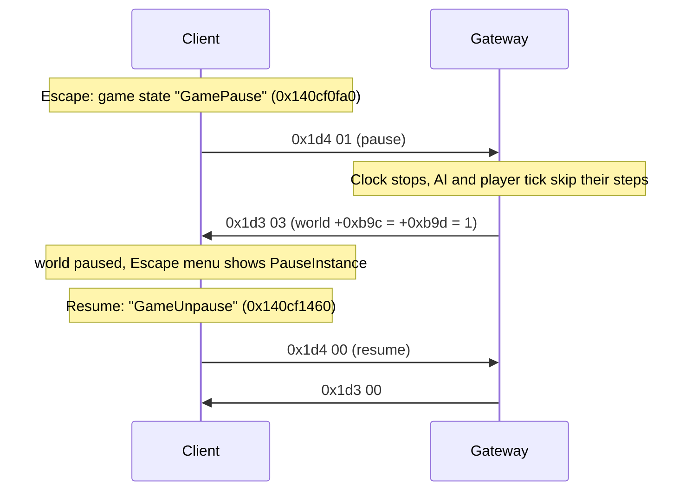

# 22. Pause (the Escape menu)

State of 2026-10-21: pressing Escape outside towns and hideouts pauses the area. The client asks with C→S 0x1d4, the
Gateway stops the connection's clock and answers S→C 0x1d3, and the client pauses its world. Closing the menu resumes it
the same way. Live verification: see the end of this document.

## 1. C→S 0x1d4: the client asks

Opening the Escape menu enters the game state at `0x140cf0fa0` (logs "GamePause", builds the Escape menu `0x1402765e0`)
and calls the instance client's vtable `+0x20`, `0x142162cb0`. Closing it ("GameUnpause", `0x140cf1460`) calls
`0x142162d20`. Both:

1. return unless `0x142142b60(world)` allows a pause. It refuses when the area (WorldAreas row at world `+0xb0`) is a
   town (`+0x14`), a hideout (`+0x139`), has `+0x14e` set, is one of three areas by HASH16 (`0xb5be`, `0x3064`,
   `0x8f53`), has a flag at `+0x1e4 == 0x33`, or when `0x1400f2340` / `0x140d61be0` match (area tags 4 and 5);
2. count opens at instance `+0xcf24` and send only on the first open (`+0xcf24` becomes 1) and the last close (back to 0);
3. send class `0x1435bf670` (write `0x140e29080`): **u16 id 0x1d4, u8** (1 = pause, 0 = resume), and flush.

So the client never asks in town or in a hideout. The Gateway checks again (`SetPaused`: WorldAreas `IsTown` or a
hideout area) and logs a refusal instead of pausing.

## 2. S→C 0x1d3: the server pauses the world

A world-group message (factory `0x1421c6150`, class `0x1435ddb98`, read `0x1421c4350`, write `0x1421c42e0`): **u8
flags**, bit 0 → message `+0x20`, bit 1 → `+0x21`. The world handler `0x142187480` (`id == 0x1d3`) calls world vtable
`+0x1d8` with both. The base world (`0x142186f90`) only stores them at **world `+0xb9c` / `+0xb9d`**; the client's world
(`0x14165e590`, vtable `0x14346e098` slot `+0x208`) also, when "both set" changes, switches the "Pause" environment
(Environments.dat) on or off and stops or restarts its sound handles. The handler then tells the listeners at
`world[0x12d] + 0xb078` about `+0xb9c`.

Readers of the flags: the Escape menu's update `0x140278520` shows its PauseInstance image while both are set; the
instance tick `0x142148880` and several world and UI functions test `+0xb9c` (`0x14011dcc0`, `0x14011e0b0`,
`0x14011e950`, `0x14167b8a0`, `0x14172bd00` …).

Being a world message, 0x1d3 is queued until the world is active ([03](03-area-and-world.md) §4).

The Gateway sends `01D3 03` to pause and `01D3 00` to resume (`InstancePause.State`).

## 3. What the Gateway pauses

Per connection (one connection is one area), `ClientState.Paused` is "the Clock is stopped":

| What | While paused |
|---|---|
| `Clock` (a `Stopwatch`) | stopped: walk estimates, skill cooldowns, attack readiness, flask effects (`FlaskEffects.Advance(last, now)` sees no time pass) stand still |
| `RunMonsterAi` | skips its steps: monsters neither chase nor start swings |
| `RunPlayerTick` | skips its steps: no regeneration, no Righteous Fire burn, no waypoint activation |
| `MonsterSwing` | a swing started before the pause waits (`WhilePaused`) and lands after the resume |
| player projectiles | cast release, swept flight collision and impact cleanup use the stopped game clock; damage commits defer while paused (2026-10-25, automated checks and live flight/stop verification) |
| ticks 0x1b / acks 0x1c | still answered |

Live projectile check (2026-10-25): the native cell remained (289, 220) throughout a 1.2-second pause.
The projectile was not removed during pause and completed its flight and cleanup after resume.

## Open

- What the two flags mean apart: the client pauses only with both set, and the Gateway always sends both.
- Other delayed player hits still use wall-clock timers; projectiles now wait through pause as described above.
- Other delayed-hit and pause combinations still need live coverage.
