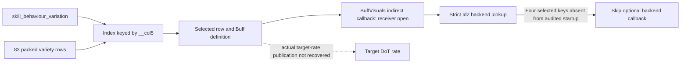

# AddBuffToTarget: variety data, native indexing and callback boundary (3.29.3b)

## Result and scope

`AddBuffToTarget` has a positive table-to-native connection: its registered metadata callback reads
`skill_behaviour_variation`, looks that value up in the loaded variety index, and forwards the selected row.
The index key is **`__col5`, not the table row number**. The 83 keys are unique and include the sparse value 1000.

Four variety rows refer to base incoming physical/chaos damage rates. Their Buff backend keys all miss the
[previously audited startup catalogue](client-buff-default-backend.md), so the selected optional backend-callback
arm is skipped. This does not identify an actual target-rate contribution or prove the whole function has no
numerical consequences: its earlier BuffVisuals callback is indirect and remains a separate boundary.

Original R2/R3/R4 remain Partial. This is an action configuration/callback connection, not recovered DoT
infliction, instance selection, aggregation, shared-cap publication or expiration withdrawal.
All addresses below are preferred VAs in the pinned original 3.29.3b executable, image base `0x140000000`, SHA-256
`78a0e227189c263658a7f65a02f086428b859bfc114ae8e7ce8aab721ebd48d5`.
No client execution, attachment, new capture or server implementation was performed.

## Registration and selected row

Registration `0x141973a60` passes the ASCII name `AddBuffToTarget`, action factory `0x141989940`, metadata
callback `0x141989800`, and coverage argument zero to `0x141941bb0` at `0x141973a7c`.
The [existing registrar contract](client-ranged-action-selection.md#startup-registration-and-replacement-order)
means both registry variants are installed. These variants are not client/server mode labels.
This binds the registration, not a recorded invocation of that callback by a live skill.

In `0x141989800`:

1. Provider slot zero is called at `0x141989830` with native key **6433**, `skill_behaviour_variation`.
   The returned integer is retained in EBX and copied to the lookup key at `0x14198987c`.
2. The exact UTF-16 literal `Data/AddBuffToTargetVarieties.dat` is passed through resource loader
   `0x1419e9a60` at `0x14198986c`.
3. The unwrapped resource's `+0x20` index is searched by `0x140215a00` at `0x1419898a1`.
   The result is compared with the resource's `+0x28` sentinel. A found entry supplies its row pointer from `+8`.
4. The row is passed as R9 to `0x141e517a0` at `0x14198990b`; the original provider and other two inputs are retained.

On a lookup miss, this caller supplies null R9. The helper reads `[r9]` at `0x141e517ba` before checking the loaded
definition pointer. Therefore **a safe invalid-variation/no-op contract is not established**. Do not convert this
observation into graceful fallback behavior or assert a live crash without examining the invocation contract.

## Exact loader and packed layout

On a cache miss, `0x1419e9a60` calls `0x1419e9ca0` at `0x1419e9b75`.
The latter supplies `0x1419e9ea0` and `0x1419e9f40` to `0x1421d0f20` at `0x1419e9e65`.
The first calls the actual table loader `0x14239a230` at `0x1419e9eee`; the second cleans up table storage.
These are loader/destructor callbacks, not damage-instance callbacks.

The PoE1 schema (`validFor=1`) gives this packed record layout:

| Field | Offset | Bytes |
|---|---|---|
| BuffDefinitions foreign row | `0x00` | 16 |
| `__col1` integer array count/pointer | `0x10` | 16 |
| StatsKeys foreign-row array count/pointer | `0x20` | 16 |
| `__col3` integer | `0x30` | 4 |
| `__col4` integer array count/pointer | `0x34` | 16 |
| **`__col5` integer** | **`0x44`** | **4** |
| `__col6` integer | `0x48` | 4 |
| `__col7` integer array count/pointer | `0x4c` | 16 |

The native loader independently multiplies the declared row count by **`0x5c`** at `0x14239a365`.
It checks the data marker, provisions storage, and calls `0x14239a6e0` at `0x14239a491` to copy/fix up records.
That helper resolves the definition foreign row, rebases array storage, and resolves each StatsKeys foreign row.
Its record loop advances by `0x5c` at `0x14239a853/0x14239a863`.

The index-building loop then computes `rowBase + ordinal * 0x5c` at `0x14239a4f0`, reads the integer at `+0x44`
at `0x14239a4f7`, pairs it with that exact row pointer, and calls index insertion `0x1422298e0` at `0x14239a510`.
This closes the previously unknown column-to-map-key connection. The remaining unknown columns are not given
invented gameplay meanings.

## Incoming-rate declarations and backend lookup

The following inventory exhausts rows in this table whose StatsKeys include one of the five exact
`base_<type>_damage_taken_per_minute` keys. It does not exhaust all possible DoT sources.
Rows/references in extracts are zero-based; native Stats keys are row plus one.

| Variety row | Variation key | BuffDefinitions row / Id | Native rate key | Id2 |
|---|---|---|---|---|
| 42 | 43 | 1811 / `ultimatum_pale_ape_degen_aura` | 356, physical | empty |
| 43 | 44 | 1812 / `ultimatum_pale_ape_degen_aura_ruin` | 356, physical | `GainUltimatumRuinOverTime` |
| 53 | 54 | 2240 / `ancestral_deathcaster_totem_aura` | 456, chaos | empty |
| 72 | 73 | 2380 / `corrosive_shroud_aura_stacking` | 456, chaos | empty |

All four definitions have `IsRecovery=false`; their GrantedStats match the variety StatsKeys.
That correspondence is a declaration, not an instance damage magnitude or a native contribution write.

`0x141e517a0` first reads the definition from the row. When nonnull, it passes definition `+0x55` (BuffVisualsKey)
and the original third input through a global object's virtual `+0x10` at `0x141e517de`.
The selected receiver and its effects are not closed here; a missing global instead enters a failure helper.

The helper then gets the existing backend registry through `0x141e06110` and calls `0x141e05e40` at
`0x141e517f7`, forwarding the selected row as the fifth argument.
As already established by the R12 audit, that function reads definition `+0x74` (Id2), hashes the UTF-16 bytes,
performs strict name lookup, and calls factory virtual `+8` only on a hit.
The audited startup has **137 registration sites / 120 distinct names**, including neither an empty name nor
`GainUltimatumRuinOverTime`. Thus all four selected keys miss that catalogue and skip this optional callback arm.
No new global registry-completeness or later-mutation claim is made.

## Evidence and next boundary

Private audit `r73-addbuff-varieties.py` retains the original function records, 42 exact instruction anchors,
six RIP-relative targets, two original literals, the PoE1 schema layout and all four selected row bindings.
`r73-addbuff-varieties-fresh.py` independently rereads those records and pinned inputs.
The immutable R12 registry and strict lookup evidence are reused without executing their producer scripts.
Exact hashes and verification results are indexed in the [evidence manifest](client-damage-evidence.json).

Do not repeat the completed table-key or default-backend investigation as an unresolved numerical producer.
A useful continuation must bind an actual target/provider/source token and amount, or identify the relevant
indirect callback receiver. Neither the action name nor a StatsKeys declaration alone closes that edge.
