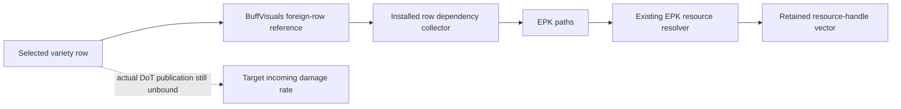

# AddBuffToTarget's selected BuffVisuals receiver collects dependencies (3.29.3b)

## Result and boundary

The remaining indirect BuffVisuals callback in the [variety-row investigation](client-addbuff-varieties.md)
has a concrete installation and receiver. Under that installation it traverses BuffVisuals resource references
and collects retained resource handles. The original third metadata input is the destination handle vector,
not an established target Entity or damage amount.

For the four incoming-rate variety declarations, the selected BuffVisuals rows supply **1, 1, 1 and 2 `.epk`
references** to the already recovered [EPK dependency collector](client-stat-preload-epk-collector.md).
This closes this selected callback receiver. It does not close actual DoT infliction, instance arbitration,
target-rate publication, shared cap or withdrawal. Original R2/R3/R4 remain Partial.

The result concerns original client 3.29.3b bytes, preferred image base `0x140000000`, executable SHA-256
`78a0e227189c263658a7f65a02f086428b859bfc114ae8e7ce8aab721ebd48d5`.
No client launch, attachment, new capture or server implementation was performed.

## Bind the installed callable, not just its default table

The original image contains pointer `0x144499878 → 0x144499840`, an inline callable with default table
`0x1435a5698`. Its invocation slot `+0x10 → 0x140125860` simply returns true.
That default is not assumed to remain installed.

Installation body `0x141599660` gives the same callable a different implementation:

1. `0x14159967a/0x141599683` construct a temporary with table **`0x14345e928`**.
2. The actual call at `0x14159969f` enters copy/move leaf `0x1415baea0`. That original 14-byte leaf installs
   the same table at the supplied destination and returns the destination pointer.
3. The first installation block handles the previous inline callable and installs the new one into the global
   object. Stores at `0x141599730`, `0x141599755`, and `0x141599778` all address pointer `0x144499878`.
4. Three bounded original-instruction interpretations, using the original image's default/inline inputs and
   different stack locations, each leave the pointer at `0x144499840` with table `0x14345e928`.
   They stop before the next installation block. This is a conditional installation contract, not a live-state claim.
5. New table `+0x10` selects the exact five-byte thunk **`0x1415bae90 → 0x141599a80`**.

The no-unwind copy/move and invocation leaves have actual call/table-entry anchors; they are not guessed
function starts. Original default copier `0x141e64720` is separately anchored by table `0x1435a5698+8`.

The bounded RIP-reference inventory found 118 selected MOV/LEA references in 78 unwind owners, including
the three stores above. Its limited encoding coverage is not a proof that every possible writer was found,
nor does this installation exclude later callable replacement.

## What that receiver consumes and produces

`0x141e517a0` passes a reference to definition `+0x55` (BuffVisualsKey) as R8, and the original third metadata
input as RDX, through the global callable's `+0x10` at `0x141e517de`.
In selected receiver `0x141599a80`, R8 is retained in R14, RDX in RSI, and `[r8]` supplies the BuffVisuals row.

The PoE1 BuffVisuals schema and original loads agree:

| Schema field | Count / pointer or reference offset | Selected receiver behavior |
|---|---|---|
| EPKFiles1 | `+0x10 / +0x18` | Walk nonempty UTF-16 path pointers and call the EPK collector |
| EPKFiles2 | `+0x20 / +0x28` | Same |
| MiscAnimated1 / MiscAnimated2 | `+0x49 / +0x59` | Pass nonnull references to `0x141e4f370` |
| EPKFiles | `+0x92 / +0x9a` | Walk path pointers and call the EPK collector |
| BuffVisualOrbs | `+0xa2 / +0xaa` | Traverse nested resource references |
| EPKFile | `+0x71` | Pass a nonempty path to the EPK collector |
| WeaponEffect | `+0xc2` | Traverse its configured resource paths |

The two first loops call global **`0x1444998f8`** through `+0x10` at `0x141599aec/0x141599b44`.
Its concrete installation and handler **`0x1415bad30`** were already closed by R15. That evidence is reused:
the handler checks the `.epk` suffix, resolves the resource through `0x1412d5a90`, and appends a retained handle
to the destination vector, directly or through its capacity-growth path.
The handler's boolean return does not supply a damage amount to these loops.

The separately recovered `0x141e4f370` likewise resolves a resource through `0x140d25b50` and appends its retained
pointer to the same vector: store `0x141e4f406`, end increment `0x141e4f410`, or growth at `0x141e4f41f`.
This positively identifies the dependency-retention category; rendering and package internals are not expanded.

## Four actual data bindings

The definition-to-visual relationship is a foreign-row reference, not an assumption that both Id strings match.

| BuffDefinitions row | BuffVisuals row / Id | EPKFiles1 count | EPKFiles2 count |
|---|---|---:|---:|
| 1811 | 1540 / `ultimatum_pale_ape_degen_aura` | 0 | 1 |
| 1812 | 1541 / `ultimatum_pale_ape_degen_aura_ruin` | 0 | 1 |
| 2240 | 1998 / `ancestral_deathcaster_totem_aura` | 1 | 0 |
| 2380 | 2109 / `corrosive_shroud_aura_monster` | 1 | 1 |

In these four rows EPKFiles, EPKFile, BuffVisualOrbs, MiscAnimated1/2 and WeaponEffect are empty/null.
Their selected paths end in `.epk`; the retained audit records the exact paths and table identities.
These are data/code bindings, not observations that every asset was requested or loaded during gameplay.

## Verification, reuse and next action

Private `r74-buff-visuals-bind.py` retains **11 function identities / 13 ranges / 955 linear disassembly records**,
39 semantic anchors, five RIP bindings, seven pointer values and the four data bindings.
The three installation controls interpret 306 original instructions in total.
They reuse only the AST definition of R15's bounded `Swap` interpreter, adapting register aliases, the allowed
move/destructor targets, entry and stop for this first installation block. R15's module initializer/producer
does not execute. The original-default/inline setup and shared interpreter limits remain explicit;
all selected destructor inputs have DL=0. These are not native runtime executions or independent emulator engines.

`r74-buff-visuals-fresh.py` independently rereads the original bytes, anchored leaves, pointer slots, schema,
actual BuffVisuals rows and earlier evidence. Exact hashes and retained results are in the
[evidence manifest](client-damage-evidence.json).

Stop this dependency-collection branch. Do not label it an unresolved numerical producer or infer that all
other client paths lack numerical consequences. The next useful evidence must bind a target/provider/source
identity and magnitude to rate publication/removal, or connect an accepted Hit to its numerical resource effect.
