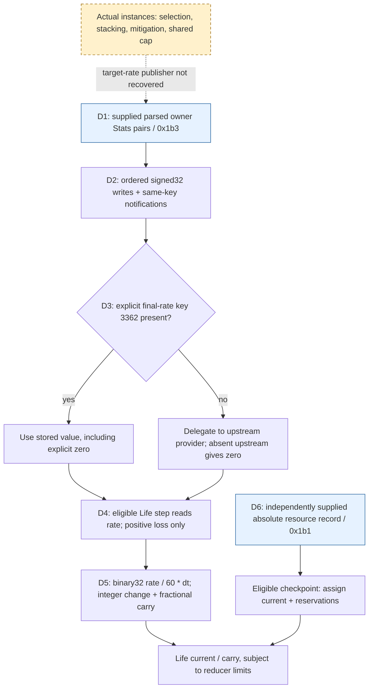
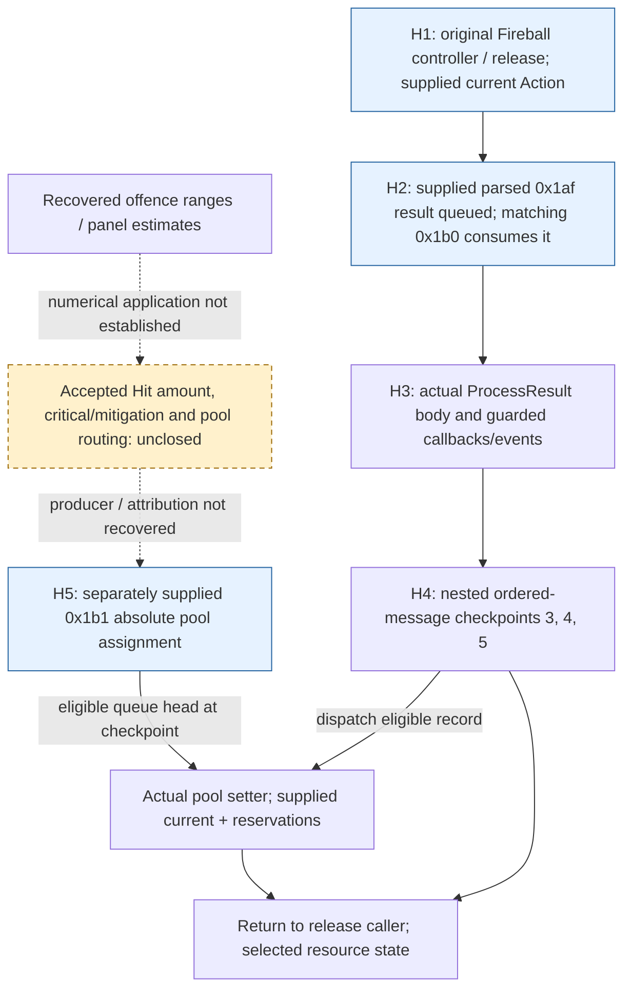

# Client Hit / DoT research: first baseline (3.29.3b)

Start here for PR #371. The client **integrates received continuous resource rates**
and **accepts independent absolute resource assignments**. A Fireball result can
consume an assignment at a nested message checkpoint; this does not identify a
locally calculated Fireball damage amount. Original R2/R3/R4 remain Partial.

This is version-pinned static dataflow and offline original-instruction
interpretation, with supplied states. It is not an official-server trace or live
parity test. Addresses use preferred image base `0x140000000`.

## Reading order

1. Read the two paths and examples below. Solid arrows are established **under
   the listed guards**; dotted arrows are missing connections. Blue nodes are
   supplied inputs; amber nodes are unresolved. Color never substitutes for a label.
2. Open the linked composition reports to inspect instructions, fixtures and
   coverage. The [combat protocol](../protocol/29-client-combat-signals.md)
   separates message fields from their consumers.
3. For server calculation work, use the [formula map](#reusable-calculation-layer)
   separately from the receiving contracts. The
   [full investigation](client-damage-calculation.md) retains supplementary findings
   and the original R0–R4 ledger; it is not the required first reading.
4. The [delivery workbench](client-damage-delivery.md) owns readiness and the
   parked queue. [Evidence review](client-damage-evidence-review.md) explains the
   machine files, local-only records and validation limits.

## DoT: received target rate to Life

The correction arrow denotes an independent operation, **not a fixed end-of-step
overwrite**. Its actual placement depends on queue eligibility and mode. Initial
Stats component bytes are a second established input route; the diagram selects
the parsed-update composition rather than claiming a captured official packet.

| Edge | Input → output and conditions | Original anchor / supporting report |
|---|---|---|
| D1 → D2 | Eligible parsed owner record → target Stats provider, then pairs in vector order. Supplied active ordered queue, lookup/TLS and available existing-key storage | World `0x142183840` → dispatcher `0x142187480`; provider load `0x1421881b6`, pair call `0x1421881dd`; [network composition §1](client-network-rate-composition.md#1-positive-composition) |
| D2 → D3 | Signed32 key/value → store, then subscriber dispatch; explicit values take precedence over fallback. Observational subscriber is supplied; complete application subscriber graph is not replayed | Setter/store `0x1424cfaf0` / `0x1424cfb68`, notifier `0x1424cfd00`, getter `0x1424cfa40`; same report |
| D3 → D4 | Life's retained provider → key 3362 `total_damage_taken_per_minute_to_life`. Absent-key upstream numerical return is supplied, not a recovered instance calculation | Same provider construction in [initial Stats](client-initial-stats-rate.md); full step `0x141e6ae70`, read `0x141e6afa9..0x141e6afb1` |
| D4 → D5 → pool | Positive rate and supplied seconds → negative floating delta → integer current and carry. Witnesses use living, below-capacity states and zero other loss/protection inputs | Life reducer `0x141e6a8a0`, common helper `0x141e6a6b0`; [network composition §3](client-network-rate-composition.md#3-numerical-witnesses-and-what-is-not-recomputed), [timing](client-damage-timing.md#resource-ordering-inside-life) |
| D6 → assignment → pool | Independent parsed current/reservations → selected Life/Mana/ES pool at an eligible checkpoint. Positive assignments and supplied bit 4 exclude separate loss-listener/sign-transition branches in these controls | Actual setter `0x141e69fb0`, Life call `0x1421880e6`; [resource/checkpoint composition](client-resource-checkpoint-composition.md) |

### Numerical witness and rate changes

All rows below are **separate controls** starting at integer Life `100`, carry
`0.25`, maximum `1000`, no reservation and zero other rates/protections. The supplied
`dt = binary32(0.033)` is a fixture, not a measurement or requirement for official
33 ms steps. Here `6000/min = 100/s`; the first negative delta is approximately
`-3.3`. Away from limits, the common helper combines delta and carry, truncates
the signed whole change toward zero, updates integer current and retains the
fraction. It does not round every small loss away or accumulate a minute quota.

| Pairs consumed before the eligible loss read | After step 1: current / carry | After step 2: current / carry |
|---|---|---|
| `3362=6000` | `97 / -0.0499999523` | `94 / -0.3499999046` |
| `3362=6000`, then `3362=0` | `100 / 0.25` | `100 / 0.25` |
| `3362=0`, then `3362=6000` | `97 / -0.0499999523` | `94 / -0.3499999046` |
| Raw fire key `2023=6000`, explicit final `3362` remains zero | `100 / 0.25` | `100 / 0.25` |
| Old recovery `6000`; receive recovery `1422=0` and loss `3362=6000` | `101 / -0.75` | `97 / -0.0500001907` |

The last row preserves the recovery amount captured before the checkpoint,
then uses the updated loss. `101 - 0.75 = 100.25`; collapsing gain and loss into
one net rate would lose the native intermediate representation and callback order.
The full Life step has another checkpoint at `0x141e6af61` before loss reads;
recovery capture and each later channel's reads are distinct. This is not arbitrary
sub-frame time splitting. Repeated writes notify sequentially, including a temporary
value, while the later loss read sees the final stored value in these controls.
Nonpositive stored loss does not enter the positive-loss branch.

**Independent correction example:** a separate recovery composition starts with
the same pool/carry, recovery `6000/min` and the same `dt`. At checkpoint `0x4001`,
a parsed record assigns Life `250`; subsequent gain ends at `253` with carry
`0.5499999523`. With captured recovery zero, that assignment ends at `250 / 0.25`.
Assignment itself preserves carry. The surrounding Life nonpositive→positive
transition separately resets it; do not generalize carry preservation to revival.
A later `0x4002` assignment can be consumed by Life's gain-wrapper checkpoint,
but remains pending in the selected Mana/ES paths. See
[the complete correction cases](client-resource-checkpoint-composition.md#numerical-witnesses).
These correction and loss examples are not a claimed single captured sequence.

**Boundary:** selected Buff removal/expiry controls can leave an explicit aggregate
rate intact, and a separate Stats update can stop loss while a Buff remains
([Buff/rate independence](client-buff-rate-independence.md)). That establishes
separate receiving contracts under supplied empty callbacks, not a universal rule
that Buffs never update rates. Actual source selection, strongest-instance rules,
aggregation/shared cap and rate withdrawal remain the missing upstream edge.

## Hit: one Fireball continuation and independent resources

H1/H2 inputs include prepared queue/order state, source/target bindings, motion
storage, current Fireball Action and empty listeners/events. The two interpreters
share byte memory; their ABI bridge executes the original consumer and checks
register/stack preservation. This is a conditional composition, not an official
wire replay or a complete Action/World construction.

| Edge | Input → output and conditions | Original anchor / supporting report |
|---|---|---|
| H1 → H2 | Original controller/release reaches checkpoints 1 and 2; supplied `0x1af` stamp 1 queues a result, matching `0x1b0` stamp 2 consumes it with one/three motions | Actor `0x141e939c5` / `0x141e93f3c`, motion preparation `0x141bb23df`; fixed peer R60 and [Hit/checkpoint report §1–2](client-hit-checkpoint-resource-composition.md#1-fixed-upstream-evidence-and-the-new-connection) |
| H2 → H3 | Actual result and existing Action/provider arguments → original `ProcessResult`, then original caller return | Call `0x141e90ec4` → `0x141e91580`; [composition and bridge](client-hit-checkpoint-resource-composition.md) |
| H3 → H4 | Guarded result processing → World calls at early/later/exit positions, with shared counter/TLS state | `0x141e915cf`, `0x141e91da7`, `0x141e92273`; [checkpoint table](client-hit-checkpoint-resource-composition.md#2-the-nested-checkpoints-are-application-opportunities-not-frames) |
| H4 + H5 → store | Supplied active nonzero-mode ordered queue and eligible head → selector 0/1/2 routes Life/Mana/ES assignment. Future head remains pending | Dispatcher `0x142187480` → setter `0x141e69fb0`, store `0x141e69fd1`; [numerical witness](client-hit-checkpoint-resource-composition.md#3-numerical-witness-an-assignment-can-land-inside-result-processing) |
| H3 → feedback/return | Hit-data gate selects callbacks/events; critical-feedback mask is a qualifier, not a computed damage amount. Empty listeners/configurations in this composition | Callback sites `0x141e92053` / `0x141e920ae`; selected Fireball slots are no-op `0x1400f0f00`; [result qualifiers](client-hit-result-qualifiers.md) |

### Numerical witness

Start all pools at current `100`, carry `0.25`, reservation zero. Baseline cases
vary channel 0/10, one/three motions, hit-data and critical-feedback mask 0/`0x20`:
with supplied empty listeners/events, all resources stay unchanged. Independently
queue a Life-selector record assigning `70`, with bit 4 excluding the separate
loss-listener path:

| Assignment stamp | Applied before result returns? | Life current / carry | Consumed records |
|---:|---|---|---:|
| 3, 4 or 5 | Yes, at the corresponding nested checkpoint | `70 / 0.25` | 3 |
| 6 | No, future record stays queued | `100 / 0.25` | 2 |

Thus `100→70` is an **absolute assignment of 70**, not proof of a 30-damage
Fireball. The five checkpoints are ordering opportunities in one supplied
dispatch, not five ticks or a 33 ms measurement. Zero motions leave the result
queued and do not enter `ProcessResult`. Nonempty scripts/listeners and other
scheduling modes require their own evidence; unchanged fixture pools do not
prove whole-client absence of numerical damage code.

### PR #373 reuse and responsibility limits

The [comparison report](client-damage-pr373-comparison.md) pins head
`b0afa90ea5c58e9082099d887180df8299dcdaf3` and hashes its exact source reports.
Its raw captures/decoder are unavailable here; ten reported ordinary hits losing
4 Life and one critical losing 5, plus approximately 33 ms arrival steps, remain
author-reported observations. They do not recover damage rolls, critical factors
or tick frequency. The separately corroborated `0x1b4` branch updates skill Stats;
it is not a shot trajectory or a numerical damage packet.

Fixed projectile R60 `4e9c9a39363a8de49c672d1c2c393a11e7a4fe20` supplies the
release/checkpoint upstream; its 106-file snapshot is retained and hash-checked
locally, without a public-availability claim. Its standalone audit was not rerun.
The receiving side demonstrably accepts external rates and resource totals.
Who computed each official total, and whether another client path independently
computes an accepted Hit amount, remain separate research questions.

## Reusable calculation layer

| Future server question | Recovered reference and remaining qualification |
|---|---|
| Base versus added attack/spell damage, conversion histories, scaling order | [Attack equations](client-attack-hit-formulas.md), [spell equations](client-spell-hit-formulas.md), [offence estimates and UI consumers](client-offence-estimates.md). These are formulas/ranges, not a concrete accepted Hit or RNG sample |
| Resistance/reduction, DoT healing exceptions and Life/Mana/ES routing | [Typed DoT routing](client-dot-routing.md), [maximum-resistance equations](client-maximum-resistance-inputs.md). Native callback arithmetic is distinct from ordinary network-entity evaluation eligibility and source publication |
| Ailment magnitude, snapshot/dynamic distinctions and duration | [Ailment formula map](client-ailment-outgoing-formulas.md), [instance rules](client-dot-instance-rules.md), [duration inputs](client-ailment-duration-inputs.md). Versioned mechanic explanations and native calculations have different evidence classes; instance arbitration remains open |
| Stat lookup/update versus re-evaluation; correction order | [Stat evaluation](client-stat-evaluation.md), [timing](client-damage-timing.md), [read order](client-resource-read-order.md). Explicit overrides can bypass upstream calculations; no single end-of-frame overwrite or universal input snapshot is established |

Preserve these distinctions when designing a server. This baseline documents
reusable numerical contracts and their missing connections; it neither imports
PR #373's server mechanics nor implements a new combat system.
