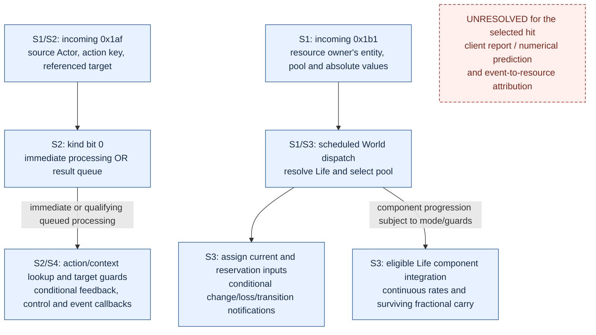

# One-hit authority contract: established static obligations

## Status and evidence keys

This is the static part of Q1 and a partial Q2 diagram under the
[workbench](client-hit-authority-contract.md).
It does not pass either gate: the [Q0 witness and networking mode](client-hit-authority-evidence.md)
are still missing, and the client-to-server contribution for that witness is unresolved.
The two incoming paths below are established separately; their coexistence is not hit attribution.

All S sources are pinned to PR #371 at `801358d732adbc558d657d8773e273a02bc891b1`.
Addresses identify client 3.29.3b at preferred image base `0x140000000`, executable
SHA256 `78a0e227189c263658a7f65a02f086428b859bfc114ae8e7ce8aab721ebd48d5`.

| Key | Evidence and scope |
|---|---|
| S1 | [Combat signals](https://github.com/LocalExile/LocalExile/blob/801358d732adbc558d657d8773e273a02bc891b1/Agents/docs/protocol/29-client-combat-signals.md): message readers, dispatch and distinct resource/stat effects |
| S2 | [Hit feedback](https://github.com/LocalExile/LocalExile/blob/801358d732adbc558d657d8773e273a02bc891b1/Agents/docs/re/client-hit-feedback.md): action identity, immediate/queued paths and conditional processing |
| S3 | [Timing](https://github.com/LocalExile/LocalExile/blob/801358d732adbc558d657d8773e273a02bc891b1/Agents/docs/re/client-damage-timing.md): mode-dependent ordering, assignment, fractional state and notifications |
| S4 | [Received-result qualifiers](https://github.com/LocalExile/LocalExile/blob/801358d732adbc558d657d8773e273a02bc891b1/Agents/docs/re/client-hit-result-qualifiers.md): target admission and mutable feedback fields, not damage deduction |
| S5 | [Resource boundary](https://github.com/LocalExile/LocalExile/blob/801358d732adbc558d657d8773e273a02bc891b1/Agents/docs/re/client-hit-resource-boundary.md): numerical receiver bindings and selected player/Sand Spitter source chains; no established accepted-hit deduction edge |
| S6 | [Contact production](https://github.com/LocalExile/LocalExile/blob/801358d732adbc558d657d8773e273a02bc891b1/Agents/docs/re/client-hit-production.md): concrete Sand Spitter action/factory/ordinary table binding, reused for the narrow callback check below |
| H1 | [PR #373 report](https://github.com/LocalExile/LocalExile/blob/b0afa90ea5c58e9082099d887180df8299dcdaf3/Agents/docs/dev/ranged-monster-actions-port.md#live-reference-official-servers): author-reported historical traffic; raw records unavailable |

Ten selected inherited audit functions, 21 ranges and 3,020 instruction byte strings
were rechecked against the executable without rerunning their producers.
These checks authenticate the reused reader/identity/setter/scheduler evidence;
they are not a new runtime observation or an independent causal trace.

## Separate incoming contracts

Blue means a conditional static path is established, not that this hit was observed.
The separate red node is a mandatory gap, not an optional omitted mechanic.
There is deliberately no proven edge from feedback processing to pool assignment.
The diagram establishes neither message arrival order nor a per-hit packet count.
The sibling assignment/integration branches do not specify a universal order between them.

## Identity and field contract

Offsets below are decoded memory offsets, not wire positions.
The common reader is `0x141f92000`; multi-byte scalar wire fields are big-endian.

| Message / input | Consumer meaning | Conditional obligation for a compatible sender |
|---|---|---|
| Common header: u32 entity, u32, u16 | Decoded `+0x10` selects the addressed entity; `+0x14/+0x18` participate in scheduling (S1-S3) | Address the correct owner. Preserve scheduling conditions; do not substitute a guessed damage seed/event ID for these fields. |
| `0x1af`: u16 sequence, first u8 phase, second u8 selector | Record `+0x40/+0x43/+0x42`; sequence matches action `+0x11a`, phase participates in queued retrieval, selector chooses primary/secondary action (S2) | Match the intended action instance/context. Neither `0xffff` nor selector 2 is a proven universal value. |
| `0x1af`: u32 referenced entity | Record `+0x44` resolves the target and distinguishes exact queued results (S1/S2) | Keep the feedback target distinct from the source Actor addressed by the header. |
| `0x1af`: u16 mask and u8 kind | Mask `+0x36`; kind bits 0/1 decode to `+0x48/+0x49`; duration/code/direction and extra fields are conditional (S1/S4) | Serialize the chosen branch exactly. Kind 3 selects immediate handling plus the hit-data fields; it is not a numerical damage amount. |
| `0x1b1`: u32 current, u32 flat reservation, u8 pool, u16 percentage reservation, u8 notification flags | Decoded `+0x20/+0x24/+0x28/+0x2a/+0x2c`; selector 0/1/2 chooses Life/Mana/ES (S1/S3) | Supply absolute pool state and reservation inputs for the resource owner. The last byte affects notifications and is not a second damage value. |

For a monster hitting a player, the feedback header addresses the monster Actor
and its referenced entity identifies the player; a player resource assignment
instead addresses the player itself.
H1 reports those roles but supplies no independently checked single-event record set.
In the audited resource reader and setter, no action sequence/selector is read as
a join key to `0x1af`; this is a bounded consumer finding, not proof that all
possible protocol/contextual attribution mechanisms have been exhausted.

## Responsibilities and application conditions

| Concern | Established client responsibility | Established server-facing boundary / remaining limit |
|---|---|---|
| Contact and numerical outcome | Local contact/avoidance paths exist, but they do not establish accepted-hit numerical loss (S1/S5) | H1 alone cannot establish who computed the accepted damage or whether this event required a C-to-S report. No per-hit report is assumed present or absent. |
| Received feedback | Resolve action/context and target; process selected qualifiers and callbacks (S2/S4) | Incoming flags are inputs to local control admission. They can be rewritten before later listeners; receiving a critical flag does not prove a local critical roll. |
| Resource state | `0x142187480` selects the embedded pool, then `0x141e69fb0` assigns current/reservations (S1/S3) | The received values are authoritative inputs to this assignment path. Their production, frequency and attribution to this hit remain unproven. |
| Recovery between assignments | Life component `+0x40` enters `0x141e6a190`, integrating eligible Life, ES and Mana paths (S3) | The client can change resources between messages. A resource difference is not necessarily the amount of one hit. |
| Recharge delay | A qualifying decrease invokes pool loss notification when `(message[+0x2c] & 0xfd) == 0`; routing/stat guards determine ES delay effects (S3) | Choosing notification flags affects behavior beyond the displayed integer. The correct official value for this witness still requires evidence. |
| Action mismatch | Immediate processing can forward a null action and empty associated context (S2) | Visible target feedback alone cannot prove that the action key was correct. |
| Result retention and duplicates | Immediate and exact-key queue-removal paths differ; queued stage/end filtering retains ordinary records in the audited nonzero-mode paths (S2) | Do not infer universal duplicate suppression, exactly-once processing, or consumption merely because an action stage advanced. |
| Resource reassignment and transitions | The audited setter body preserves carry; Life nonpositive-to-positive handling separately resets carry and invokes transition callbacks (S3) | An absolute message is not a damage delta or a general history-replay instruction. Equal values and repeated messages still require surrounding-state analysis. |

## Ordering is conditional on networking mode

| Static condition | Proven application order | Unsupported shortcut |
|---|---|---|
| Predictive, World `+0x984 == 0` in `0x142183ce0` | Dispatch queued World messages, clear that queue, then update eligible entity components (S3) | This does not cover unread socket data, HUD timing, or guarantee a fixed 33 ms client step. |
| Queued-frame branch, nonzero mode | Advertised durations drive steps; header/cursor guards interleave messages with entities/components (S3) | Arrival order alone does not specify assignment relative to resource integration. |
| During eligible Life integration | Pool work can use saved rates and later resource state; component checkpoints have additional established insertion conditions | A synthetic checkpoint/resource composition is not evidence that H1 used that checkpoint or that Predictive admits arbitrary mid-component insertion. |

The last row reuses the disclosed offline
[checkpoint composition](https://github.com/LocalExile/LocalExile/blob/801358d732adbc558d657d8773e273a02bc891b1/Agents/docs/re/client-resource-checkpoint-composition.md).
Its supplied records and numerical fixtures are not official recordings.
This batch does not repeat the projectile owner's scheduling analysis.

## Selected Sand Spitter callback edge

For static analysis, choose the reported Sand Spitter action under **Predictive** as an explicit
analysis condition; this does not recover the networking mode of H1's historical capture.
S6 binds `MMASandSpitterProjectile` (GrantedEffects 617, ActiveSkills 537) to
`MonsterMortarAttack`, registration `0x141266030`, factory `0x1412b0260` and ordinary
final table `0x143359808` stored at `0x1412b0352`.
The selected clone `0x1414005b0` restores the same table.

The result consumer has two guarded calls: `0x141e92053` to action `+0x2d0`, then
`0x141e920ae` to action `+0x2d8`, with the source signal dispatch between them.
Both require a non-null action and decoded record `+0x49 != 0`.
Fresh original-file checks close these two callbacks for that concrete ordinary table:

| Table slot VA | Original file offset | Pointer bytes (little-endian) | Target |
|---|---|---|---|
| `0x143359ad8` (`+0x2d0`) | `53841624` | `00 0f 0f 40 01 00 00 00` | `0x1400f0f00` |
| `0x143359ae0` (`+0x2d8`) | `53841632` | `00 0f 0f 40 01 00 00 00` | `0x1400f0f00` |

At file offset `983808`, that target's complete leaf is `c2 00 00` (`ret 0`).
These two callbacks therefore do not perform numerical deduction for an instance using this table.
This is not a whole-result no-deduction proof: target controls, signal subscribers, event programs,
other action tables and independent resource paths remain distinct.
The check reused 31 sealed constructor/clone/contact instructions and verified their bytes against
the pinned executable, without rebuilding or mutating an analysis database.

The [prepared probe](client-hit-authority-probe.md) observes the shared result boundary and pool changes
for a future operator-run session; offline fixture success does not establish that any path executed.

## Mandatory edges still open

1. Freeze an attributable ordinary Sand Spitter hit, its actual action/result fields,
   entity mapping and explicit client networking mode from inspectable evidence.
2. Determine the relevant client outbound contribution and any independent numerical
   pre-deduction for that same path; static contact or feedback must not substitute for this.
3. Establish how the accepted event relates to resource assignment, including any
   contextual association when no action key is carried by the inspected resource reader.
4. Bind the selected mode's actual application conditions and necessary order to that witness.

These gaps block Q2 acceptance and Ready.
They cannot be moved to optional Known issues while retaining the current objective.
The missing record requirements are in the evidence ledger.
Collection is deferred in the current static-only phase; additional formulas
or more synthetic replays of these known consumers would not supply the missing witness.
