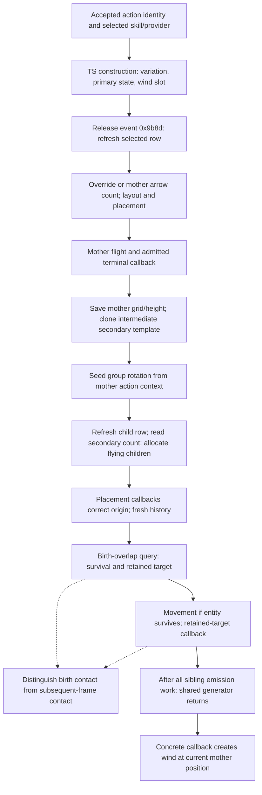

# Tornado Shot: inputs required by the client execution path

## Scope and result

This is a bounded input contract for ordinary Tornado Shot in client **3.29.3b**: Predictive mode,
default character scale, an ordinary bow, no supports or MTX, one release through mother termination,
wind/child creation and the first child contact. It advances the K3 actual-input investigation in
[issue #467](https://github.com/LocalExile/LocalExile/issues/467).

**Established:** the authored secondary-count contribution reaches the native stat writer; the installed
TS readers distinguish mother arrow count from secondary count; selection, terminal ordering and the
required identity/geometry inputs can be joined into one handoff. **Still partial:** the actual effective
values, selected views and execution order of a real release have not been recorded. This document does
not close K3 or certify server/client trajectory, contact or damage parity.

The executable SHA256 is `78a0e227189c263658a7f65a02f086428b859bfc114ae8e7ce8aab721ebd48d5`.
Addresses below are preferred-image virtual addresses. Evidence classes are:

| Mark | Meaning |
|---|---|
| N | Fresh bounded inspection of original executable bytes and installed slots |
| D | Authored table relationships; a contribution or default, not a measured effective value |
| B | Reused, fixed baseline static/composed evidence; supplied inputs remain supplied |
| S | Project source at a fixed commit; not evidence of the official server |
| O | A missing observation from a real release; no new runtime capture was made here |

The [evidence receipt](tornado-shot-input-evidence.json) pins inspected byte spans, slots, table-file
identities and source blobs. It contains no game files or disassembly. Its checker establishes those
identities, not the semantic correctness of the interpretation.

## Fixed references

The preceding research is [PR #468](https://github.com/LocalExile/LocalExile/pull/468), fixed here at
`aaebde497419b5167f9c56cacfe7aa70a18f5f51`, independently of whether that PR has merged:

- [Concrete TS stages and composed controls](https://github.com/LocalExile/LocalExile/blob/aaebde497419b5167f9c56cacfe7aa70a18f5f51/Agents/docs/re/projectiles/tornado-shot.md).
- [Group RNG and quantized geometry](https://github.com/LocalExile/LocalExile/blob/aaebde497419b5167f9c56cacfe7aa70a18f5f51/Agents/docs/re/projectiles/tornado-geometry.md).
- [Count readers](https://github.com/LocalExile/LocalExile/blob/aaebde497419b5167f9c56cacfe7aa70a18f5f51/Agents/docs/re/projectiles/count-stat-inputs.md)
  and [layout readers](https://github.com/LocalExile/LocalExile/blob/aaebde497419b5167f9c56cacfe7aa70a18f5f51/Agents/docs/re/projectiles/layout-stat-inputs.md).
- [Placement and birth overlap](https://github.com/LocalExile/LocalExile/blob/aaebde497419b5167f9c56cacfe7aa70a18f5f51/Agents/docs/re/projectiles/actions-and-emission.md#8-placement-callbacks-overlap-then-movement)
  and [the survival boundary](https://github.com/LocalExile/LocalExile/blob/aaebde497419b5167f9c56cacfe7aa70a18f5f51/Agents/docs/re/projectiles/emission-admission.md#63-registration-and-survival-precede-movement).
- [Client/server contract](https://github.com/LocalExile/LocalExile/blob/aaebde497419b5167f9c56cacfe7aa70a18f5f51/Agents/docs/re/projectiles/client-server-contract.md)
  and [verification limits](https://github.com/LocalExile/LocalExile/blob/aaebde497419b5167f9c56cacfe7aa70a18f5f51/Agents/docs/re/projectiles/verification-and-limitations.md).

Current-source comparisons use main `d377bd256036242d2fb43f53eb7110b4897e1862`. Earlier local
feature-branch experiments are not evidence of this main's behavior.
This change modifies research documentation/tooling only.

## 1. Authored inputs and the installed readers

Table references in this section are **zero-based row indices**. Native stat keys and the selector's art
candidate are one-based. `GrantedEffects.SkillID` is an authored behavior variation, not the network
skill ID or action sequence.

| Input | Authored source (D) | Native producer or reader (N) | Limit |
|---|---|---|---|
| Ordinary skill | GrantedEffects[3991], `TornadoShot`: ActiveSkill 468, Animation 82, StatSet1 4000, SkillID 0 | Factory `0x1412d4890` calls TS ctor and installs final table `0x143423898` at `0x1412d4987` | A table binding does not demonstrate that a real actor selected this action |
| Projectile and arrow capability | StatSet[4000] implicit Stats refs 501 and 851: native `0x1f6 base_is_projectile`, `0x354 skill_can_fire_arrows` | Stat-set builder `0x141ee8ef0` contributes implicit value 1; write call `0x141ee8feb` | Selected effective capability can have other sources |
| Three ordinary children | StatSet[4000] constant ref 4318, value 3: native `0x10df tornado_shot_num_of_secondary_projectiles` | Constant builder loop to `0x1424fc480`; TS `+0x5f0 → 0x141a82510` reads `0x10df` for variation 0 and secondary state | Three is a base contribution, not an unconditional effective child count |
| Ordinary variation | GrantedEffects[3991].SkillID = 0 | `0x141ee9090` reads authored variation at `0x141ee9383`, contributes nonzero values to `0x1921 skill_behaviour_variation` | Zero skips this contribution; it does not exclude other variation sources |
| Bow art | SkillArtVariations[133] `tornado_shot_bow`, ProjectileArt [147,152], AnimatedArt [1217,1222], Stat ref 348 (`0x15d skill_art_variation`) | TS `+0x380 → 0x141a82610` chooses candidate `0x86` when the resolved provider's `+0x14c == 0xe`; otherwise `0x87`, including missing provider | Actual variation/resource readiness must still be observed |
| Mother row | ProjectileArt[147], default variant 0 → Projectiles[108], `TornadoShotArrow`, UseTargetLocation true | `+0x510 → 0x141a826f0` selects association slot 0 for primary state | Nominal speed 2173 is not the effective movement speed |
| Child row | ProjectileArt[152], default variant 0 → Projectiles[114], `TornadoShotSecondaryArrow`, UseTargetLocation false | The same selector chooses slot 1 when action byte `+0x530 != 0` | The copied mother row must be refreshed before child release |
| Wind resources | AnimatedArt[1217/1222] → default Animation 393/3804 | Concrete terminal calls `0x1414fc340`; factory-derived slot `+0x538` is copied | Slot selection and resource availability are separate from wind placement |

The level-1 links are GEPerLevel[32571] and GESSPerLevel[32412]; the latter adds no additional stats in
that row. Absence there does not exclude equipment, passives, quality, parent views or network overrides.

### Constant contribution to the child-count read

The newly checked producer edge is the paired constant loop in `0x141ee8ef0`:

1. `0x141ee8f46 → 0x14249f2f0` resolves the value at ordinal *i*.
2. `0x141ee8f59 → 0x14249f140` resolves the stat reference at the same ordinal.
3. `0x141ee8f62 → 0x142290090` produces its one-based key.
4. `0x141ee8f7b` passes the resolved value in `r9d`; `0x141ee8f86 → 0x1424fc480` accumulates it.

The base reference list is native row `+0x18/+0x20` (count/pointer); values are `+0x28/+0x30`.
The respective accessor sites are `0x14249f1a4..0x14249f1b2` and `0x14249f38b..0x14249f399`.
This connects the authored `3` to a contribution under key `0x10df`. The TS reader loads that key at
`0x141a8253d`; it obtains the selected action view via `0x14193b350` immediately beforehand.
The unobserved edge is the composition and selection of that effective view at the real read time.

### Mother arrow total is a different input

TS `+0x598 → 0x141b6fa10` requires a resolved provider with `+0x14c == 0xe` **and** nonzero selected
`skill_can_fire_arrows` to return true. Shared count `0x141ba6070` then reads:

```text
key = 0x4b4b + bool(arrow)
0x4b4b = virtual_total_number_of_projectiles
0x4b4c = virtual_total_number_of_arrows
```

Key selection is at `0x141ba6117`; the effective read is `0x141ba6123`. Action-local contributions and
conversion gates also participate. `0x4a37` and `0x56ee` conditionally impose minimum/maximum one;
there is no unconditional minimum-one repair. Preparation `0x141ba51a0` first reads
`0x1884 number_of_projectiles_override`; only its zero branch calls `+0x5f0`. A zero resolved count can
stop admission. Multi-release partitioning is another branch, not the ordinary child-count formula.

Therefore publishing `total_number_of_projectiles_to_fire`, or even `virtual_total_number_of_projectiles`,
does not by itself establish a bow mother's effective count. The display alias
`0x2d6 total_number_of_arrows_to_fire` is also distinct from native count key `0x4b4c`.

## 2. One release: values are read at different stages

`0x14193b350` first considers action override storage `+0x1b8/+0x1c0`, indexed by byte `+0x174`, then
falls back to the selected skill view (`0x14193b3a3 → 0x141ee7e70`). Do not replace every read below with
one assumed immutable generic stat dictionary. These are native relative-order constraints, not a measured
wall-clock schedule or a claim that the official server uses the project's 30 Hz simulation clock.



The arrow to wind indicates callback order after the shared generator returns, including synchronous
child initialization work. It does not require subsequent-frame child contact before wind. The first
child update's timing relative to other queued work is an O gap.

| Stage | Required input and read/update boundary | Evidence |
|---|---|---|
| Action construction | Owner, sequence, selected provider/view and variation; ctor establishes primary/secondary state | N/B; actual values O |
| Wind-slot construction | Concrete factory computes `+0x538` from its count/stat branch; copy `0x1414fbc30` retains it | N/B; do not recompute it from later child count |
| Release admission | Concrete event `0x1414fbd00` calls `0x141ba4620`; hash `0x9b8d` dispatches `+0x4b8 → 0x141ba4930` | N; no generic attack-versus-spell law follows |
| Mother creation | Selected row, count override/arrow total, layout gates, aim, model/contact transform and height | N/B; effective model/terrain/scale inputs O |
| Mother terminal | `0x1414fbd90` first invokes shared generator `0x141a827c0` | N; terminal admission and chronological position must agree |
| Template setup | Save mother grid to `+0x524/+0x528`, effective height to `+0x52c`, set secondary byte `+0x530=1` | N/B; clone initially retained the mother row |
| Child release | High-level release refreshes through `0x141ba4946 → 0x141bb66a0 → +0x510`; preparation refreshes again, selects child slot 1, reads count | N/B; do not emit from the stale copied primary row |
| Child placement | Generic placement, then ordinary TS `+0x568 → 0x141a82bd0` corrects to saved mother grid/height | N/B; birth inputs O |
| Birth overlap and movement | Placement/configuration callbacks precede birth query `0x141bb83c0`; only a surviving flight reaches `+0x558 → 0x1414fc170`. A retained target then invokes `+0x4d0` | B; TS composed controls supplied empty birth contacts; nonempty TS birth outcome O |
| Wind | After shared generation returns, primary terminal reads current flight grid/effective height and calls `0x1414fc340` | N; later third-argument test does not guard this wind call |
| First child contact | Distinguish birth-query/retained-target handling from subsequent-frame admission/history; later-frame supplied controls show sibling suppression | B; birth contact and actual first-update order O; not numerical damage confirmation |

## 3. Identity, geometry and hit memory must agree together

The ordinary terminal generator initializes its action-keyed group RNG at `0x141a829ad` with:

```text
[sequence:u16, motherDerived:u8, ownerId:u32,
 outerRemaining(+0x2d0), innerRemaining(+0x2b8):u8, 0, 0, 0]
```

This is the **mother's** derived byte, not the intermediate template's or a child's identity. The fixed
baseline documents the rejection sampler, uint32 transition, float32 angle, integer aim and radial
quantization. Multi-child baseline layout is one random group rotation with equal-circle spacing;
independently random child angles are not equivalent. Later variance and the count-one branch remain
separate conditions. A constructed ray length is not proof of final flight range.

The template registers at `u8(motherDerived+1)` without consuming the flying-child allocator at that
step. Flying children consume the shared allocator separately. Mother completion order can therefore
change child identities, object seeds and contact keys even when each group's rotation seed is unchanged.
The baseline's supplied mother/allocator examples are arithmetic witnesses, not recorded game inputs.

The pre-mover birth query is not interchangeable with a later frame query. The baseline survival control
can remove the flight during the birth-query boundary: movement is then skipped while its allocated
identity/ordinal stay consumed and later sibling emissions proceed. The TS contact controls instead
supplied empty birth contacts and introduced targets after generation. They do not establish the result
of a real TS child born over a target, or justify assuming its first contact follows its first update.

Ordinary children share one **new** same-mother history; they do not inherit the mother's remembered
targets. Nonzero `0xb2b projectiles_can_shotgun` gives each child an independent fresh history. In the
baseline supplied contact controls, one sibling can remember a target even when predictive admission is
rejected, and later siblings skip it. This is local memory, not a receipt that Life was reduced.
The logical result key `(sequence, derived, stage, target)` must retain the native wire ordering:
sequence, stage byte, derived byte, target. Internal server entity/use/emission IDs are not substitutes.

Children's ordinary origin correction writes the saved mother grid and
`worldZ = f32(float(-heightMarker) * 7.8125f)`. Effective height getter `0x141e35ae0` uses the stored marker
unless it is `INT_MAX`, then samples terrain. Initial child target-height substitution additionally
requires a flight, secondary state and zero continuation counters/return state. This does not establish
a universal fixed-height trajectory or the actor's actual bow muzzle, even at default scale.

Wind rotation uses a separate TLS random path (B). Action-keyed group rotation is not thereby unknown,
but TLS consumption/order remains a presentation boundary; this guide does not prove that every wind
random read is isolated from all other consumers. The bounded nearby-target controls did not change
initial child trajectories; they do not prove a universal absence of homing throughout child lifetime.

## 4. Server adaptation ledger at the pinned main

These are prerequisites for a future implementation, not changes made by this research PR. Source
paths refer to `d377bd25`; the receipt pins their full blobs.

| Boundary | Current project source (S) | Required agreement / remaining check |
|---|---|---|
| Skill inputs | `Modules/Core/Game/Projectile/ProjectilePanel.cs` writes projectile display and virtual totals; `Skills.cs` applies them to outgoing gem records | Establish effective arrow key `0x4b4c` for the selected bow view. Source omission alone does not prove the native inherited value is zero |
| Descriptor/behavior | `SkillCatalog.cs` supplies TS mother metadata; `ProjectileDefinitions.cs` has generic fallback behavior | A mother metadata mapping does not implement native child selection, terminal ordering or resource associations |
| Visual authority | `ProjectileRelease.cs` sets gem `ClientPredicted = spell`; `Projectiles.cs` suppresses only a predicted root's source visual | This is current project policy. Qualify TS ownership separately; do not derive a universal attack/spell prediction split or suppress both/all visual sources |
| Muzzle/height | `CaptureGemProjectile` already uses animation attack contact and presentation height steps | Preserve that work; compare actual native transform/terrain inputs before adding another fixed offset |
| Action/random identity | `Projectiles.cs` increments session seed; Core runtime has its own use/emission sequence and `System.Random` mixing | Retain the native action context/shared allocation order for any parity work. The `1` in `ProjectileUse(..., 1, ...)` is Team, not seed/identity |
| Release input lifetime | `CaptureGemProjectile` rebuilds current stats at release; its signature does not receive the native action sequence | Capture/read the appropriate selected inputs at their native boundaries; do not silently substitute one release snapshot for all later reads |
| Hit reconciliation | Ordinary gem `ProjectileOffense` defaults to `HitPacket=false`, nullable `ActionSequence`; `ProjectileReactions.cs` has an optional `0x1af` path | Compare real TS identity/stage and prediction result ingress; an enabled packet alone is not a full contact protocol |
| Damage | Server offense/Life remain authoritative in the project | Local history/contact acceptance cannot determine numerical hit damage or prove duplicate damage |

## 5. Finite observation handoff and completion criteria

No suitable retained real TS trace was found in the bounded initial inventory. Supplied interpreter
controls are not relabelled as captures. Under the current no-launch/no-attach scope, the following
values remain O. A later user-operated observation can settle them at these six checkpoints:

| Checkpoint | Record only what is needed for this ordinary release |
|---|---|
| O1: accepted action | Sequence, owner, network skill, selected provider, variation and source/view identity; primary derived/stage and allocator state |
| O2: construction and release | Effective arrow capability/total, count override, count bounds/action locals, selected art/primary row, factory wind slot; when each value is read |
| O3: initial flight | Actual contact/model transform and scale, start grid/height, aim, effective speed, first update inputs and terrain marker source |
| O4: admitted mother terminal | Reason, current grid/height, sequence/derived/stage, repeat/subrelease seed words, template registration and shared allocation order |
| O5: child/wind creation | Effective secondary count, refreshed row, group angle and final quantized aims, child derived IDs/origins/histories; birth-query outcome, surviving flight/retained target and whether movement ran; number/owner of wind and child visual creations |
| O6: first child contact | Birth-query/retained-target versus later-frame path, candidate target/body/terrain input, pre/post history, stage and local decision, result ingress identity, independent server Life change if testing damage |

Pass the runtime slice only when one release's recorded inputs reproduce its mother/child count,
selected descriptors, group rotation/quantized origins, identity order and first contact/history result.
Visual ownership also needs a once-only wind/child check; count agreement alone is insufficient. Numerical
damage parity requires separate evidence. A missing checkpoint remains named and does not become an
assumed default or a reason to start a global stat/TLS/renderer investigation.

Static handoff completion means the authored producer/read edges, ordered contracts, current-source
differences and these finite missing observations are reviewable. Supports, Return/Fork/Chain/Split,
transfigured variants, MTX, other skills and whole-engine scheduling are deferred here; their existing
baseline findings are preserved without making this slice a universal projectile implementation.

## 6. Rechecking the evidence identity

From the repository root, with legally obtained/extracted local inputs:

```powershell
python scripts/re/projectiles/check_tornado_input_evidence.py
```

The standard-library checker verifies the pinned executable, selected byte ranges/vtable slots,
extracted table-file hashes and fixed source Git blobs. Use `--client` and `--tables` for other local input
locations; they are never written into the receipt. It does not launch a process, import old interpreter
graphs, decompile anything, replay native execution or validate actual effective inputs. Table-file
hashes bind this extraction; equivalent differently serialized tables need their own reviewed receipt.
The referenced main and baseline commits must be available in local Git storage first;
fetch their published branch or PR refs if necessary. Missing blobs fail explicitly rather than using
the current checkout as a substitute.
